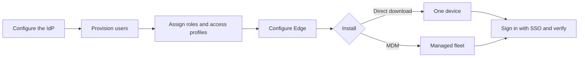

Use this section to take Bifrost Edge from an unconfigured deployment to a verified device. Every Edge user signs in through your organization's identity provider (IdP), so identity is configured first and the agent is installed last.

## Before you begin

You need:

- A running Bifrost Enterprise deployment with an Edge entitlement and an available device seat.
- The externally reachable HTTPS URL of the Bifrost deployment.
- A supported identity provider (Okta, Microsoft Entra ID, Keycloak, Zitadel, Google Workspace, Auth0, or a generic OIDC provider) and permission to register an application in it.
- Access to **Governance** and **Edge Control** in the Bifrost dashboard.
- The Edge agent package for each target operating system and architecture, from the organization-specific download location shared during Edge onboarding.

<Warning>
  An identity provider is required. Edge sign-in is unavailable until user provisioning is configured in Bifrost, and the tray reports **User provisioning not set up - contact your Bifrost admin**.
</Warning>

## Setup sequence

<Steps>
  <Step title="Configure the identity provider">
    Enable OIDC sign-in under **Governance → User Provisioning**. See [Prepare identity and access](/edge/setup-bifrost#2-configure-the-identity-provider).
  </Step>
  <Step title="Provision users">
    Import or sync the people who will run Edge. See [Provision Edge users](/edge/setup-bifrost#3-provision-edge-users).
  </Step>
  <Step title="Assign roles and access profiles">
    Give each Edge user a role and an access profile so Bifrost can issue the governed virtual key that Edge traffic is attributed to. See [Assign roles and access profiles](/edge/setup-bifrost#4-assign-roles-and-access-profiles).
  </Step>
  <Step title="Configure Edge">
    Create the Edge certificate and review the fleet settings in **Edge Control → Edge Settings**. See [Configure Edge](/edge/setup-edge-control).
  </Step>
  <Step title="Install the agent">
    Follow either the [direct installation](/edge/install-direct) or [MDM deployment](/edge/install-mdm) path.
  </Step>
  <Step title="Sign in and verify">
    Sign in with SSO, trust the certificate, restart the computer, and confirm that a supported AI request reaches Bifrost. See [Sign in and verify](/edge/sign-in-and-verify).
  </Step>
</Steps>

## Choose an installation path

<CardGroup cols={2}>
  <Card title="Install directly" icon="download" href="/edge/install-direct">
    Download the package for one device and install it locally. Use this path for a pilot, a test device, or a device that is not managed through MDM.
  </Card>
  <Card title="Deploy with MDM" icon="cloud-arrow-up" href="/edge/install-mdm">
    Push the package and managed configuration to a fleet. On macOS, also push the Edge certificate as a device-scoped trusted root.
  </Card>
</CardGroup>

Both paths install the same agent and use the same SSO sign-in. They differ in how the device receives its Bifrost URL and certificate trust.

| | Direct installation | MDM deployment |
| --- | --- | --- |
| Best for | Pilots and individual devices | Managed fleets |
| Bifrost URL | Entered from the tray, or supplied in `config.json` | Supplied in managed `config.json` |
| Agent package | Installed locally | Pushed by the device-management platform |
| macOS certificate trust | User approves the administrator prompt | MDM pushes a device-scoped trusted-root profile |
| User sign-in | SSO through the identity provider | SSO through the identity provider |

## Verify setup

Do not treat installation alone as a successful rollout. A device is ready when:

- The tray shows the signed-in user and **Connected**.
- The computer was restarted after the Edge certificate was first trusted or last replaced.
- Edge Diagnostics reports **Healthy**.
- The device appears under **Edge Control → Devices** with the expected owner and hostname.
- A request from a [supported application](/edge/supported-applications) is visible in Bifrost logs, attributed to the signed-in user.

## Next step

Start with [Prepare identity and access](/edge/setup-bifrost).
