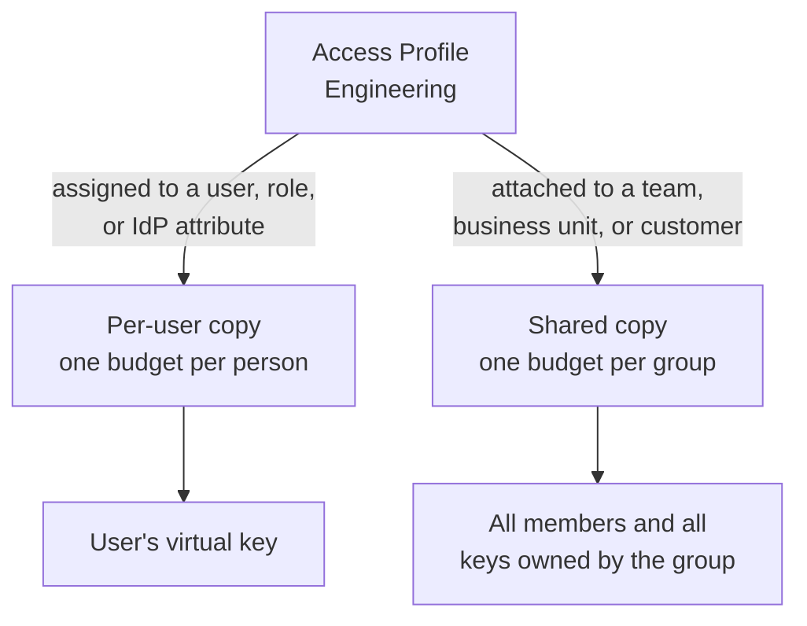

## Overview

An **Access Profile** is a reusable policy: which providers and models can be used, how much can be spent, how fast requests can be made, and which MCP tools are available. You write the policy once and apply it wherever you need it: to a person, to everyone in a role, or to a whole team, business unit, or customer.

Bifrost enforces the profile on every request. Editing a profile and propagating the change takes effect straight away; nobody needs a new key.

**Key benefits:**

- **Reusable policy** - Define a profile once (for example, "Engineering") and apply it to every user in a role, or to a whole team, business unit, or customer.
- **Per-user enforcement** - Each user gets an independent copy with isolated budget and rate-limit counters.
- **Shared group budgets** - Attached to a team, business unit, or customer, a profile becomes one shared budget for everyone under it, charged alongside each member's own profile.
- **Layered access** - A user can hold several profiles at once. What they can reach adds up, and if one profile's budget runs out another can cover their requests.
- **Role auto-assignment** - Attach profiles to a role and users gaining that role are provisioned automatically.
- **Safe propagation** - Edit the template, then push selected fields (budgets only, MCP only, and so on) to every user and group holding it in one call.
- **Locked virtual keys** - A key whose owner holds a profile is write-protected, so a user cannot weaken their own policy by editing the key directly.
- **Govern user-created keys** - Remove the **Create Standalone** permission from a role and every virtual key its members create is owned by them and governed by their profiles, not just the auto-issued key. Members who hold no profile still get keys with no profile governing them.
- **Audit and versioning** - Every change to a profile is recorded with a full snapshot history.

<Info>
	For the full API contract (every endpoint, request and response shape, error codes), see the **Access Profiles** section of the [API
	Reference](/api-reference).
</Info>

---

## Where a profile can be applied

A profile can be applied to two kinds of holder, and they behave differently:

| Applied to | How it is applied | What the holder gets |
| --- | --- | --- |
| **A user** | By hand, through their role, or from an identity-provider attribute | Their **own copy** of the profile: their own budget, their own rate limit, their own per-model limits. Bifrost also issues them a virtual key if they don't have one. |
| **A team, business unit, or customer** | From the Dashboard, or `config.json` | **One shared copy for the whole group.** Everyone and every key under the entity draws from the same budget. No per-member copies and no new keys are created. |

The same profile can be applied both ways at once. If "Engineering" is on the Engineer role **and** on the Platform team, every engineer gets their own Engineering budget, and the Platform team also has one Engineering budget that all its members share. These are two separate budgets, each with its own limit and counter, but they are not alternatives: an engineer on Platform is charged against **both** on every request, so their spending counts toward their own Engineering budget and toward Platform's shared one. See [who pays](#multiple-profiles-what-a-user-can-do-and-who-pays) for the full rules.



---

## Profiles on users

### How a user gets a profile

A user can hold any number of profiles, from three sources:

| Source | How it is granted | Shown on the user as |
| --- | --- | --- |
| **Manual** | An admin adds it from the user's **Access Profiles** tab | Manual |
| **Role** | The user holds a role the profile is attached to | From role |
| **Access profile mapping** | One of your [access profile mapping rules](/enterprise/user-provisioning#access-profile-mappings) matches the user's IdP attributes or groups | From attributes |

Bifrost remembers where each profile came from. When the same profile comes from more than one source, a mapping wins over the role, and the role wins over a manual grant. In practice:

- Removing a role only removes the profiles that role granted. Profiles from other sources are untouched.
- If an admin assigned a profile by hand and an IdP mapping later grants the same one, the mapping takes it over. From then on it follows the IdP, and it is removed when the user stops matching the mapping.
- A profile granted by a mapping can't be detached from the user directly. Change the mapping or the user's attribute in your IdP.

### What the user gets

When a user receives a profile:

1. **User copy** - Bifrost copies the profile to the user, with its own budget and rate-limit counters. Each user's usage is tracked separately.
2. **Virtual key** - A user with no virtual key is issued one. A key is never attached to a profile directly: it belongs to the user, and is governed by every profile the user holds. That is why it keeps working as their profiles change.
3. **Locked key** - Only the name and description of a virtual key can be edited, so the policy can't be worked around. To change what the key allows, edit the profile.

When a user loses their last profile, their virtual keys are removed.

---

## Profiles on teams, business units, and customers

A team, business unit, or customer can hold **one** profile. It acts as the group's policy and its shared budget.

### What attaching does

When you attach a profile to a team, business unit, or customer:

1. **Entity copy** - Bifrost copies the profile to the entity once. Its budgets and rate limits form one shared pool, and every member's requests count toward it.
2. **Virtual keys** - The entity's keys stay owned by the entity. Because the entity now holds a profile, every key it owns is governed by that profile and locked: the profile's providers, budgets, limits, and MCP access replace the key's own.
3. **Members** - Members are covered from their next request, and stop being covered as soon as they leave. No copies are made for them and no keys are issued to them.

An entity uses **either** an access profile **or** its own legacy budgets and rate limit, never both. If the entity already has its own limits, Bifrost asks you to [migrate them](#migrate-legacy-budgets-to-a-profile) first.

### What members can access

A profile on a group only ever **adds** access. Members can use anything the group's profile allows, in addition to what their own profiles allow. A member who holds no profile of their own is still allowed what their team, business unit, or customer allows.

Profiles reach users through the organization hierarchy:

- A user is covered by the profiles of **every team** and **every business unit** they belong to.
- A user is also covered by the profile of every **customer** those teams and business units belong to. A customer reached through both a team and a business unit counts once.

See [Teams, Business Units & Customers](/enterprise/teams-business-units-customers) for how the hierarchy fits together.

---

## Multiple profiles: what a user can do and who pays

A user often answers to several profiles at once: some of their own, plus the profiles of their teams, business units, and customers. They are never merged into one blended policy. Instead, two rules apply.

### Rule 1: access adds up

The user can use any provider and model that **any** of the profiles they answer to allows. Adding a profile can only widen access. To narrow access, remove a profile or tighten it. A user who is allowed nothing by any profile is refused.

### Rule 2: one personal profile pays, and every group profile is charged

For each request, Bifrost charges two kinds of budget:

1. **One of the user's own profiles pays.** Bifrost looks only at the user's own profiles that allow the requested model and still have budget and rate limit left, then picks one. Only that profile's budgets move. The user's other personal profiles are not touched.
2. **Every team, business unit, and customer profile the user answers to is charged.** These are charged on every request the user makes, whichever profile allowed the model. A group profile's provider budget is charged when it has a budget for the provider being used, and its per-model budget when it has one for that model.

If none of the user's own profiles allows the model, or all of the ones that allow it are out of budget, the request is paid for by the group profiles alone.

A request goes through only if **every** charged budget and rate limit has room. A spent team budget therefore blocks the team's members even when their personal budget has money left.

### Common scenarios

Assume Priya is on the **Platform** team, which belongs to the customer **Acme**. Unless noted, Platform has the profile "Team Pool" and Acme has none.

| Situation | What Priya can use | What is charged |
| --- | --- | --- |
| Priya holds no profile of her own | Whatever Team Pool allows | **Team Pool only** |
| Priya holds "Engineering" and it allows the model | Engineering + Team Pool | **Engineering and Team Pool** |
| Priya holds "Engineering" but it doesn't allow the model; Team Pool does | Engineering + Team Pool | **Team Pool only**. Engineering is not charged. |
| Priya holds "Engineering" and "Research"; both allow the model; Engineering is out of budget | Engineering + Research + Team Pool | **Research and Team Pool**. Bifrost switches to the personal profile that can still pay. |
| Every personal profile that allows the model is out of budget, but Team Pool has room | Engineering + Team Pool | **Team Pool only** |
| Team Pool is out of budget; Engineering has room | Engineering + Team Pool | **Refused.** Team Pool must be charged and can't be. |
| Priya is also on the **Data** team, which has its own profile | Everything allowed by all three | Her paying personal profile, **Team Pool, and Data's profile** |
| Acme also has a profile, "Acme Contract" | Everything allowed by all of them | Her paying personal profile, **Team Pool, and Acme Contract** |
| Priya reaches Acme through both Platform and a business unit | Same as above | Acme Contract is charged **once**, not twice |

<Note>
	Group profiles are about **shared** limits: "the Platform team can spend \$5,000 a month between them." Personal profiles are about
	**individual** limits: "each engineer can spend \$200 a month." A personal profile is not a hard cap when a group profile also allows
	the model: once it runs out, the group profile pays for the user's requests until the group's own limit is reached.
</Note>

### When a request is refused

A refused request names the profile that ran out, not just the team. For example:

```text
Budget exceeded: team_access_profile Team Pool budget exceeded: 5000.1200 >= 5000.0000 dollars
```

If several limits are out at once, the message names one of them. Check the [user's Usage tab](#see-what-a-user-is-charged) to see them all.

### Requests made with group-owned keys

A virtual key belongs to at most one owner: a user, a team, a business unit, or a customer. When a request uses a key owned by a team, business unit, or customer:

- The key is governed by **its owner's profile**, plus the profile of every customer above that owner.
- That profile is charged, and so is every customer profile above it.
- If the profile is detached and the keys are preserved, a key only reaches what a customer profile above its owner allows. With no customer profile above, it can't reach any model.

A key whose owner holds no profile (for example, a team key on a team that has no profile, or a key owned by a user who holds none) is governed by its own settings **plus** every group profile above it. All of them must have room for the request to go through.

---

## Lifecycle

| Event | What happens |
| --- | --- |
| **A user joins a team, business unit, or customer** | They are covered by its profile, and charged against it, from their next request. Their own keys and profiles are untouched. |
| **A user leaves** | They stop being covered and charged immediately. |
| **A user's role changes** | Profiles from the old role are removed and profiles from the new role are added. Manual and IdP-granted profiles stay. |
| **A user loses their last profile** | Their virtual keys are removed. |
| **A profile is detached from a team, business unit, or customer** | You choose: **Delete virtual keys** removes the entity's keys, or **Preserve virtual keys** keeps them stripped of the profile's access, so they only reach what a customer above still allows. Either way, the entity's profile budgets and their usage are removed, and its old legacy limits are not restored. |
| **The team, business unit, or customer is deleted** | Its profile copy is deleted with it. Its keys are kept but no longer owned by it. |
| **A profile is edited and propagated** | Every user and every entity holding it is updated. Usage is preserved unless you choose to reset it, and budget overrides are always kept. |
| **A profile is deleted** | Refused while any team, business unit, or customer holds it, and while any user holds a copy. Detach it first. |

---

## Virtual keys and profiles

A virtual key is never attached to a profile directly. Every key has at most one owner (a user, team, business unit, or customer), and it is governed by the profiles that owner holds. A key with no owner is governed only by its own settings. Change the owner's profiles, or change the key's owner, and the policy on the key changes with them.

### Keys are locked when their owner holds a profile

A key whose owner holds a profile can't be edited directly, except for its name and description. This stops a user who can edit keys from loosening their own policy. To change what the key allows, edit the owner's profile and propagate.

### Keys members create

Whether a key a user creates is governed depends on the **Create Standalone** permission on **Virtual Keys** in their [role](/enterprise/rbac):

- **With Create Standalone**, a user can create ordinary keys with any policy their other permissions allow.
- **Without Create Standalone**, every key they create is owned by them, so it is governed by their profiles and locked. A user who holds no access profile still gets a key, with no profile governing it. A team, business unit, or customer named on the new key is ignored, so naming a team can't be used to escape their own limits.
- A key created under a team, business unit, or customer that has a profile (by a user free to create standalone keys) belongs to **that entity** only, so it is governed by the entity's profile.

Bifrost grants Create Standalone to every role that could already create keys, so nothing changes until you remove the permission from a role. Users without their own sign-in identity (the local admin account, raw API keys) are never governed this way.

### Governing an existing key with a profile

To put an existing key under a profile, give it an owner who holds that profile:

- **For a user**, assign the key to them from the key's edit sheet. It is then governed by the profiles they hold.
- **For a team, business unit, or customer**, open the entity's **Virtual Keys** tab and use **Assign Existing**. Bifrost confirms before the entity takes ownership of the key, and the key is unassigned from any user it was attached to, since a key can have only one owner.

### Automatic virtual key rotation

A profile can rotate the virtual keys owned by the users who hold it on a schedule, so credentials expire without anyone remembering to call the rotate endpoint. Set an **interval** (for example `30d`) and, optionally, a **first rotation** time; after each run the next one is scheduled at run time + interval.

When a run comes due, Bifrost enqueues a background job that rotates, in batches of 25, every key owned by a user who holds this profile. Keys owned by teams, business units, and customers are not rotated automatically, even when the entity holds this profile. Each key gets a brand-new value exactly as if you had rotated it by hand:

- If `client.vk_rotation_cooldown` is set (Config → Security), the previous value keeps authenticating until the cooldown expires, so callers have time to pick up the new key.
- Leaving it unset, empty, or `0` disables the grace period, so the previous value stops working immediately.

Two dashboard notifications track each run: one when the job starts (profile name, how many keys will rotate, and until when the old values stay valid) and one when it finishes (how many keys rotated, failed, or were skipped).

Safety rules worth knowing:

- **A key is never rotated twice for one scheduled run.** Rotating again would push the previous value out and end the cooldown early. Retries, resumed jobs, catch-up runs after downtime, and keys rotated manually after the schedule fired are all skipped for that run.
- **Manual rotation still works.** The manual endpoints stay available on these keys; a key rotated manually inside the window is simply skipped by the scheduled run.
- **Cluster-safe.** Every node checks the schedule, but only one job is created per profile and due time, and rotated keys are gossiped to all nodes.
- **Missed runs collapse into one.** If the gateway was down past a due time, the next start performs a single catch-up rotation rather than one per missed period.
- **Deactivated profiles pause.** A deactivated profile is never rotated; reactivating it re-anchors an overdue schedule to now + interval so it does not fire immediately.

---

## Configuration (Web UI)

### Browse and create profiles

1. Navigate to **Governance** → **Access Profiles**.

<Frame>
	
</Frame>

The table shows **Name**, **Description**, **Providers**, **Budgets**, **Rate Limit** and per-row actions. Use **Search** or the active/inactive filter to narrow the list.

2. Click **Create Profile**.

### Fill in the basics

<Frame>
	
</Frame>

- **Name** - Required and unique. Max 255 characters.
- **Description** - Optional, shown in the list view.

### Configure provider access

In the **Allowed Providers** section, add providers. For each provider:

<Frame>
	
</Frame>

- **Allowed Models** - Toggle **All Models**, or pick specific models. An empty selection allows no models from that provider.
- **Provider Budget** - One or more budget lines, each with a **max limit** and a **reset duration** (`1h`, `1d`, `1w`, `1M`, `1Q`, `1Y`). Stack lines with different durations, for example a hard hourly cap plus a softer monthly cap. A quarterly line can follow your fiscal quarters - see [Quarterly budgets](/features/governance/budget-and-limits#quarterly-budgets-and-fiscal-quarters).
- **Maximum Tokens** / **Maximum Requests** - Per-provider rate limits.
- **Per-model budgets** - Optionally cap individual models under this provider. Each holder of the profile gets its own copy: one per user, or one shared copy per team, business unit, or customer.

### Configure global budgets and rate limits

**Global Budget Configuration** lines apply across all providers. Global rate limits for tokens and requests follow the same number-plus-duration pattern.

### Align to the calendar

Turn on **Align to calendar cycle** to reset budgets and rate limits at the start of each calendar period (midnight UTC, start of the week, first of the month) instead of rolling from when they were created. Applies to durations of one day or longer.

### Schedule automatic key rotation

Under **Automatic key rotation**, pick **Every 7 / 30 / 90 days** or **Custom** (a whole number of days or hours, from `1h` to `365d`). Optionally set **First rotation**; leave it empty to start one interval from now. Choose **Off** to stop.

<Frame>
	
</Frame>

### Configure MCP tool access

<Frame>
	
</Frame>

- **Virtual MCPs** - Grant existing [Virtual MCPs](/enterprise/virtual-mcps).
- **MCP Servers** - Granting a server grants all of its tools.
- **Individual Tool Overrides** - Include or exclude specific tools.

<Warning>
	If you grant a whole MCP server and also add an `exclude` override for the same server, the form shows a conflict and won't save. A key can
	only carry a list of allowed tools per server; "everything except X" can't be represented. List the tools you want instead.
</Warning>

### Assign the profile to users

Click **Create**, then assign the profile in any of these ways. A user can hold profiles from all of them at once.

- **To a role** - From **Governance** → **Roles & Permissions**, open the role and click **Attach Access Profile**. Choose **Set as default for new users** and/or **Apply to existing users with this role**.
- **To one user** - Open the user from **Governance** → **Users**, go to the **Access Profiles** tab, and add it.
- **From your identity provider** - Add an access profile mapping in **User Provisioning**. See [Access profile mappings](/enterprise/user-provisioning#access-profile-mappings).

<Frame>
	
</Frame>

### Attach the profile to a team, business unit, or customer

1. Open **Governance** → **Teams**, **Business Units**, or **Customers**, and click the entity to open its detail sheet.
2. In the **Access Profile** field at the top of the sheet:
   - If it shows **No access profile attached**, click **Attach**, pick the profile, and confirm.
   - If it shows **Uses legacy budgets and rate limits**, click **Migrate to access profile** (see below).
3. Once attached, the field shows the profile with **View access profile** and **Detach** actions.

To switch an entity to a different profile, detach the current one first.

You need **Update** permission on the entity and **View** on Access Profiles to attach, and **Create** on Access Profiles to migrate.

### Migrate legacy budgets to a profile

Teams, business units, and customers created before access profiles may have budgets and a rate limit of their own. **Migrate to access profile** opens a wizard that moves the entity onto a profile:

- Choose which providers the profile allows: **All providers**, **Specific providers**, or none.
- Budgets with a matching reset window carry their current spend across, so nobody's month restarts at zero.
- Anything that can't carry across is listed before you confirm.

### See what a user is charged

Open a user and go to the **Usage** tab. **Team, Business Unit and Customer Limits** lists every group profile and legacy group limit their requests are charged against, alongside their own profiles.

### Propagate changes

When you edit a profile, **Save** changes only the profile itself. **Save and Propagate** also pushes the change to everyone holding it. Choose which fields to push:

<Frame>
	
</Frame>

**Provider Configurations**, **Budgets**, **Rate Limit**, **Virtual MCPs**, **MCP Servers**, **MCP Tool Overrides**. Click **Propagate**. The result reports how many users were updated, failed, or skipped. Teams, business units, and customers holding the profile are always updated too.

Propagation **preserves usage** by default: where reset durations match, accumulated spend and request counts carry over.

### Extend a budget for one user or one group

Profile budgets apply uniformly. To make an exception, add a **budget override**. It adds to the limit and leaves the base limit, current usage, and reset schedule untouched:

```text
Effective limit = Base budget + Override amount
```


Choose **for a number of reset cycles** (the current cycle counts as the first) or **until removed**. Overrides propagate cluster-wide and survive profile cloning and propagation, and setting one requires the `AccessProfiles.Update` permission. Programmatically:

```bash
# Add or replace an override
curl -X PUT "$BIFROST_URL/api/users/$USER_ID/access-profiles/$PROFILE_ID/budgets/$BUDGET_ID/override" \
  -H "Authorization: Bearer $TOKEN" \
  -H "Content-Type: application/json" \
  -d '{"amount": 100, "mode": "cycles", "cycles": 2}'

# Remove it
curl -X DELETE "$BIFROST_URL/api/users/$USER_ID/access-profiles/$PROFILE_ID/budgets/$BUDGET_ID/override" \
  -H "Authorization: Bearer $TOKEN"
```

Use `"mode": "forever"` (omitting `cycles`) to keep the override active until it is deleted. The response returns the persisted budget plus its `effective_max_limit`. For the equivalent on a standalone virtual key, see [Budget Overrides](/features/governance/virtual-keys#budget-overrides).

### Edit, duplicate, delete

<Frame>
	
</Frame>

- **Edit** - Opens the form in edit mode.
- **Duplicate** - Opens the form pre-filled from the original.
- **Delete** - Refused while any user, team, business unit, or customer still holds the profile.

---

## Declaring profiles in config.json and Helm

Profiles are declared under `access_profiles`, and a team, business unit, or customer names the profile it holds with `access_profile`:

```json
{
	"access_profiles": [
		{
			"name": "Engineering",
			"provider_configs": [{ "provider_name": "openai", "all_models_allowed": true }],
			"budgets": [{ "id": "budget-engineering", "max_limit": 5000, "reset_duration": "1M" }]
		}
	],
	"governance": {
		"teams": [{ "id": "team-platform", "name": "Platform", "access_profile": "Engineering" }],
		"business_units": [{ "id": "bu-emea", "name": "EMEA", "access_profile": "Engineering" }],
		"customers": [{ "id": "customer-acme", "name": "Acme Corp", "access_profile": "Engineering" }]
	}
}
```

In Helm, set the same fields under `bifrost.accessProfiles` and `bifrost.governance.teams[].access_profile`, `.businessUnits[].access_profile`, and `.customers[].access_profile`.

How the file is applied depends on your [source of truth](/deployment-guides/config-json/source-of-truth):

- **Split mode (default)** - The profile is attached when the entry is new or changes. Changes made in the dashboard are otherwise kept.
- **config.json as source of truth** - The file wins on every start. An entity entry without `access_profile` has its profile removed; its virtual keys are kept.

An entity that already holds the declared profile is not re-attached, so its usage is kept. Entries are skipped with a warning when the entity still has legacy budgets or a rate limit (migrate it in the dashboard first), or when the profile name is unknown.

---

## Examples

### Give every engineer their own budget

1. Create an "Engineering" profile with the providers, models, and monthly budget each engineer should have.
2. Attach it to the Engineer role with **Apply to existing users with this role** and **Set as default for new users**.
3. Every engineer gets their own copy and a virtual key. New engineers are covered the moment they gain the role.

### Cap a team's total spend

1. Create a "Platform Pool" profile with a \$5,000 monthly budget.
2. Open the Platform team and **Attach** Platform Pool.
3. Every request a Platform member makes, and every request made with a Platform-owned key, is charged to the one \$5,000 pool. When it is spent, the team is paused until the next reset, even for members whose personal budgets have room.

### Individual and team caps together

Attach "Engineering" (\$200 a month each) to the Engineer role and "Platform Pool" (\$5,000 a month) to the Platform team. Each engineer's own requests use their \$200 first. After that, they're paid by Platform Pool until the team reaches \$5,000 combined.

### Bill a customer contract

Attach an "Acme Contract" profile with the contract's monthly ceiling to the Acme customer. Every team and business unit under Acme, and every key Acme owns, now draws from that one ceiling.

### Keep everyone's keys on policy

Remove **Create Standalone** from the Developer role's **Virtual Keys** permissions. Any key a developer creates is now owned by them, governed by their profiles, and locked. A developer who holds no profile still gets keys with no profile governing them, so give every developer one, for example by attaching a profile to the Developer role.

### Raise a monthly budget without resetting usage

1. Edit the profile and set the new monthly budget.
2. Click **Save and Propagate**, check only **Budgets**, and click **Propagate**.
3. Everyone holding the profile, including teams and customers, gets the new limit and keeps their month-to-date spend.

---

## Next steps

- **[Teams, Business Units & Customers](/enterprise/teams-business-units-customers)** - How the organization hierarchy fits together and what each level is charged.
- **[Data Access Control](/enterprise/data-access-control)** - Control which teams, business units, and customers each operator can see.
- **[RBAC](/enterprise/rbac)** - Define the roles profiles attach to, and the Create Standalone permission.
- **[How Identity Sync Works](/enterprise/how-identity-sync-works)** - How profiles follow roles and IdP attributes.
- **[Projects](/enterprise/projects)** - Scope access and spend to a piece of work rather than to a person.
- **[Virtual Keys](/features/governance/virtual-keys)** - The underlying virtual key concept.
- **[Model Limits](/features/governance/model-limits)** - Per-model limits outside of profiles.
