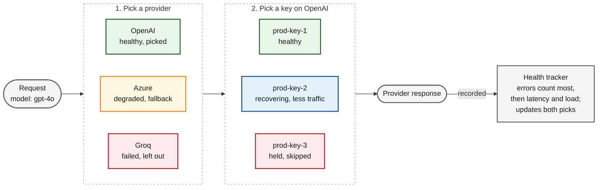
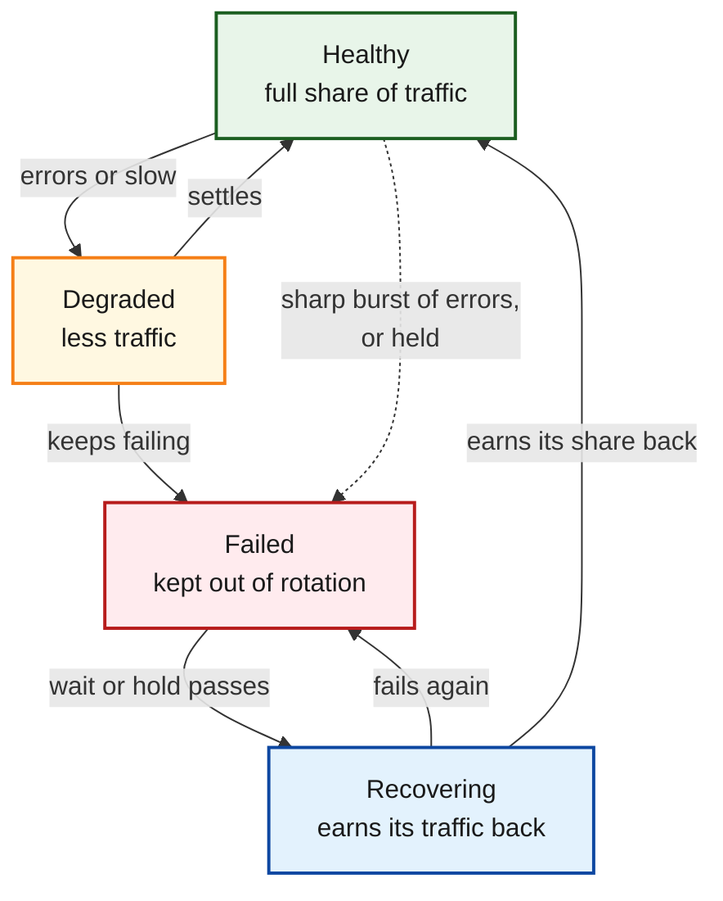
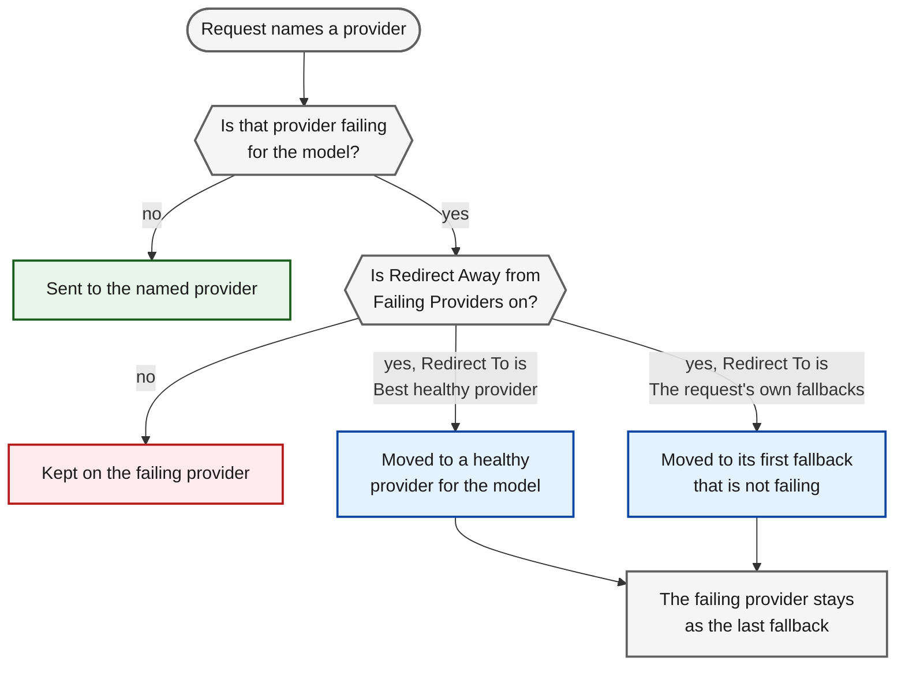
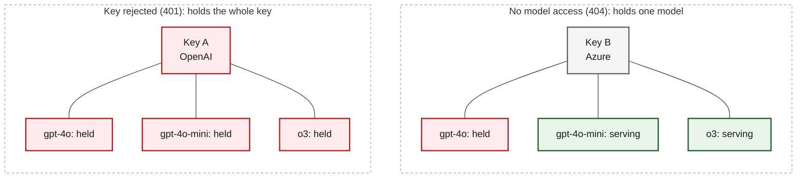
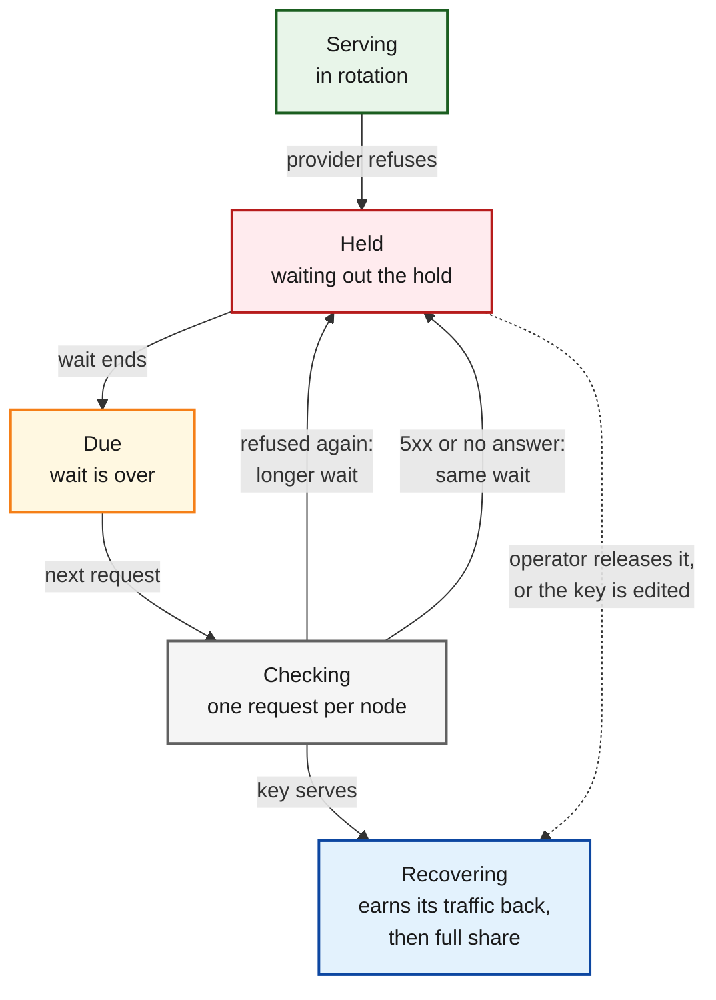
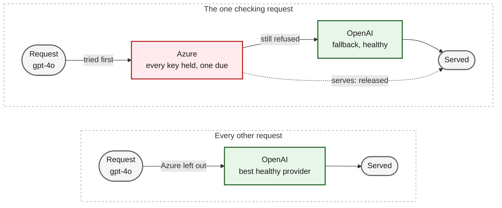
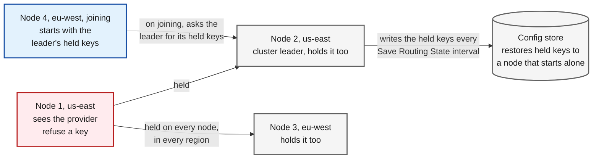

## Two choices per request

Every request goes through two choices.

1. **Provider.** For a request that does not name a provider, adaptive routing picks the healthiest provider that serves the model. The other healthy providers become its fallbacks, best first. Providers that [governance](/features/governance/routing) does not allow for the request are never considered.
2. **Key.** On the provider the request goes to, adaptive routing picks the key. Healthier, faster and less loaded keys get more of the traffic, but every usable key keeps a share, so a key that has recovered is noticed.

Each node keeps the health of every provider and key from the requests it sends, and recalculates it every few seconds.

{/* Mermaid experiment: to revert, delete the mermaid block below and uncomment this Frame.
<Frame>
  
</Frame>
*/}



### How health is judged

Errors count the most, then latency, then load. Latency is judged against the other keys and against the key's own recent latency, so a key that is slow for its model stands out even if every key is slow. The exact weights are internal and change as Bifrost is tuned; the dashboard shows each key's score over time if you want to see how it moved.

## States

{/* Mermaid experiment: to revert, delete the mermaid block below and uncomment this Frame.
<Frame>
  
</Frame>
*/}



### Keys

A key has a state for each model it serves.

| State | What it means | Traffic |
|-------|---------------|---------|
| **Healthy** | Serving normally. | Its full share. |
| **Degraded** | A small share of its requests fail, or it is much slower than usual. | Less than its share. |
| **Failed** | Failing steadily, or [held](#held-keys) because the provider refused it. | None, apart from the single request that checks a held key. |
| **Recovering** | Back after a failure or a hold. | A reduced share that grows as it serves cleanly, until it is Healthy again. |

A sharp burst of errors moves a key straight to Failed without passing through Degraded. A Failed key that is not held returns to Recovering on its own after a short wait.

### Providers

A provider has a state for each model, rolled up from the keys that can serve that model.

| State | When |
|-------|------|
| **Healthy** | Every key is serving. |
| **Degraded** | Some keys failed and the rest still serve. The provider stays in rotation and in fallback chains. |
| **Failed** | Every key that can serve the model failed. The provider is left out until a key recovers. |

A key that has never been sent a request keeps the provider out of Failed, because it is the key selection would try next. Keys that cannot serve the model, such as a disabled key or a key restricted to other models, do not count.

## What counts against a key

| The request ended with | Counted as a failure of the key? |
|------------------------|----------------------------------|
| A provider error, a rate limit or an error from a refused key | Yes |
| A timeout | Yes |
| An error caused by the request itself, such as an invalid parameter or a context that is too long | No. No key would have served it. |
| The caller cancelling the request | No |
| A key the caller sent in the request (`x-bf-direct-key`) | No. Adaptive routing only measures keys it can pick. |

Failures are classified as described in [Retries and Fallbacks](/features/retries-and-fallbacks#how-failures-are-classified). A key that was tried and rotated away from within the same request counts as a failure of that key.

## Requests that name a provider

A request names its provider when the caller sends `provider/model`, or when a routing rule or the virtual key set the provider. By default adaptive routing leaves such a request as it is, apart from picking the key. [The settings](/enterprise/adaptive-routing/overview#choosing-each-setting) decide when it may add fallbacks or move the request; this section covers what happens when it does.

{/* Mermaid experiment: to revert, delete the mermaid block below and uncomment this Frame.
<Frame>
  
</Frame>
*/}



With **Add Fallbacks When a Provider Is Named** on, the request keeps its provider, its own fallbacks come first, and the healthy providers for the model follow. The model name is also mapped to each provider's own name for it.

With **Redirect Away from Failing Providers** on, a request whose named provider is failing for its model is moved:

- With **Redirect To** set to **Best healthy provider**, the request goes to a healthy provider that adaptive routing picks among the others serving the same model.
- With **Redirect To** set to **The request's own fallbacks**, it goes to the first of its own fallbacks that is not failing, whatever its provider or model. When every fallback is failing, the best healthy provider is used instead.
- The failing provider stays as the last fallback, since a node's view of a failure can be out of date.
- If nothing healthier is available, the request stays on the named provider.
- If a held key on the named provider is due for its check, the request goes to the named provider to check it, with the healthy providers behind it.
- While the named provider is recovering, requests that name it are sent to it, so its recovery can be measured. Turn on **Add Fallbacks When a Provider Is Named** so those requests fall back if it is still down.

Each node judges failures from its own traffic, so whether a request is redirected can differ between nodes and over time.

### Key pins and direct keys

- **A key pinned by the caller** (`x-bf-api-key-id` or `x-bf-api-key`) applies to the first provider of the chain, its retries included. When adaptive routing redirects the request to another provider, the pin goes with it: if the new provider has no such key, the attempt fails without a call and the request moves to its fallbacks. The pin is not carried to the failing provider kept as the last fallback.
- **A key pinned by a routing rule** outranks the caller's pin on the primary attempt (see [Fallback Chain](/providers/routing-rules#fallback-chain)) and stays with its provider. When the request is redirected, the failing provider kept as the last fallback still uses the rule's key.
- **A key the caller sends in the request** (`x-bf-direct-key`) is used on the first provider the request is routed to, whichever that is. Picking a provider for a request that names none, redirecting a failing provider, and a [circuit breaker](/enterprise/circuit-breaker) redirect can each send that key to a provider it was not issued for. Fallbacks always use the provider's own keys. For traffic that brings its own keys, name the provider and keep redirecting and cross-provider circuit breaker policies off.

## Held keys

Error rates describe how a key is doing. Some provider answers say more than that: the key is rejected, its account is out of credit, it cannot reach the model, the model was retired, the provider refuses the region, or it is rate limited. These answers repeat on every request until something changes, so waiting for an error rate to climb only costs requests.

When a provider gives one of these answers, adaptive routing **holds** the key. A held key is out of rotation on every node, and its state is **Failed** with the provider's reason. After a wait, one request is let through to check whether the key serves again.

### What holds a key

| Reason (dashboard) | `failure_class` | What is held | Longest wait without a provider hint |
|--------------------|-----------------|--------------|--------------------------------------|
| Key rejected | `credential` | The whole key, for every model | 15 minutes |
| Out of quota | `quota` | The whole key, for every model. A quota that applies to one model is treated as a rate limit. | 5 minutes |
| No model access | `model_access` | The model | 5 minutes |
| Model retired | `model_gone` | The model | 30 minutes |
| Region blocked | `region_blocked` | The model | 15 minutes |
| Rate limited | `rate_limit` | The model | 2 minutes |

Transient failures (network errors, and a `500`, `502`, `503`, `504` or `529` that does not report a rate limit), request errors (`caller_fault`), timeouts (`timeout`), cancellations (`cancelled`) and unrecognised failures (`unknown`) never hold a key. A `5xx` that reports a rate limit is classed `rate_limit` and holds the model like a `429`.

A hold on one model leaves the key serving its other models. A key that cannot reach `gpt-4o` on one Azure resource keeps serving `gpt-4o-mini` there.

{/* Mermaid experiment: to revert, delete the mermaid block below and uncomment this Frame.
<Frame>
  
</Frame>
*/}



### How long a key is held

- **When the provider says how long to wait**, that wait is used, whatever the reason. It is read from the same headers and error details as [provider retry hints](/features/retries-and-fallbacks#provider-retry-hints), and is never shorter than 10 seconds.
- **Otherwise the wait climbs a ladder.** It starts at 30 seconds and doubles after each failed check, up to the cap for the reason in the table above.
- A wait from the ladder varies by 10 percent either way, so the nodes of a cluster do not all check the same key in the same second. A wait the provider stated is used as given.
- Refusals from requests that were already in flight when the key was held do not lengthen the wait. Only a failed check moves the key up the ladder.
- A key that is held again for the same reason within 10 minutes of being released resumes the rung it was on, so a key that keeps flapping does not restart at 30 seconds. After an operator releases it or the key is edited, the ladder starts again at 30 seconds.

<Frame>
  
</Frame>

### Checking a held key again

When the wait is over, the key is **due**. The next request that could use the key is let through to it, one request per node. Every other request keeps skipping the key until the answer comes back.

| The check's answer | What happens |
|--------------------|--------------|
| The key serves | The hold is released and the key goes to **Recovering**, so it earns its traffic back instead of returning at full share. |
| The same refusal | The key is held again on the next rung of the ladder, or for the provider's new wait. |
| An answer that shows the refusal no longer applies, such as a `429` from a key held for a rejected credential | The hold is released. The new answer is recorded on its own if it is itself a refusal. |
| A network error or a `5xx` | The key is held again on the same rung. The answer says nothing about the key. |

A check that never reports back, such as a cancelled request, frees the slot after 5 minutes. A refusal on a request that named the key after its wait ran out holds the key again and doubles the wait, like a failed check. The incident shows these as **Refused again**.

{/* Mermaid experiment: to revert, delete the mermaid block below and uncomment this Frame.
<Frame>
  
</Frame>
*/}



### When every key is held

- **Key selection** skips held keys. When every key of the provider that could serve the request is held, the request is sent anyway rather than refused inside Bifrost, and its answer counts as a check.
- **Provider selection** leaves out a provider held on every key. When one of its keys is due, one request is sent to that provider first, with the healthy providers as its fallbacks, so a key that is still refused costs one attempt and the request is served by a fallback.
- A request that names a provider held on every key is used as the check only when **Redirect Away from Failing Providers** is on.

{/* Mermaid experiment: to revert, delete the mermaid block below and uncomment this Frame.
<Frame>
  
</Frame>
*/}



A held key does not return to Recovering on the short timer that brings back other failed keys. It stays out until a check, an operator or a key change releases it.

### Releasing held keys

Besides a check that succeeds, a hold is released when:

- **An operator releases it**, from the dashboard or the API. The key goes to **Recovering**, and starts again at the bottom of the ladder if the provider refuses it again.
- **The key is edited**, or the vault rotates it. Every hold on the key is released on every node, for every model, since the provider's answers applied to the key as it was.
- **The key or its provider is deleted.** Its holds and its health are removed on every node.

On the [dashboard](/enterprise/adaptive-routing/incidents-and-monitoring#the-dashboard), a provider row with held keys shows **N keys held**, and each held key row shows a **Held** chip with the time to its next check. Click either to open **Held keys**, which lists every hold with the provider's reason and its own words, when it started, and the next check. **Release** returns one key, or one model of a key; **Release all** returns every held key.

Releasing needs **AdaptiveRouter: Update** (see [RBAC](/enterprise/rbac)). Through the API:

```bash
# Release every model of one key
curl -X POST http://localhost:8080/api/adaptive-routing/conditions/clear \
  -H "Authorization: Bearer $API_KEY" \
  -H "Content-Type: application/json" \
  -d '{"provider": "openai", "key_id": "key-uuid"}'
```

Name a `model` as well to release one model of the key, or send no body to release every held key. A hold on the whole key, such as a rejected credential, is released only by naming the key without a model. The release reaches every node.

### Across the cluster

{/* Mermaid experiment: to revert, delete the mermaid block below and uncomment this Frame.
<Frame>
  
</Frame>
*/}



- **Every node holds a key another node saw refused**, in every region, before it sends that key a request of its own. A provider almost always refuses a key the same way from every region, so unlike health, holds are not kept per node.
- **Each node lets its own one request through** when a key is due. A failed check on one node moves the key up the ladder on every node, and a release on any node releases it everywhere.
- **A node that joins a running cluster** asks the cluster leader for its held keys as it joins, and retries until the leader answers, so it does not have to find each refused key again.
- **Holds survive restarts.** The cluster leader writes the held keys to the config store every **Save Routing State Every** interval (5 minutes by default), and a node that starts while no other node is running restores them.

### In the request logs

Every hold, check and release is written to the request's routing logs, so a request that skipped a key says why:

<Frame>
  
</Frame>

When the provider named a wait shorter than 10 seconds, the first line says so: `It asked for 1s; holding that key back for 10s, which is the shortest hold the load balancer applies`.

