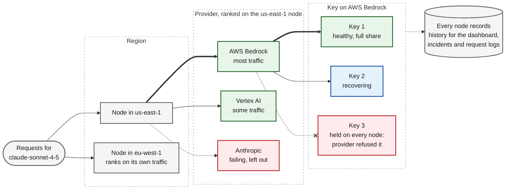

**Adaptive Routing** picks where each request goes from what Bifrost Enterprise observes on live traffic. It makes two choices for every request: the **provider** that serves the model, and the **API key** within that provider. A provider or key that starts failing loses its traffic, and gets it back as it recovers, without anyone editing weights or fallbacks.

{/* Experiment: mermaid in place of the image. To revert, delete the mermaid block and uncomment this Frame.
<Frame>
  
</Frame>
*/}



## What it does

| Capability | What you get |
|------------|--------------|
| **Provider selection** | For a request that does not name a provider, the healthiest provider for the model is picked and the other healthy ones become its fallbacks. |
| **Key selection** | Within the chosen provider, the key is picked by live health, latency and load instead of only the weights you set. |
| **Held keys** | A key the provider refuses (rejected credential, exhausted quota, no model access, retired model, blocked region, rate limit) is taken out of rotation on every node and checked again by a single live request after a wait. When every key is held, the request is sent anyway and its answer counts as the check; see [When every key is held](/enterprise/adaptive-routing/how-it-works#when-every-key-is-held). |
| **Redirecting named providers** | Optional. A request that names a provider that is failing for its model can be sent to a healthy provider, or to its own fallbacks. |
| **Routing history and incidents** | Every node records key and provider health and every decision it changes, so the dashboard can show what happened, when, and what adaptive routing did about it. |

<Note>
Adaptive routing never sends requests of its own to a provider: no health checks, pings or test calls. Everything it knows comes from your live traffic and from how the routing decisions it made turned out. Even a held key is checked by letting one of your real requests through to it.
</Note>

Each node reads health from its own traffic, so nothing waits on another node to decide. The exception is a held key: a provider refuses a key the same way from everywhere, so a hold is shared with every node.

## Where it fits

Adaptive routing runs after routing rules and virtual keys, and before session affinity. See [with other routing features](#with-other-routing-features) for how they combine.

<CardGroup cols={2}>
  <Card title="How It Works" icon="diagram-project" href="/enterprise/adaptive-routing/how-it-works">
    Provider and key states, requests that name a provider, and how held keys are checked and released.
  </Card>
  <Card title="Incidents & Monitoring" icon="chart-line" href="/enterprise/adaptive-routing/incidents-and-monitoring">
    Read the dashboard, work through incidents, and follow a request in the logs.
  </Card>
</CardGroup>

## Settings

The scoring, thresholds and wait times are tuned in Bifrost and are not configurable. The settings decide what adaptive routing is allowed to change, and how it records history.

| Setting (UI) | Key | Default |
|--------------|-----|---------|
| **Adaptive Provider Selection** | `direction_selection_enabled` | On |
| **Adaptive Key Selection** | `route_selection_enabled` | On |
| **Add Fallbacks When a Provider Is Named** | `append_fallbacks_to_pinned` | Off |
| **Redirect Away from Failing Providers** | `reroute_failed_directions` | Off |
| **Redirect To** | `reroute_target` | `pool` |
| **Skip Failing Fallbacks** | `prune_failed_fallbacks` | Off |
| **Record Routing History** | `history_enabled` | On |
| **History Retention (days)** | `history_retention_days` | `7` (1 to 30) |
| **Save Routing State Every (seconds)** | `snapshot_persist_interval_seconds` | `300` (5 to 86400) |

Every setting applies at once on every node, except the retention, which is read when Bifrost starts.

### Changing settings

<Tabs>
<Tab title="Web UI">

Open **Adaptive Routing > Settings** in the sidebar. Saving applies the settings to every node in the cluster.

<Frame>
  
</Frame>

</Tab>
<Tab title="API">

Read and update the settings at `/api/adaptive-routing/config`. Reading needs **AdaptiveRouter: View** and updating needs **AdaptiveRouter: Update** (see [RBAC](/enterprise/rbac)).

```bash
# Read the current settings
curl http://localhost:8080/api/adaptive-routing/config \
  -H "Authorization: Bearer $API_KEY"

# Update the settings: send every field
curl -X PUT http://localhost:8080/api/adaptive-routing/config \
  -H "Authorization: Bearer $API_KEY" \
  -H "Content-Type: application/json" \
  -d '{
    "direction_selection_enabled": true,
    "route_selection_enabled": true,
    "append_fallbacks_to_pinned": false,
    "reroute_failed_directions": true,
    "reroute_target": "pool",
    "prune_failed_fallbacks": false,
    "history_enabled": true,
    "history_retention_days": 7,
    "snapshot_persist_interval_seconds": 300
  }'
```

<Warning>
`PUT` replaces every setting. A switch left out of the body is turned off, and a missing `history_retention_days` or `snapshot_persist_interval_seconds` is rejected with `400`. Read the settings first and send them all back with your change.
</Warning>

For every field, see the [API Reference](/api-reference).

</Tab>
<Tab title="config.json">

Add a top-level `load_balancer_config` block. Only the keys you list are applied; the rest keep their defaults.

```json
{
  "load_balancer_config": {
    "reroute_failed_directions": true,
    "reroute_target": "fallbacks",
    "history_retention_days": 14
  }
}
```

Out-of-range numbers are brought into range: `snapshot_persist_interval_seconds` to between 5 and 86400, and `history_retention_days` to between 1 and 30. A negative interval and a retention of `0` or less are ignored.

<Note>
Settings saved from the dashboard or the API are stored in the database and take precedence over `config.json`. After the first save, change the settings there.
</Note>

</Tab>
</Tabs>

### Which requests name a provider

Several settings only matter for requests that already **name** a provider when they reach adaptive routing. A request names its provider when:

- the caller sends `provider/model`,
- a [routing rule](/providers/routing-rules) sets a provider, or
- the [virtual key's weighted provider configs](/features/governance/routing#weighted-load-balancing) pick one.

By default adaptive routing keeps a named request's provider and fallbacks as they are and only picks the key. Requests that name no provider get the healthiest provider with the other healthy ones as fallbacks. For the order in which every routing layer runs, see [Provider Routing](/providers/provider-routing#how-governance-and-load-balancing-interact).

### Choosing each setting

#### Adaptive Provider Selection

Picks the provider for requests that name none, and is what allows the three switches for named requests to act at all.

- **Keep it on** in almost every deployment.
- **Turn it off** only to stop adaptive routing from choosing or changing providers, for example while you debug another routing layer. Requests keep the provider and fallbacks they arrive with, and a request with no provider goes to the [model catalog's default pick](/providers/provider-routing#default-provider-resolution), which does not look at health. Health is still measured and refused keys are still held, so turning it back on picks up where it left off.

#### Adaptive Key Selection

Picks the key on a provider from live health, latency and load. While it is on, the [weights set on keys](/features/keys-management#weighted-load-balancing) are not used; to take a key out of rotation, disable it.

- **Keep it on** unless your key weights must decide the split, for example to divide traffic by contract.
- **With it off**, keys are picked by their weights. Held keys are still skipped, but a key that keeps failing is no longer avoided.
- Neither mode applies to a key the request pins, a key the caller sends, or a provider with one key. Those are used as given; see [API key selection](/providers/request-options#api-key-selection).

#### Add Fallbacks When a Provider Is Named

Gives a named request the healthy providers for its model as fallbacks, after its own. Requests that name no provider always get them, so this setting changes nothing for them.

- **Turn it on** when callers, routing rules or virtual keys name providers and you want those requests to fail over instead of failing.
- **Leave it off** when a named request must only reach the providers it lists, for example for data residency or a contract.

#### Redirect Away from Failing Providers and Redirect To

Moves a request whose named provider is failing for its model, and keeps the failing provider as its last fallback. It reacts only to a provider that is failing on every key it could use; a degraded or recovering provider keeps its requests. See [how a redirect works](/enterprise/adaptive-routing/how-it-works#requests-that-name-a-provider).

- **Turn it on** when named traffic should not spend its first attempt on a provider that is down. With it off, the dashboard counts these requests as **kept on a failing provider**, and their incident points here.
- **Redirect To: Best healthy provider** moves the request to another healthy provider for the same model. Use this by default.
- **Redirect To: The request's own fallbacks** moves it to the first of its own fallbacks that is not failing, which can be another model or a specific key. Use this when the fallbacks say what should happen next, such as stepping down to a smaller model.
- **Leave it off** for strictly pinned traffic, and for traffic that sends its own key: a [direct key](/providers/request-options#direct-api-key) goes to whichever provider the request is moved to.

When no other provider can take the request, because the virtual key allows no other or none serves the model, the request stays on the named provider rather than failing.

#### Skip Failing Fallbacks

Drops providers that are failing for the model from a request's own fallbacks. It applies to requests that name no provider, and to named requests when **Add Fallbacks When a Provider Is Named** is on or the request was redirected.

- **Turn it on** when requests carry long fallback lists and you would rather not spend attempts on providers that are down.
- **Leave it off** if you want every configured fallback tried. Each node judges failures from its own traffic, and a skipped fallback is not tried for that request at all.

#### History

**Record Routing History**, **History Retention (days)** and **Save Routing State Every (seconds)** do not change routing. They decide what the [dashboard and incidents](/enterprise/adaptive-routing/incidents-and-monitoring#what-is-recorded) can show, and how often key health and held keys are saved so a restarted node can pick up where the cluster left off.

### Common setups

| Your traffic | Settings |
|--------------|----------|
| Callers send bare model names | The defaults. Turn on **Skip Failing Fallbacks** if callers send their own fallbacks. |
| Callers, routing rules or virtual keys name providers | **Add Fallbacks When a Provider Is Named** on, **Redirect Away from Failing Providers** on, **Redirect To** set to **Best healthy provider**. Use **The request's own fallbacks** only when those fallbacks express intent, such as a smaller model or a specific key. |
| Strictly pinned traffic (compliance, data residency, direct keys) | **Add Fallbacks When a Provider Is Named** and **Redirect Away from Failing Providers** off. Restrict providers with [governance](/features/governance/routing#providermodel-restrictions). |

### With other routing features

- **[Routing rules](/providers/routing-rules)** run before adaptive routing. A rule that sets a provider makes the request named, its fallbacks become the request's own, and its key pin wins over the caller's.
- **[Virtual keys](/features/governance/routing)** limit every provider adaptive routing picks or adds. Their weighted provider configs pick before adaptive routing, so that traffic is named.
- **[Session affinity](/providers/session-affinity#health-aware-invalidation-enterprise)** runs after adaptive routing and can keep a session on its provider and key, but not on one that adaptive routing has failing or held on this node.
- **[Retries and fallbacks](/features/retries-and-fallbacks)** run per attempt on the chain adaptive routing leaves, and decide which failures retry a key, rotate to another, or move to the next fallback.


## Limits

- **Health is per node.** Each node scores providers and keys from its own traffic, so two nodes can briefly disagree, and nodes in different regions see their own latency. Held keys are shared across the cluster.
- **Changes follow traffic.** Health is recalculated every few seconds, so a provider that starts failing loses traffic within seconds, not on the first error. Retries and fallbacks protect each request in the meantime.
- **New keys start at full share.** A key or provider adaptive routing has not measured yet competes at a fair share and settles within a cycle or two.
- **Ranking is relative.** Providers and keys are ranked against each other, not against a fixed latency or cost target. Cost and budget decisions belong to [governance](/features/governance/budget-and-limits).
