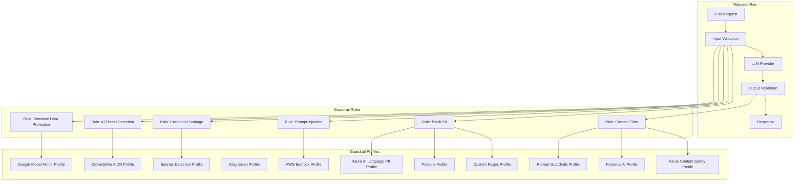

## Overview

**Guardrails** in Bifrost provide enterprise-grade content safety, security validation, and policy enforcement for LLM traffic and MCP tool executions. The system validates inputs and outputs in real-time against your specified policies, ensuring responsible AI deployment with protection against harmful content, prompt injection, PII leakage, credential leakage, and policy violations.

<Frame>
  
</Frame>

### Supported Providers

<CardGroup cols={2}>
  <Card title="Secrets Detection" icon="key" href="/enterprise/guardrails/secrets-detection">
    Built-in Gitleaks-backed detection for leaked API keys, tokens, private keys, and credentials.
  </Card>
  <Card title="Prompt Guardrails" icon="shield-check" href="/enterprise/guardrails/prompt-guardrails">
    LLM-as-judge enforcement for organization-specific natural-language policies.
  </Card>
  <Card title="Custom Regex" icon="code" href="/enterprise/guardrails/custom-regex">
    In-process regex guardrails, including the built-in PII Detection template.
  </Card>
  <Card title="Microsoft Presidio" icon="microsoft" href="/integrations/guardrails/presidio">
    Presidio Analyzer based PII detection, blocking, and redaction.
  </Card>
  <Card title="Azure AI Language PII" icon="microsoft" href="/integrations/guardrails/azure-language-pii">
    Azure Language PII entity recognition with configurable categories and redaction.
  </Card>
  <Card title="AWS Bedrock Guardrails" icon="aws" href="/integrations/guardrails/aws-bedrock">
    Enterprise content filtering, PII detection, and prompt attack prevention.
  </Card>
  <Card title="Azure Content Safety" icon="microsoft" href="/integrations/guardrails/azure-content-safety">
    Multi-modal content moderation with severity-based filtering.
  </Card>
  <Card title="Google Model Armor" icon="/media/google-model-armor-card.svg" href="/integrations/guardrails/google-model-armor">
    Google Cloud policy enforcement for prompt injection, content safety, malicious URLs, and Sensitive Data Protection.
  </Card>
  <Card title="CrowdStrike AIDR" icon="/media/crowdstrike-card.svg" href="/integrations/guardrails/crowdstrike-aidr">
    Inline AI threat detection, policy enforcement, redaction, and AIDR audit visibility.
  </Card>
  <Card title="Gray Swan Cygnal" icon="/media/grayswan-logo-card.svg" href="/integrations/guardrails/grayswan">
    AI safety monitoring with natural language rule definitions.
  </Card>
  <Card title="Patronus AI" icon="/media/patronus-logo-card.svg" href="/integrations/guardrails/patronus-ai">
    LLM security, hallucination detection, and safety evaluation.
  </Card>
  <Card title="Check Point's AI Agent Security" icon="/media/lakera-logo-card-v5.svg" href="/integrations/guardrails/checkpoint">
    Threat detection for LLM conversations, including prompt injection and sensitive data exposure.
  </Card>
  <Card title="Repello Argus" icon="/media/repello-argus-logo-card.svg" href="/integrations/guardrails/repello-argus">
    Asset-defined AI security policies for prompt injection, sensitive data, unsafe content, and policy violations.
  </Card>
  <Card title="Singulr AI" icon="/media/singulr-logo-card.svg" href="/integrations/guardrails/singulr-ai">
    Policy-driven prompt-injection, PII, and PHI enforcement with allow, block, and span-based redaction decisions.
  </Card>
  <Card title="Noma Security" icon="/media/noma-logo-card-v2.svg" href="/integrations/guardrails/noma-security">
    AI-DR runtime protection profiles that allow, alert on, mask, or block prompts, responses, and tool activity.
  </Card>
  <Card title="A10 Guardrails" icon="/media/a10-logo-card.svg" href="/integrations/guardrails/a10">
    Firewall-enforced policies that block or rewrite prompts and completions.
  </Card>
</CardGroup>

### Core Concepts

Bifrost Guardrails are built around two core concepts that work together to provide flexible and powerful content protection:

| Concept | Description |
|---------|-------------|
| **Rules** | Custom policies defined using CEL (Common Expression Language) that determine which LLM requests or MCP tool executions to validate and when. Rules can apply to inputs, outputs, or both, and can be linked to one or more profiles for evaluation. |
| **Profiles** | Configurations for guardrail providers, including Bifrost-managed providers (Prompt Guardrails, Custom Regex, Secrets Detection) and external providers (Presidio, Azure AI Language PII, AWS Bedrock, Azure Content Safety, Google Model Armor, CrowdStrike AIDR, Gray Swan, Patronus AI, Check Point's AI Agent Security, Repello Argus, Singulr AI, Noma Security, and A10 Guardrails). Profiles are reusable and can be shared across multiple rules. |

**How They Work Together:**
- **Profiles** define *how* content is evaluated using native Bifrost checks or external provider capabilities
- **Rules** define *when* and *what* content gets evaluated using CEL expressions
- A single rule can use multiple profiles for layered protection
- Profiles can be reused across different rules for consistency

### Key Features

| Feature | Description |
|---------|-------------|
| **Multi-Provider Support** | Bifrost-managed Prompt Guardrails, Custom Regex, and Secrets Detection, plus Presidio, Azure AI Language PII, AWS Bedrock, Azure Content Safety, Google Model Armor, CrowdStrike AIDR, Gray Swan, Patronus AI, Check Point's AI Agent Security, Repello Argus, Singulr AI, Noma Security, and A10 Guardrails integrations |
| **Dual-Stage Validation** | Guard LLM prompts and responses or MCP tool arguments and results |
| **Real-Time Processing** | Synchronous and asynchronous validation modes |
| **CEL-Based Rules** | Define custom policies using Common Expression Language |
| **Reusable Profiles** | Configure providers once, use across multiple rules |
| **Sampling Control** | Apply rules to a percentage of requests for performance tuning |
| **Automatic Remediation** | Detect, block, redact, or modify content based on policy |
| **Bifrost-Managed Redaction** | Redact runtime payloads, Bifrost logs, and trace-export connector content for supported providers |
| **Comprehensive Logging** | Detailed audit trails for compliance |

### Redaction

Supported providers can redact detected text instead of only detecting or blocking it. Bifrost supports three redaction modes:

- **Runtime** (`runtime`) redacts the live request or response and stores redacted values in logs.
- **Logs only** (`logs_only`) leaves runtime content raw but redacts Bifrost logs and trace-export connector content.
- **Runtime + reversible logs** (`runtime_reversible`) redacts runtime content and logs with reversible placeholders.

For the full behavior matrix, reveal permissions, and connector export caveats, see [Guardrail Redaction](/enterprise/guardrails/redaction).

### Navigating Guardrails in the UI

Access Guardrails from the Bifrost dashboard:

| Page | Path | Description |
|------|------|-------------|
| **Configuration** | Guardrails > Configuration | Manage guardrail rules and their settings |
| **Providers** | Guardrails > Providers | Configure and manage guardrail profiles |

### Guardrail Targets

Every rule has one execution target. Existing rules and rules that omit `target` default to `llm`.

| Target | Input phase | Output phase | Target-specific CEL variables |
|--------|-------------|--------------|-------------------------------|
| `llm` | Before the request reaches the model provider | After the model provider responds | `model`, `provider`, `params`, `service_tier` |
| `mcp` | Before the MCP tool executes; guardrails can inspect or redact its arguments | After the tool returns; guardrails can inspect or redact its result | `mcp_client`, `mcp_tool`, `mcp_arguments` |

Both targets also expose `headers`, `virtual_key`, `customer`, `team`, and `user`. Target-specific CEL variables are intentionally isolated: an MCP rule cannot reference `model`, and an LLM rule cannot reference `mcp_tool`.

`service_tier` is the tier the request asks for, such as `auto`, `default`, `flex`, `priority`, `fast`, or `ultrafast`, in Bifrost's naming (Anthropic's `standard_only` arrives as `default`). It is `""` when the request sets no tier or has no tier concept, such as embeddings. Rules are selected before the provider call, so it reflects the requested tier, not the one the provider served.

### Architecture

The following diagram illustrates how Rules and Profiles work together for the LLM target. For tool execution, see [MCP Guardrails](#mcp-guardrails).



**Flow Description:**
1. **Incoming Request** - LLM request arrives at Bifrost
2. **Input Validation** - Applicable rules evaluate the input using linked profiles
3. **LLM Processing** - If input passes, request is forwarded to the LLM provider
4. **Output Validation** - Response is evaluated by output rules using linked profiles
5. **Response** - Validated response is returned (or blocked/modified based on violations)

---

## MCP Guardrails

MCP guardrails protect the actual tool-execution boundary, not merely the tool call proposed by an LLM.

After the rule's CEL expression matches, Bifrost applies the selected phase:

| Apply on | Flow |
|----------|------|
| **Before tool call** (`input`) | Inspect arguments → allow or redact and execute; **block → stop before execution** |
| **After tool result** (`output`) | Execute tool → inspect a successful text-bearing result → allow or redact and return; **block → do not return the result** |
| **Both** (`both`) | Run the input flow; if allowed, execute the tool and run the output flow. A block at either boundary stops processing |

<Frame>
  
</Frame>

### Choose Which Tool Calls to Guard

- **MCP Client** is populated from configured clients that are enabled.
- **MCP Tool** is populated from their currently discovered tools.
- **Tool Argument** shows a searchable dropdown of top-level string, number, and boolean input-schema fields when one MCP tool is selected with the `=` operator. You can also enter an argument name manually.

MCP rules can additionally use the shared identity fields listed under [Guardrail Targets](#guardrail-targets).

<Note>
All supported guardrail providers can be linked to MCP rules without separate MCP-specific provider setup. Provider capabilities still apply: only providers listed in [Guardrail Redaction](/enterprise/guardrails/redaction) support Bifrost-managed redaction, while other providers may detect, block, or return provider-managed transformations.
</Note>

MCP rules use the same linked profiles, sampling, and timeout settings as LLM rules. See [Creating Rules](#creating-rules) for configuration and [CEL Expression Examples](#cel-expression-examples) for targeting examples.

---

## Streaming Output Guardrails

Streaming delivery depends on what the matched output guardrails can do:

- Detect-only and logs-only rules observe the stream without delaying client delivery.
- Runtime redaction checks buffered text segments and releases the resulting safe text as the response is generated.
- If any matched rule can block, Bifrost holds the complete stream until generation and guardrail evaluation finish. If `stream_replay_event_interval_ms` is positive, an allowed stream is replayed with that delay between buffered events; otherwise, it is delivered immediately. A blocked stream returns the guardrail intervention instead.

Replay pacing is disabled by default. The dashboard initializes the event interval to `25` milliseconds when pacing is enabled, while `0` sends all buffered events immediately. If multiple matched block-capable rules configure different intervals, Bifrost uses the largest value. This behavior applies to streaming Chat Completions, Text Completions, and Responses API requests.

Input guardrails still check the request before Bifrost sends it to the LLM provider.

<Note>
  Gray Swan is a tool-call-specific exception. Text-only streams are delivered directly to the client and are not sent to Cygnal. See [Gray Swan Cygnal](/integrations/guardrails/grayswan#streaming-output-and-tool-calls) for the full behavior.
</Note>

<Note>
  If the same rule also uses another output guardrail profile, Bifrost waits for that profile to check the completed response. Gray Swan's text-only behavior only skips the Gray Swan call; it does not bypass the other profile.
</Note>

<Note>
  Noma Security is a block-capable exception. When the only enforced output rule matching a request has Noma as its only profile, Bifrost releases text progressively as Noma clears it instead of holding the complete stream. See [Noma Security](/integrations/guardrails/noma-security#streaming-responses) for the conditions.
</Note>

---

## Monitor Mode

Set a rule's `output_mode` to `monitor` to see what its output guardrails would do before you enforce them.

- The response reaches the client untouched, and a stream is never paused, so time to first token is unchanged.
- Once the response completes, Bifrost evaluates it in the background with the rule's profiles and records the result on the request's log. Nothing is blocked, redacted, or transformed for the client.
- Each match becomes a `guardrail_debug.detections[]` entry with `action` (`block`, `redact`, `transform`, or `detect`) and `enforced: false`. The stored response is redacted as enforcement would have left it, and the plugin logs carry `[output-monitor]` lines with each provider's verdict.
- The log entry is written once the evaluation finishes, so it can appear a few seconds after the response.

Monitor mode applies to the output phase only: the rule needs `target` `llm` and `apply_to` `output` or `both`, and the input phase of a `both` rule is still enforced. When enforce and monitor rules match the same request, the enforce rules decide what the client receives and the monitor rules add their findings to the log.

<Note>
  Every monitored response is evaluated; there is no limit on how many evaluations run at once. Each one holds a copy of the response and its log entry until it finishes, for at most 90 seconds, so memory grows with monitored traffic multiplied by the guardrail provider's latency. Use the rule's sampling rate to monitor a share of high-volume traffic.
</Note>

---

## Guardrail Rules

Guardrail Rules are custom policies that define when and how content validation occurs. Rules use CEL (Common Expression Language) expressions to evaluate requests and can be linked to one or more profiles for execution.

<Frame>
  
</Frame>

### Rule Properties

| Property | Type | Required | Description |
|----------|------|----------|-------------|
| `id` | integer | Yes | Unique identifier for the rule |
| `name` | string | Yes | Descriptive name for the rule |
| `description` | string | No | Explanation of what the rule does |
| `enabled` | boolean | Yes | Whether the rule is active |
| `target` | enum | No | Execution boundary: `llm` (default) or `mcp` |
| `cel_expression` | string | Yes | CEL expression for rule evaluation |
| `apply_to` | enum | Yes | When to apply: `input`, `output`, or `both`. For MCP rules, input means tool arguments and output means the tool result |
| `sampling_rate` | integer | No | Percentage of requests to evaluate (0-100) |
| `timeout` | integer | No | Execution timeout in seconds (default: 60) |
| `send_all_conversation_turns` | boolean | No | `true` sends all input conversation turns. When `false`, `max_turns_to_send` selects the current input plus preceding turns. Omit it to preserve legacy behavior (`0` sends all; a positive value limits history). |
| `max_turns_to_send` | integer | No | Used when `send_all_conversation_turns` is `false`: number of preceding conversation turns to include. `0` sends only the current input. |
| `evaluation_mode` | enum | No | `bundled` (default) sends selected turns in one guardrail call; `per_turn` evaluates each turn in isolation and uses more provider calls |
| `stream_replay_event_interval_ms` | integer | No | Delay in milliseconds between buffered events after block-capable streaming output guardrails allow the response. `0` sends buffered events immediately; maximum `1000` |
| `output_mode` | enum | No | `enforce` (default) acts on output matches; `monitor` delivers the response untouched and only logs what the output guardrails would do. Requires `apply_to` `output` or `both`. See [Monitor Mode](#monitor-mode) |
| `input_timing` | enum | No | `pre_call` (default) finishes the input check before the request is sent; `parallel` runs it alongside the LLM call, holds the response for the verdict, and enforces only blocks. `parallel` requires target `llm` and `apply_to` `input` or `both` |
| `fail_closed` | boolean | No | `true` blocks traffic when one of the rule's providers errors, times out, or returns an invalid or partial result; `false` (default) lets it through and logs the failure. See [Provider Failures](#provider-failures) |
| `provider_config_ids` | array | No | IDs of profiles to use for evaluation, in execution order |
| `profile_execution_mode` | enum | No | `independent` (default) gives every linked profile the original payload; `chained` gives each profile the payload as earlier profiles redacted or transformed it. See [Chained Profile Execution](#chained-profile-execution) |

### Creating Rules

<Tabs group="rules-config">
<Tab title="Web UI">
1. **Navigate to Rules**
   - Go to **Guardrails** > **Configuration**
   - Click **Add Rule**

<Frame>

</Frame>


2. **Configure Rule Settings**

**Basic Information:**
- **Name**: Enter a descriptive name (e.g., "Block PII in Prompts")
- **Description**: Explain the rule's purpose
- **Enabled**: Toggle to activate the rule
- **Target**: Choose **LLM** or **MCP**. LLM is the default for existing rules

**Evaluation Settings:**
- **Apply To**: Select when to apply the rule
  - `input` - Validate incoming prompts for LLM rules or tool arguments for MCP rules
  - `output` - Validate LLM responses or MCP tool results
  - `both` - Validate both phases
- **CEL Expression**: Define the validation logic
- **Sampling Rate**: Set percentage of requests to evaluate (default: 100%)
- **Timeout**: Set maximum execution time in seconds (default: 60)
- **Block when guardrail is unavailable**: Off by default. Blocks traffic when a guardrail provider errors, times out, or returns an invalid or partial result. Applies to profiles that block or redact content before it's sent; detect-only and logs-only profiles never block. See [Provider Failures](#provider-failures)

3. **Link Profiles**
   - Select one or more profiles to use for evaluation
   - Bifrost evaluates linked profiles in the execution order shown under the profile picker. A block stops the remaining profiles for that rule; a provider error fails open and the next profile still runs, unless **Block when guardrail is unavailable** is on. See [Profile Execution Order](#profile-execution-order)
   - With more than one enabled profile, turn on **Chain profiles** so each profile evaluates the payload as the profiles above it redacted it. See [Chained Profile Execution](#chained-profile-execution)

4. **Save and Test**
   - Click **Save Rule**
   - Use the **Test** button to validate with sample content

</Tab>
<Tab title="API">

The HTTP API uses camelCase field names (`celExpression`, `applyTo`, `samplingRate`, `selectedGuardrailProfiles`, `profileExecutionMode`). The `target` field remains lowercase and accepts `llm` or `mcp`. Profiles are referenced as `"<provider-type>:<config-id>"` strings (for example, `"regex:1"`, `"patronus-ai:6"`).

**Create a Guardrail Rule:**
```bash
curl -X POST http://localhost:8080/api/guardrails/rules \
  -H "Content-Type: application/json" \
  -d '{
    "name": "Protect GitHub issue creation",
    "description": "Inspect arguments before the GitHub tool creates an issue",
    "enabled": true,
    "target": "mcp",
    "celExpression": "mcp_client == \"github\" && mcp_tool == \"create_issue\"",
    "applyTo": "input",
    "samplingRate": 100,
    "timeout": 5000,
    "selectedGuardrailProfiles": ["regex:1", "bedrock:2"]
  }'
```

**List All Rules:**
```bash
curl -X GET http://localhost:8080/api/guardrails/rules \
  -H "Content-Type: application/json"

# Response
{
  "count": 1,
  "limit": 1,
  "offset": 0,
  "rules": [
    {
      "id": 1,
      "name": "Protect GitHub issue creation",
      "description": "Inspect arguments before the GitHub tool creates an issue",
      "enabled": true,
      "target": "mcp",
      "celExpression": "mcp_client == \"github\" && mcp_tool == \"create_issue\"",
      "applyTo": "input",
      "samplingRate": 100,
      "timeout": 5000,
      "selectedGuardrailProfiles": ["regex:1", "bedrock:2"]
    }
  ]
}
```

**Update a Rule:**

`PUT` revalidates against the full rule schema. Send the complete rule body (same shape as `POST`), not a patch.
```bash
curl -X PUT http://localhost:8080/api/guardrails/rules/1 \
  -H "Content-Type: application/json" \
  -d '{
    "name": "Protect GitHub issue creation",
    "description": "Inspect arguments before the GitHub tool creates an issue",
    "enabled": false,
    "target": "mcp",
    "celExpression": "mcp_client == \"github\" && mcp_tool == \"create_issue\"",
    "applyTo": "input",
    "samplingRate": 50,
    "timeout": 5000,
    "selectedGuardrailProfiles": ["regex:1", "bedrock:2"]
  }'
```

**Delete a Rule:**
```bash
curl -X DELETE http://localhost:8080/api/guardrails/rules/1
```

</Tab>
<Tab title="config.json">

```json
{
  "guardrails_config": {
    "guardrail_rules": [
      {
        "id": 1,
        "name": "Block PII in Prompts",
        "description": "Prevent PII from being sent to LLM providers",
        "enabled": true,
        "target": "llm",
        "cel_expression": "true",
        "apply_to": "input",
        "sampling_rate": 100,
        "timeout": 5000,
        "provider_config_ids": [1, 2]
      },
      {
        "id": 2,
        "name": "Content Filter for Responses",
        "description": "Filter harmful content from LLM responses",
        "enabled": true,
        "target": "llm",
        "cel_expression": "true",
        "apply_to": "output",
        "sampling_rate": 100,
        "timeout": 3000,
        "send_all_conversation_turns": false,
        "max_turns_to_send": 8,
        "evaluation_mode": "per_turn",
        "provider_config_ids": [2]
      },
      {
        "id": 3,
        "name": "Protect GitHub issue creation",
        "description": "Inspect arguments before the GitHub tool creates an issue",
        "enabled": true,
        "target": "mcp",
        "cel_expression": "mcp_client == 'github' && mcp_tool == 'create_issue'",
        "apply_to": "input",
        "sampling_rate": 100,
        "timeout": 2000,
        "provider_config_ids": [1]
      }
    ]
  }
}
```

</Tab>
<Tab title="Helm">

```yaml
bifrost:
  guardrails:
    rules:
      - id: 1
        name: "Block PII in Prompts"
        description: "Prevent PII from being sent to LLM providers"
        enabled: true
        target: "llm"
        cel_expression: "true"
        apply_to: "input"
        sampling_rate: 100
        timeout: 5000
        provider_config_ids: [1, 2]
      - id: 2
        name: "Content Filter for Responses"
        description: "Filter harmful content from LLM responses"
        enabled: true
        target: "llm"
        cel_expression: "true"
        apply_to: "output"
        sampling_rate: 100
        timeout: 3000
        send_all_conversation_turns: false
        max_turns_to_send: 8
        evaluation_mode: per_turn
        stream_replay_event_interval_ms: 25
        provider_config_ids: [2]
      - id: 3
        name: "Protect GitHub issue creation"
        description: "Inspect arguments before the GitHub tool creates an issue"
        enabled: true
        target: "mcp"
        cel_expression: "mcp_client == 'github' && mcp_tool == 'create_issue'"
        apply_to: "input"
        sampling_rate: 100
        timeout: 2000
        provider_config_ids: [1]
```

</Tab>
</Tabs>

### CEL Expression Examples

CEL (Common Expression Language) determines whether a rule applies using request identity and target-specific metadata. The linked guardrail profiles inspect the actual prompt, response, tool arguments, or tool result; message content is not exposed as a `request.messages` CEL object.

**Always Apply Rule:**
```cel
true
```

**Apply Based on LLM Model:**
```cel
model.startsWith("gpt-4")
```

**Apply to OpenAI Traffic in Production:**
```cel
provider == "openai" && ("x-environment" in headers) && headers["x-environment"] == "production"
```

**Apply to a Team:**
```cel
team == "team-platform"
```

**Skip Fast-Tier OpenAI Traffic:**
```cel
!(provider == "openai" && service_tier in ["fast", "priority", "ultrafast"])
```

**Apply to an MCP Tool:**
```cel
mcp_client == "github" && mcp_tool == "create_issue"
```

**Apply Based on an MCP Argument:**
```cel
("amount" in mcp_arguments) && mcp_arguments["amount"] > 1000
```

### Linking Rules to Profiles

Rules can be linked to multiple profiles for comprehensive validation:

<Frame>
  
</Frame>

**Best Practices:**
- Link credential-leakage rules to [Secrets Detection](/enterprise/guardrails/secrets-detection)
- Link PII detection rules to profiles with PII capabilities (Custom Regex PII template, Presidio, Azure AI Language PII, Bedrock, Patronus)
- Link content filtering rules to profiles with content safety features (Azure, Bedrock, Gray Swan)
- Use [Prompt Guardrails](/enterprise/guardrails/prompt-guardrails) for natural-language policies evaluated by a configured Bifrost judge model
- Use Gray Swan when you want its external Cygnal policy service, violation scoring, and threat-detection capabilities
- Use multiple profiles for defense-in-depth (e.g., Bedrock + Patronus for PII, Azure + Gray Swan for content)
- Set appropriate timeouts when using multiple profiles

### Profile Execution Order

When a rule links more than one profile, the rule editor shows an **Execution order** list under the profile picker. Profiles run top to bottom whenever the rule matches. Drag a profile by its handle to change its position.

<Frame>
  
</Frame>

| Outcome of a profile | Effect on the remaining profiles |
|----------------------|----------------------------------|
| Allows the content | The next profile runs |
| Blocks the content | Later profiles do not run and the rule returns the intervention |
| Provider error or timeout | Fails open: the error is reported and the next profile still runs. With **Block when guardrail is unavailable** on, a failed profile that can block or redact stops the rule: later profiles do not run and the rule blocks. See [Provider Failures](#provider-failures) |

Put a cheap, local profile such as [Custom Regex](/enterprise/guardrails/custom-regex) first to block obvious cases before an external provider is called. The order is saved with the rule. Through the API, list profiles in the order you want them to run in `selectedGuardrailProfiles`; duplicates are rejected.

By default, every profile evaluates the original payload, so a value an earlier profile redacts still reaches the profiles after it. To prevent that, chain the profiles.

#### Chained Profile Execution

When a rule has more than one enabled profile, turn on **Chain profiles** in the rule editor. Through the API, set `"profileExecutionMode": "chained"`; in `config.json`, set `"profile_execution_mode": "chained"`. Profiles then run in execution order, and each one evaluates the payload as the profiles above it redacted or transformed it. A local redactor such as Custom Regex or [Secrets Detection](/enterprise/guardrails/secrets-detection) can run first, so external and judge profiles later in the chain never see the values it caught.

- Later profiles see every earlier finding replaced, including `logs_only` findings, so the chain never forwards a value it already flagged.
- A block stops the chain. A profile that errors or times out is skipped, and the next profile sees the payload as it stood.
- Chaining applies within a rule; separate rules still run in parallel. A rule with one profile never chains.
- It covers LLM input and output, streaming output, and MCP tool arguments and results.
- If a profile's rewrite cannot be combined safely with the earlier ones, the rule fails closed with an error.

Chaining is off by default (`independent`), so existing rules keep their behavior.

---

## Managing Profiles

Profiles are reusable configurations for guardrail providers. External providers include credentials, endpoints, and detection thresholds. Custom Regex and Secrets Detection run locally. Prompt Guardrails uses a configured Bifrost LLM provider and model as its judge.

<Frame>
  
</Frame>

### Profile Properties

| Property | Type | Required | Description |
|----------|------|----------|-------------|
| `id` | integer | Yes | Unique identifier for the profile |
| `provider_name` | string | Yes | Provider type: `regex`, `secrets`, `prompt-guardrail`, `presidio`, `azure-pii`, `bedrock`, `azure`, `model-armor`, `crowdstrike-aidr`, `grayswan`, `patronus-ai`, `lakera`, `repelloai-argus`, `singulr-ai`, `noma-security`, or `a10` |
| `policy_name` | string | Yes | Descriptive name for the policy |
| `enabled` | boolean | Yes | Whether the profile is active |
| `config` | object | No | Provider-specific configuration |

### Creating Profiles

<Tabs group="profiles-config">
<Tab title="Web UI">

1. **Navigate to Providers**
   - Go to **Guardrails** > **Providers**
   - Click **Add Profile**

<Frame>
  
</Frame>

2. **Select Provider Type**
   - Choose a supported Bifrost-managed or external provider

3. **Configure Provider Settings**
   - Enter credentials and endpoint information for external providers, local settings for native providers, or the judge provider, model, and policy for Prompt Guardrails
   - Configure provider-specific detection, decision, or transformation settings
   - See the provider-specific page for detailed configuration

4. **Verify and Save**
   - Click **Verify and Save**. Bifrost checks the configuration against the provider (credentials, endpoint, or judge model) and saves the profile only if the check passes. When you edit an existing profile, **Re-verify** runs the same check without saving
   - Secrets Detection and Custom Regex have nothing external to check, so they save directly with **Save Guardrail Configuration**
   - The profile is now available for linking to rules

</Tab>
<Tab title="API">

Profiles are managed per provider type at `/api/guardrails/{provider}`, where `{provider}` is one of `secrets`, `regex`, `prompt-guardrail`, `presidio`, `azure-pii`, `bedrock`, `azure`, `model-armor`, `crowdstrike-aidr`, `grayswan`, `patronus-ai`, `lakera`, `repelloai-argus`, `singulr-ai`, `noma-security`, or `a10`. The API assigns the configuration ID after creation.

**Create a Profile:**
```bash
curl -X POST http://localhost:8080/api/guardrails/bedrock \
  -H "Content-Type: application/json" \
  -d '{
    "name": "PII Detection Profile",
    "enabled": true,
    "config": {
      "access_key": "env.AWS_ACCESS_KEY_ID",
      "secret_key": "env.AWS_SECRET_ACCESS_KEY",
      "guardrail_arn": "arn:aws:bedrock:us-east-1:123456789:guardrail/abc123",
      "guardrail_version": "1",
      "region": "us-east-1"
    }
  }'
```

**List All Profiles (grouped by provider):**
```bash
curl -X GET http://localhost:8080/api/guardrails \
  -H "Content-Type: application/json"

# Response
[
  {
    "name": "regex",
    "configs": [
      { "id": 1, "name": "PII Detection", "enabled": true, "patterns": [...] }
    ]
  },
  {
    "name": "bedrock",
    "configs": [
      { "id": 2, "name": "PII Detection Profile", "enabled": true, "guardrail_arn": "...", "region": "us-east-1" }
    ]
  }
]
```

To list only a single provider's profiles, hit the provider path directly: `GET /api/guardrails/bedrock`.

**Update a Profile:**
```bash
curl -X PUT http://localhost:8080/api/guardrails/bedrock \
  -H "Content-Type: application/json" \
  -d '{
    "id": 1,
    "name": "PII Detection Profile",
    "enabled": false
  }'
```

**Delete a Profile:**
```bash
curl -X DELETE http://localhost:8080/api/guardrails/bedrock \
  -H "Content-Type: application/json" \
  -d '{"id": 1}'
```

</Tab>
<Tab title="config.json">

```json
{
  "guardrails_config": {
    "guardrail_providers": [
        {
          "id": 1,
          "provider_name": "secrets",
          "policy_name": "Block Leaked Credentials",
          "enabled": true,
          "config": {
            "ignored_secret_keywords": ["example", "dummy"]
          }
        },
        {
          "id": 2,
          "provider_name": "regex",
          "policy_name": "PII Detection",
          "enabled": true,
          "config": {
            "patterns": [
              { "pattern": "\\b[A-Z0-9._%+-]+@[A-Z0-9.-]+\\.[A-Z]{2,}\\b", "description": "Email address", "flags": "i" },
              { "pattern": "\\b\\d{3}-\\d{2}-\\d{4}\\b", "description": "US Social Security Number" }
            ]
          }
        },
        {
          "id": 3,
          "provider_name": "bedrock",
          "policy_name": "PII Detection Profile",
          "enabled": true,
          "config": {
            "access_key": "env.AWS_ACCESS_KEY_ID",
            "secret_key": "env.AWS_SECRET_ACCESS_KEY",
            "guardrail_arn": "arn:aws:bedrock:us-east-1:123456789:guardrail/abc123",
            "guardrail_version": "1",
            "region": "us-east-1"
          }
        },
        {
          "id": 4,
          "provider_name": "azure",
          "policy_name": "Content Safety Profile",
          "enabled": true,
          "config": {
            "endpoint": "https://your-resource.cognitiveservices.azure.com/",
            "api_key": "env.AZURE_CONTENT_SAFETY_API_KEY",
            "analyze_enabled": true,
            "analyze_severity_threshold": "medium",
            "jailbreak_shield_enabled": true,
            "indirect_attack_shield_enabled": true
          }
        },
        {
          "id": 5,
          "provider_name": "model-armor",
          "policy_name": "Google Model Armor Production",
          "enabled": true,
          "timeout": 30,
          "config": {
            "auth_type": "default_credential",
            "project_id": "env.GCP_PROJECT_ID",
            "location": "env.GCP_LOCATION",
            "template_id": "env.GMA_TEMPLATE_ID"
          }
        },
        {
          "id": 6,
          "provider_name": "crowdstrike-aidr",
          "policy_name": "CrowdStrike AIDR Production",
          "enabled": true,
          "timeout": 30,
          "config": {
            "api_key": "env.CS_AIDR_TOKEN",
            "base_url": "env.CS_AIDR_BASE_URL",
            "app_id": "bifrost-production",
            "collector_instance_id": "prod-us-east-1"
          }
        },
        {
          "id": 7,
          "provider_name": "grayswan",
          "policy_name": "Custom Safety Rules",
          "enabled": true,
          "config": {
            "api_key": "env.GRAYSWAN_API_KEY",
            "policy_id": "YOUR_GRAYSWAN_POLICY_ID",
            "violation_threshold": 0.5,
            "reasoning_mode": "hybrid",
            "rules": {
              "no_pii": "Do not allow personally identifiable information",
              "professional_tone": "Ensure responses maintain a professional tone"
            }
          }
        },
        {
          "id": 8,
          "provider_name": "patronus-ai",
          "policy_name": "Patronus Quality Checks",
          "enabled": true,
          "config": {
            "api_key": "env.PATRONUS_API_KEY",
            "base_url": "https://api.patronus.ai",
            "evaluators": [
              {
                "evaluator": "pii",
                "explain_strategy": "on-fail"
              },
              {
                "evaluator": "judge",
                "criteria": "patronus:is-concise",
                "explain_strategy": "on-fail"
              }
            ],
            "capture": "none"
          }
        }
      ]
    }
  }
```

</Tab>
<Tab title="Helm">

```yaml
bifrost:
  guardrails:
    providers:
      - id: 1
        provider_name: "secrets"
        policy_name: "Block Leaked Credentials"
        enabled: true
        config:
          ignored_secret_keywords:
            - "example"
            - "dummy"
      - id: 2
        provider_name: "regex"
        policy_name: "PII Detection"
        enabled: true
        config:
          patterns:
            - pattern: "\\b[A-Z0-9._%+-]+@[A-Z0-9.-]+\\.[A-Z]{2,}\\b"
              description: "Email address"
              flags: "i"
            - pattern: "\\b\\d{3}-\\d{2}-\\d{4}\\b"
              description: "US Social Security Number"
      - id: 3
        provider_name: "bedrock"
        policy_name: "PII Detection Profile"
        enabled: true
        config:
          guardrail_arn: "arn:aws:bedrock:us-east-1:123456789:guardrail/abc123"
          guardrail_version: "1"
          region: "us-east-1"
          # AWS Authentication (choose one method):
          # Option 1: Explicit credentials
          access_key: "env.AWS_ACCESS_KEY_ID"
          secret_key: "env.AWS_SECRET_ACCESS_KEY"
          # Option 2: IAM Role - omit access_key and secret_key
          # (Bifrost will use IAM credentials from the environment)
      - id: 4
        provider_name: "azure"
        policy_name: "Content Safety Profile"
        enabled: true
        config:
          endpoint: "https://your-resource.cognitiveservices.azure.com/"
          api_key: "env.AZURE_CONTENT_SAFETY_API_KEY"
          analyze_enabled: true
          analyze_severity_threshold: "medium"
          jailbreak_shield_enabled: true
      - id: 5
        provider_name: "model-armor"
        policy_name: "Google Model Armor Production"
        enabled: true
        timeout: 30
        config:
          auth_type: "default_credential"
          project_id: "env.GCP_PROJECT_ID"
          location: "env.GCP_LOCATION"
          template_id: "env.GMA_TEMPLATE_ID"
      - id: 6
        provider_name: "crowdstrike-aidr"
        policy_name: "CrowdStrike AIDR Production"
        enabled: true
        timeout: 30
        config:
          api_key: "env.CS_AIDR_TOKEN"
          base_url: "env.CS_AIDR_BASE_URL"
          app_id: "bifrost-production"
          collector_instance_id: "prod-us-east-1"
      - id: 7
        provider_name: "grayswan"
        policy_name: "Custom Safety Rules"
        enabled: true
        config:
          api_key: "env.GRAYSWAN_API_KEY"
          policy_id: "YOUR_GRAYSWAN_POLICY_ID"
          violation_threshold: 0.5
          reasoning_mode: "hybrid"
          rules:
            no_pii: "Do not allow personally identifiable information"
            professional_tone: "Ensure responses maintain a professional tone"
      - id: 8
        provider_name: "patronus-ai"
        policy_name: "Patronus Quality Checks"
        enabled: true
        config:
          api_key: "env.PATRONUS_API_KEY"
          base_url: "https://api.patronus.ai"
          evaluators:
            - evaluator: "pii"
              explain_strategy: "on-fail"
            - evaluator: "judge"
              criteria: "patronus:is-concise"
              explain_strategy: "on-fail"
          capture: "none"
```

</Tab>
</Tabs>

### Provider Capabilities

Bifrost-managed providers cover deterministic local checks and natural-language policies:

| Provider | Evaluation | Decisions | Additional provider cost | Best for |
|----------|------------|-----------|--------------------------|----------|
| [Secrets Detection](/enterprise/guardrails/secrets-detection) | Local Gitleaks rules | Detect, block, or redact | No | Credentials, tokens, and private keys |
| [Custom Regex](/enterprise/guardrails/custom-regex) | Local RE2 patterns | Detect, block, or redact | No | Known patterns, identifiers, and PII templates |
| [Prompt Guardrails](/enterprise/guardrails/prompt-guardrails) | Configured Bifrost LLM judge | Allow or block | Yes | Semantic, organization-specific policies |

See [Guardrail Redaction](/enterprise/guardrails/redaction) for Bifrost-managed redaction modes. Third-party guardrail providers offer the following capabilities:

| Capability | AWS Bedrock | Azure Content Safety | Google Model Armor | CrowdStrike AIDR | Gray Swan | Patronus AI | Check Point's AI Agent Security | Repello Argus | Azure AI Language PII | Presidio |
|------------|-------------|----------------------|--------------------|------------------|-----------|-------------|--------------|---------------|-----------------------|----------|
| PII Detection | Yes | No | Yes | Policy-dependent | No | Yes | Yes | Yes | Yes | Yes |
| Content Filtering | Yes | Yes | Yes | Policy-dependent | Yes | Yes | Yes | Yes | No | No |
| Prompt Injection | Yes | Yes | Yes | Policy-dependent | Yes | Yes | Yes | Yes | No | No |
| Hallucination Detection | No | No | No | No | No | Yes | No | No | No | No |
| Toxicity Screening | Yes | Yes | Yes | Policy-dependent | Yes | Yes | Policy-dependent | Yes | No | No |
| Custom Policies | Yes | Yes | Yes | Policy-dependent | Yes | Yes | Yes | Yes | Category filters | Entity filters |
| Custom Natural Language Rules | No | No | No | No | Yes | No | No | No | No | No |
| Image Support | Yes | No | No | No | No | No | No | No | No | No |
| IPI Detection | No | Yes | Yes | Policy-dependent | Yes | No | Policy-dependent | Policy-dependent | No | No |
| Mutation Detection | No | No | No | No | Yes | No | No | No | No | No |
| Bifrost-managed Redaction | No | No | No | No | No | No | Yes | No | Yes | Yes |
| Provider-managed Transformation | Yes | No | Yes | Policy-dependent | No | No | No | No | No | No |

<Note>
  CrowdStrike AIDR capabilities depend on the AIDR policy and detectors configured in CrowdStrike. Bifrost sends the request to AIDR, then enforces the returned `blocked` or `transformed` decision.
</Note>

<Warning>
  Do not configure provider-managed transformations and Bifrost-managed redaction to rewrite the same input or output phase. Bifrost fails closed when a phase produces both provider-managed transformed text and Bifrost-managed redaction findings, because there is no safe unambiguous way to merge two rewritten outputs. Detection-only and blocking guardrails can still run alongside redaction.
</Warning>

### Best Practices

**Profile Organization:**
- Create separate profiles for different use cases (PII, content filtering, etc.)
- Use descriptive policy names that indicate the profile's purpose
- Keep credentials secure using environment variables

**Performance Considerations:**
- Enable only the profiles you need to minimize latency
- Use sampling rates on rules for high-traffic endpoints
- Set appropriate timeouts to prevent slow requests
- Account for the extra model latency and token cost of each Prompt Guardrails judge call
- Test Prompt Guardrails policies with representative allow, block, ambiguous, and adversarial examples before production use

**Security:**
- Store API keys and credentials in environment variables or secrets managers
- Regularly rotate credentials
- Use least-privilege IAM roles for AWS Bedrock
- Use least-privilege Google IAM roles for Google Model Armor, such as `roles/modelarmor.user` or a higher Model Armor role

---

## Using Guardrails in Requests

### Attaching Guardrails to API Calls

Once configured, attach guardrails to your LLM requests using custom headers:

**Single Guardrail:**
```bash
curl -X POST http://localhost:8080/v1/chat/completions \
  -H "Content-Type: application/json" \
  -H "x-bf-guardrail-id: bedrock-prod-guardrail" \
  -d '{
    "model": "gpt-4o-mini",
    "messages": [
      {
        "role": "user",
        "content": "Help me with this task"
      }
    ]
  }'
```

**Multiple Guardrails (Sequential):**
```bash
curl -X POST http://localhost:8080/v1/chat/completions \
  -H "Content-Type: application/json" \
  -H "x-bf-guardrail-ids: bedrock-prod-guardrail,azure-content-safety-001" \
  -d '{
    "model": "gpt-4o-mini",
    "messages": [
      {
        "role": "user",
        "content": "Help me with this task"
      }
    ]
  }'
```

**Guardrail Configuration in Request:**
```bash
curl -X POST http://localhost:8080/v1/chat/completions \
  -H "Content-Type: application/json" \
  -d '{
    "model": "gpt-4o-mini",
    "messages": [
      {
        "role": "user",
        "content": "Help me with this task"
      }
    ],
    "bifrost_config": {
      "guardrails": {
        "input": ["bedrock-prod-guardrail"],
        "output": ["patronus-ai-001"],
        "async": false
      }
    }
  }'
```

### Guardrail Response Handling

An allowed request returns the model's response, with any masking your rules apply.

When a guardrail blocks, Bifrost returns HTTP `400` with `type: "guardrail_intervention"`. The message carries the guardrail's reason. For an input rule, the request is not sent to the model; for an output rule, the model's response is replaced by the error. A blocked stream ends with the same `guardrail_intervention` error.

Trimmed example:

```json
{
  "type": "guardrail_intervention",
  "is_bifrost_error": false,
  "status_code": 400,
  "error": {
    "type": "guardrail_intervention",
    "message": "Blocked by Noma AI-DR policy: Email detected in the user prompt"
  },
  "extra_fields": {
    "request_type": "chat_completion"
  }
}
```

Use `type` (or `error.type`) equal to `guardrail_intervention` to tell guardrail blocks apart from other `400` errors.

### Provider Failures

A guardrail provider can fail to return a usable verdict: its API errors or is unreachable, the call exceeds the rule's timeout, or the response is invalid or partial, such as when the provider skips some of its checks. By default, Bifrost lets traffic through, logs a warning, and lists the profile under `providers_failed` on the guardrail span. Other rules and profiles still run, so another rule can still block.

Turn on **Block when guardrail is unavailable** on a rule (`fail_closed: true` in config files, `failClosed: true` through the API) to block instead. The block applies wherever the rule enforces: inputs checked before or in parallel with the LLM call, non-streaming and held streaming outputs, runtime-redaction streams, and MCP tool arguments and results. It does not apply to monitor mode, and a profile that only detects or redacts the logs never blocks, since it could not have changed what was sent. With **Block when guardrail is unavailable** on, a failed profile that can block or redact also stops the rule, so the profiles after it do not run. A profile that only detects or redacts the logs never stops the rule.

The block returns the same `400` `guardrail_intervention` error as a policy block, with `code` set to `guardrail_unavailable`. The message names the profile, and the provider's own error stays in the logs. When another rule blocks the same request, its policy reason is returned instead.

```json
{
  "type": "guardrail_intervention",
  "is_bifrost_error": false,
  "status_code": 400,
  "error": {
    "type": "guardrail_intervention",
    "code": "guardrail_unavailable",
    "message": "Request blocked: guardrail check failed for \"model-armor-prod\""
  }
}
```

Use `error.code` equal to `guardrail_unavailable` to tell a provider outage, which may succeed on retry, apart from a policy violation.
