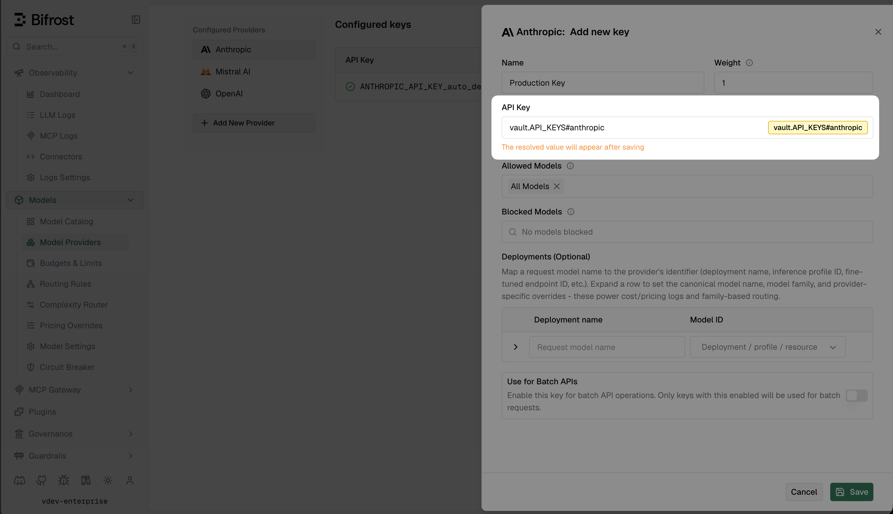

## Overview

By default, Bifrost stores provider API keys, virtual key values, and other credentials in its config database. Secret Management lets you keep those values in your own secret manager - Bifrost stores a reference and resolves the real value at runtime.

Once connected, any secret field in Bifrost (provider keys, virtual key values, MCP auth headers, etc.) accepts a `vault.<path>` reference alongside the existing `env.<VAR>` and plaintext options.

<Note>
Secret Management is an Enterprise-only feature and requires a PostgreSQL config store.
</Note>

---

## Access modes

Set `access_mode` to control how much Bifrost interacts with your vault:

| Mode | What Bifrost does |
|------|-------------------|
| `read_only` (default) | Resolves `vault.<path>` references. Never writes to or deletes from the backend. |
| `read_and_write` | Also auto-stores plaintext values you save via the dashboard or API, and deletes owned secrets when you remove an entity. |

Start with `read_only` if you want to manage secrets yourself. Use `read_and_write` if you want Bifrost to handle it - useful when migrating existing plaintext keys, since Bifrost pushes the value to the vault on the next save.

---

## Setup

Pick your backend and add a `vault_store` block inside your existing `config_store` in `config.json`. Credential fields in this block accept a plain value or an `env.<VAR>` reference, but not a `vault.<path>` reference, since they are read before the vault is connected.

<Tabs group="vault-backend">
<Tab title="AWS Secrets Manager">

<Tabs group="aws-auth">
<Tab title="IAM role (recommended)">

Attach an IAM role to your EC2 instance, ECS task, or EKS pod. No credentials needed in config - the SDK inherits the role automatically. For EKS with IRSA, annotate your service account with the role ARN and leave credentials unset.

```json
{
  "config_store": {
    ...
    "vault_store": {
      "enabled": true,
      "type": "aws-secrets-manager",
      "prefix": "bifrost",
      "access_mode": "read_only",
      "aws": {
        "region": "us-east-1"
      }
    }
  }
}
```

</Tab>
<Tab title="Static credentials">

Use static credentials when IAM roles are not available. `access_key_id` and `secret_access_key` must always be set together.

```json
{
  "config_store": {
    ...
    "vault_store": {
      "enabled": true,
      "type": "aws-secrets-manager",
      "prefix": "bifrost",
      "access_mode": "read_only",
      "aws": {
        "region": "us-east-1",
        "access_key_id": "env.AWS_ACCESS_KEY_ID",
        "secret_access_key": "env.AWS_SECRET_ACCESS_KEY"
      }
    }
  }
}
```

</Tab>
<Tab title="Role assumption">

Assume a cross-account or restricted IAM role on top of any existing credential source (instance profile, static credentials, or IRSA).

```json
{
  "config_store": {
    ...
    "vault_store": {
      "enabled": true,
      "type": "aws-secrets-manager",
      "prefix": "bifrost",
      "access_mode": "read_only",
      "aws": {
        "region": "us-east-1",
        "role_arn": "arn:aws:iam::123456789012:role/BifrostSecretsReader"
      }
    }
  }
}
```

</Tab>
</Tabs>

#### AWS fields

| Field | Required | Description |
|-------|----------|-------------|
| `region` | No | AWS region (e.g. `us-east-1`). Falls back to `AWS_DEFAULT_REGION` or instance metadata if unset. |
| `access_key_id` | No | Required when not using IAM roles. Must be set with `secret_access_key`. |
| `secret_access_key` | No | Must be set with `access_key_id`. |
| `session_token` | No | For STS-issued temporary credentials. |
| `role_arn` | No | IAM role to assume via STS. |
| `kms_key_id` | No | KMS key for encrypting new secrets (`read_and_write` only). |

**Minimum IAM policy** for `read_only`:

```json
{
  "Version": "2012-10-17",
  "Statement": [
    {
      "Effect": "Allow",
      "Action": "secretsmanager:GetSecretValue",
      "Resource": "arn:aws:secretsmanager:us-east-1:*:secret:bifrost/*"
    },
    {
      "Effect": "Allow",
      "Action": "secretsmanager:ListSecrets",
      "Resource": "*"
    }
  ]
}
```

Add `secretsmanager:CreateSecret`, `secretsmanager:PutSecretValue`, and `secretsmanager:DeleteSecret` for `read_and_write`.

</Tab>
<Tab title="GCP Secret Manager">

<Tabs group="gcp-auth">
<Tab title="Workload Identity (recommended)">

Bind a GCP service account to your GKE workload or attach one to your Compute Engine instance. No credentials file needed.

```json
{
  "config_store": {
    ...
    "vault_store": {
      "enabled": true,
      "type": "gcp-secret-manager",
      "prefix": "bifrost",
      "access_mode": "read_only",
      "gcp": {
        "project_id": "my-gcp-project"
      }
    }
  }
}
```

</Tab>
<Tab title="Service account key">

Pass the service account key as a JSON string (the full key file contents) or a path to a credentials file on disk. Using an environment variable is recommended.

```json
{
  "config_store": {
    ...
    "vault_store": {
      "enabled": true,
      "type": "gcp-secret-manager",
      "prefix": "bifrost",
      "access_mode": "read_only",
      "gcp": {
        "project_id": "my-gcp-project",
        "credentials_json": "env.GCP_CREDENTIALS_JSON"
      }
    }
  }
}
```

</Tab>
</Tabs>

#### GCP fields

| Field | Required | Description |
|-------|----------|-------------|
| `project_id` | Yes | GCP project containing your secrets. |
| `credentials_json` | No | Service account key JSON string or file path. If omitted, Application Default Credentials are used. |

**Required IAM role:** `roles/secretmanager.secretAccessor` for `read_only`. For `read_and_write`, also grant `roles/secretmanager.secretCreator`, `roles/secretmanager.secretVersionAdder`, and `roles/secretmanager.secretDeleter`.

</Tab>
<Tab title="HashiCorp Vault">

Bifrost uses the KV v2 secrets engine. Auth is resolved in order: explicit `token` → AppRole → Kubernetes auth → ambient `VAULT_TOKEN` env var. Tokens issued by an AppRole or Kubernetes login are renewed in the background, and Bifrost logs in again once a token reaches its max TTL.

<Tabs group="hcp-auth">
<Tab title="Token">

```json
{
  "config_store": {
    ...
    "vault_store": {
      "enabled": true,
      "type": "hashicorp-vault",
      "prefix": "bifrost",
      "access_mode": "read_only",
      "hashicorp": {
        "address": "https://vault.internal:8200",
        "token": "env.VAULT_TOKEN"
      }
    }
  }
}
```

</Tab>
<Tab title="AppRole">

```json
{
  "config_store": {
    ...
    "vault_store": {
      "enabled": true,
      "type": "hashicorp-vault",
      "prefix": "bifrost",
      "access_mode": "read_only",
      "hashicorp": {
        "address": "https://vault.internal:8200",
        "role_id": "env.VAULT_ROLE_ID",
        "secret_id": "env.VAULT_SECRET_ID",
        "mount_path": "secret"
      }
    }
  }
}
```

</Tab>
<Tab title="Kubernetes">

When Bifrost runs on Kubernetes, it can log in with its pod's service account token through Vault's [Kubernetes auth method](https://developer.hashicorp.com/vault/docs/auth/kubernetes). No Vault token or AppRole secret has to be distributed to the pod.

```json
{
  "config_store": {
    ...
    "vault_store": {
      "enabled": true,
      "type": "hashicorp-vault",
      "prefix": "bifrost",
      "access_mode": "read_only",
      "hashicorp": {
        "address": "https://vault.internal:8200",
        "kubernetes_role": "bifrost"
      }
    }
  }
}
```

Bifrost reads the service account token from `/var/run/secrets/kubernetes.io/serviceaccount/token` and calls `auth/kubernetes/login`. The token file is read again on every login, so rotated projected tokens are picked up. Set `kubernetes_mount_path` if the auth method is enabled at a path other than `kubernetes`, and `kubernetes_token_path` if the token is mounted somewhere else.

**Vault-side setup.** Enable the auth method, then bind a role to the service account and namespace Bifrost runs as:

```bash
vault auth enable kubernetes

# When Vault runs inside the same cluster. For an external Vault, also pass
# token_reviewer_jwt and kubernetes_ca_cert (see the Vault Kubernetes auth docs).
vault write auth/kubernetes/config \
  kubernetes_host="https://kubernetes.default.svc"

vault write auth/kubernetes/role/bifrost \
  bound_service_account_names=bifrost \
  bound_service_account_namespaces=bifrost \
  token_policies=bifrost-read \
  token_ttl=1h
```

`bifrost-read` is the policy shown under [Minimum Vault policy](#hashicorp-fields) below. The role name you create here is the value of `kubernetes_role`.

<Note>
The pod must mount its service account token. Kubernetes does this by default; if your pod spec sets `automountServiceAccountToken: false`, mount a projected token and point `kubernetes_token_path` at it.
</Note>

</Tab>
<Tab title="Ambient token">

If `VAULT_TOKEN` is set in the environment and no `token`, AppRole, or Kubernetes role is configured, Bifrost inherits it automatically. Useful with Vault Agent injection.

```json
{
  "config_store": {
    ...
    "vault_store": {
      "enabled": true,
      "type": "hashicorp-vault",
      "prefix": "bifrost",
      "access_mode": "read_only",
      "hashicorp": {
        "address": "https://vault.internal:8200"
      }
    }
  }
}
```

</Tab>
</Tabs>

#### HashiCorp fields

| Field | Required | Description |
|-------|----------|-------------|
| `address` | No | Vault server URL. Reads `VAULT_ADDR` env var if unset. |
| `token` | No | Vault token. |
| `namespace` | No | Vault namespace (HCP Vault / Vault Enterprise). |
| `mount_path` | No | KV v2 mount path. Defaults to `secret`. |
| `role_id` | No | AppRole role ID. Must be set together with `secret_id`. |
| `secret_id` | No | AppRole secret ID. Must be set together with `role_id`. |
| `kubernetes_role` | No | Vault role for Kubernetes auth. Setting it enables login with the pod's service account token. |
| `kubernetes_mount_path` | No | Mount path of the Kubernetes auth method, without the `auth/` prefix. Defaults to `kubernetes`. |
| `kubernetes_token_path` | No | Path to the service account token file. Defaults to `/var/run/secrets/kubernetes.io/serviceaccount/token`. |

**Minimum Vault policy** for `read_only`:

```hcl
path "secret/data/bifrost/*" {
  capabilities = ["read"]
}
path "secret/metadata/bifrost/*" {
  capabilities = ["list"]
}
```

Add `create`, `update`, and `delete` on both paths for `read_and_write`.

</Tab>
<Tab title="Azure Key Vault">

Bifrost reads and writes secrets in a single Key Vault. With `client_id` and `client_secret` set, it authenticates as that service principal. Otherwise it uses [`DefaultAzureCredential`](https://learn.microsoft.com/en-us/azure/developer/go/sdk/authentication/credential-chains#defaultazurecredential-overview), which picks up Workload Identity, a managed identity, or the `AZURE_*` environment variables.

<Tabs group="azure-auth">
<Tab title="Workload / managed identity (recommended)">

On AKS, enable [Workload Identity](https://learn.microsoft.com/en-us/azure/aks/workload-identity-overview), federate a user-assigned managed identity with Bifrost's service account, and label the pod with `azure.workload.identity/use: "true"`. On a VM or App Service, assign a managed identity instead: a system-assigned identity works as-is, and a user-assigned identity also needs `AZURE_CLIENT_ID` set to its client ID. No credentials go in config.

```bash
# Managed identity that Bifrost will run as
az identity create --name bifrost-kv-identity --resource-group <resource-group>

# Trust tokens issued to Bifrost's Kubernetes service account
az identity federated-credential create \
  --name bifrost \
  --identity-name bifrost-kv-identity \
  --resource-group <resource-group> \
  --issuer "$(az aks show -g <resource-group> -n <cluster> --query oidcIssuerProfile.issuerUrl -o tsv)" \
  --subject system:serviceaccount:<namespace>:<service-account> \
  --audiences api://AzureADTokenExchange

# Let the identity read secrets (use "Key Vault Secrets Officer" for read_and_write)
az role assignment create \
  --assignee-object-id "$(az identity show -g <resource-group> -n bifrost-kv-identity --query principalId -o tsv)" \
  --assignee-principal-type ServicePrincipal \
  --role "Key Vault Secrets User" \
  --scope "$(az keyvault show -n <vault-name> --query id -o tsv)"
```

Annotate the service account with `azure.workload.identity/client-id: <identity client ID>`. The webhook then injects `AZURE_CLIENT_ID`, `AZURE_TENANT_ID`, `AZURE_FEDERATED_TOKEN_FILE`, and `AZURE_AUTHORITY_HOST` into the pod, and Bifrost picks them up. See the [Helm guide](/deployment-guides/helm/secret-management) for the matching values.

```json
{
  "config_store": {
    ...
    "vault_store": {
      "enabled": true,
      "type": "azure-key-vault",
      "prefix": "bifrost",
      "access_mode": "read_only",
      "azure": {
        "vault_url": "https://my-bifrost-kv.vault.azure.net"
      }
    }
  }
}
```

Leave `tenant_id` unset with Workload Identity: the webhook injects `AZURE_TENANT_ID`. Setting it overrides that tenant.

<Warning>
`DefaultAzureCredential` tries environment variables before Workload Identity. If the pod has `AZURE_CLIENT_SECRET` set together with `AZURE_CLIENT_ID` and `AZURE_TENANT_ID` (which the webhook injects), Bifrost authenticates with that client secret instead of the federated token, and Key Vault access fails. Give env vars used for other purposes, such as an [Azure provider](/providers/supported-providers/azure) key, a different name.
</Warning>

</Tab>
<Tab title="Service principal">

Use a client secret for an app registration when managed identities are not available. `client_id` and `client_secret` must be set together, and `tenant_id` is required with them.

```json
{
  "config_store": {
    ...
    "vault_store": {
      "enabled": true,
      "type": "azure-key-vault",
      "prefix": "bifrost",
      "access_mode": "read_only",
      "azure": {
        "vault_url": "https://my-bifrost-kv.vault.azure.net",
        "tenant_id": "env.AZURE_TENANT_ID",
        "client_id": "env.AZURE_CLIENT_ID",
        "client_secret": "env.AZURE_CLIENT_SECRET"
      }
    }
  }
}
```

</Tab>
</Tabs>

#### Azure fields

| Field | Required | Description |
|-------|----------|-------------|
| `vault_url` | Yes | Key Vault URI, for example `https://<vault-name>.vault.azure.net`. Must be `https`. |
| `tenant_id` | No | Microsoft Entra tenant ID. Required when `client_id` and `client_secret` are set. |
| `client_id` | No | Service principal (app registration) client ID. Must be set together with `client_secret`. |
| `client_secret` | No | Service principal client secret. Must be set together with `client_id`. |

**Required role** (Azure RBAC on the vault): **Key Vault Secrets User** for `read_only`. Bifrost lists secrets at startup to verify access, and this role covers both reading and listing. For `read_and_write`, assign **Key Vault Secrets Officer**, which also covers set, delete, and recover.

If the vault uses access policies instead of Azure RBAC, grant the secret permissions **Get** and **List**, plus **Set**, **Delete**, and **Recover** for `read_and_write`.

Key Vault secret names allow only letters, digits, and `-`, so reference your own secrets by their exact name. See [Azure Key Vault secret names](#azure-key-vault-secret-names).

</Tab>
</Tabs>

---

## Using vault references

Any secret field in Bifrost that supports `env.<VAR>` also supports `vault.<path>`. This covers provider keys, virtual key values, MCP auth headers, plugin credentials, observability tokens, and more. Type the reference directly in the dashboard or set it in `config.json`.



For example, a provider key in `config.json`:

```json
{
  "providers": {
    "openai": {
      "keys": [
        {
          "models": ["gpt-4o", "gpt-4o-mini"],
          "value": "vault.bifrost/providers/openai/key"
        }
      ]
    }
  }
}
```

### Fragment references

If your secret manager holds a JSON object with multiple keys, use `vault.<path>#<key>` to extract a single field.

For example, if `prod/shared-keys` contains:

```json
{
  "openai_api_key": "sk-...",
  "anthropic_api_key": "sk-ant-..."
}
```

You can reference each key independently:

```
vault.prod/shared-keys#openai_api_key
vault.prod/shared-keys#anthropic_api_key
```

Both resolve to their respective values with a single backend fetch for the shared secret.

<Note>
Fragment references are never auto-deleted by Bifrost in `read_and_write` mode, because the secret is externally managed and may be shared with other services.
</Note>

### Azure Key Vault secret names

Key Vault secret names only allow letters, digits, and `-`, and are case-insensitive. Bifrost maps a reference path to a secret name like this:

- **A path that is already a valid name is used as-is.** `vault.openai-api-key` reads the secret named `openai-api-key`. Use this form to reference secrets you created yourself.
- **Any other path is encoded.** `/` becomes `-s`, `_` becomes `-u`, `.` becomes `-d`, `-` becomes `-h`, and an uppercase letter becomes `-c` followed by the lowercase letter. For example, `vault.bifrost/providers/openai/key` reads the secret `bifrost-sproviders-sopenai-skey`.

Secrets that Bifrost writes in `read_and_write` mode always use the encoded form, because their paths look like `<prefix>/<table>/<id>/...`. Encoded names never collide with each other. A secret you create yourself can only clash with one if you give it an encoded-looking name such as `bifrost-s...`, so avoid that pattern. An encoded name longer than 127 characters is rejected.

Fragment references work the same way: `vault.shared-keys#openai_api_key` reads the JSON secret `shared-keys` and returns its `openai_api_key` field.

<Note>
Key Vault always soft-deletes. When Bifrost removes a secret it owns, the secret stays recoverable for the vault's retention period and its name stays reserved. If Bifrost later writes to the same name, it recovers the deleted secret first and then writes the new value, which is why `read_and_write` needs the **Recover** permission.
</Note>

---

## Rotating secrets

Update the value in your secret manager - no Bifrost restart needed. Bifrost checks for updated secrets every hour in the background and picks up the new value automatically.

To apply a rotation immediately, call `POST /api/vault/flush-cache`. The endpoint requires a management bearer token and, in a [clustered deployment](/enterprise/clustering), broadcasts the flush to all peers automatically.

Full details in the [API reference](/api-reference/vault/flush-vault-secret-cache).

---

## Troubleshooting

**Bifrost fails to start with "vault: ping failed"**

The backend is unreachable or credentials are invalid. Check network connectivity, verify the IAM role / token has read permissions on the configured prefix, and confirm the region / address / project ID / vault URL are correct.

**Bifrost fails to start with "vault: hashicorp kubernetes login"**

The Kubernetes login was rejected or the token file could not be read. Confirm the role in `kubernetes_role` exists under the right mount (`vault read auth/kubernetes/role/<name>`), that `bound_service_account_names` and `bound_service_account_namespaces` match the pod's service account, and that the token file exists at `kubernetes_token_path`.

**Bifrost fails to start with "vault: azure ping: DefaultAzureCredential: failed to acquire a token"**

No credential in the chain could get a token. With Workload Identity, check that the pod carries the `azure.workload.identity/use: "true"` label (`kubectl get pod <pod> -o yaml` should show `AZURE_FEDERATED_TOKEN_FILE`), that the service account annotation holds the identity's client ID, and that the federated credential's subject is exactly `system:serviceaccount:<namespace>:<service-account>`. Also make sure `AZURE_CLIENT_SECRET` is not set in the pod (see the warning in the Azure tab).

**Bifrost fails to start with "vault: azure ping" and a 403**

The identity authenticated but cannot list secrets. Check that it has **Key Vault Secrets User** (or the **List** access policy) on the vault and that the vault's network rules allow Bifrost's egress.

**Azure reference resolves to "secret not found"**

The reference path was encoded to a different name than you expected. Reference your own secrets by their exact Key Vault name (`vault.<secret-name>`), with no `/`, `_`, or `.` in the path. See [Azure Key Vault secret names](#azure-key-vault-secret-names).

**Secret field is empty after save**

The reference was saved but the backend returned nothing. Verify the secret exists at that exact path and the credentials have `GetSecretValue` / `secretAccessor` / `read` / Key Vault **Get** permission on it.

**New values aren't being pushed to the vault**

`access_mode` must be `read_and_write`. The default `read_only` mode never writes to the backend.

**Old value still in use after rotation**

Flush the cache via `POST /api/vault/flush-cache`. If the issue persists, confirm the new version is active in the backend and not still pending.

**"vault: not enabled" from the flush-cache endpoint**

`vault_store.enabled` is `false` or the block is missing from `config.json`. Fix the config and restart.

---

## Next steps

- [Audit Logs](/enterprise/audit-logs) - use vault-backed keys for HMAC audit log signing
- [Clustering](/enterprise/clustering) - cache flushes broadcast to all cluster peers automatically
- [AWS deployment guide](/deployment-guides/enterprise/aws) - set up IRSA for keyless Secrets Manager access
- [GCP deployment guide](/deployment-guides/enterprise/gcp) - set up Workload Identity for keyless Secret Manager access
- [Azure deployment guide](/deployment-guides/enterprise/azure) - set up AKS Workload Identity for keyless Key Vault access
