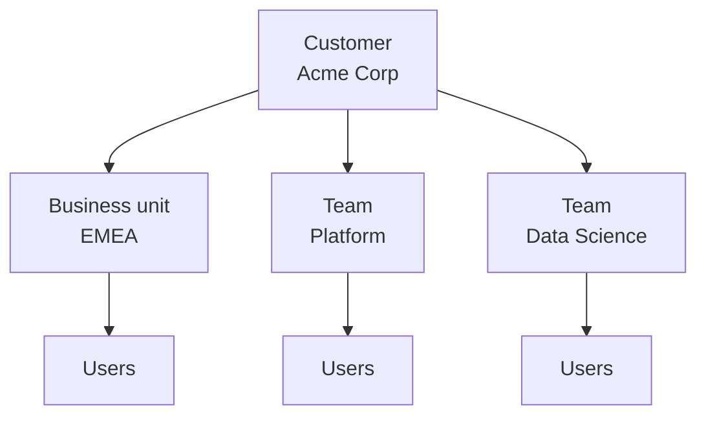

## Overview

Bifrost Enterprise lets you mirror your organization with three kinds of group, on top of individual users:

- **Customers** - The top level. A customer is usually a client, a contract, or a cost center you bill against.
- **Business units** - Groups of people, such as a division or a region (EMEA, Retail Banking).
- **Teams** - Groups of people who work together (Platform, Data Science).

Each group can hold its own policy and budget, own virtual keys, and decide what its members can see. Together they let you answer questions like "how much did EMEA spend this quarter?", "cap the Platform team at \$5,000 a month", and "Acme's contract ceiling is \$20,000; stop all Acme traffic when it's reached."

**Key benefits:**

- **Spend rolls up** - Every request a user makes is charged to their teams, their business units, and the customers above them, so each level sees its true total.
- **Shared and individual caps together** - Combine a per-person budget with a group budget, and both are enforced.
- **Scoped visibility** - With [Data Access Control](/enterprise/data-access-control), a team lead can be limited to their team's data, or an account manager to their customer's.

---

## How the hierarchy fits together



- **A team or business unit can be part of several customers**, and a customer can have any number of teams and business units.
- **Users belong to teams and business units**, as many as they need. A user can be on Platform and Data Science and in EMEA at the same time.
- **Users reach customers through their teams and business units.** There is no direct user-to-customer membership. A user's customers are the customers of every team and business unit they are in.

| | Belongs to | Members | Can own keys | Can hold an access profile |
| --- | --- | --- | --- | --- |
| **Customer** | - | Teams and business units | Yes | Yes |
| **Business unit** | Any number of customers | Users | Yes | Yes |
| **Team** | Any number of customers | Users | Yes | Yes |
| **User** | Any number of teams and business units | - | Yes | Yes (several) |

---

## Access profile

The recommended way to give a team, business unit, or customer a policy and budget is to attach an [access profile](/enterprise/access-profiles#profiles-on-teams-business-units-and-customers). The profile sets which providers and models the group can use, its budgets and rate limits (overall, per provider, and per model), and its MCP tool access. It is **one shared pool** for everyone under the group.

Groups created before access profiles may instead have **legacy budgets and a rate limit** of their own. A group has either a profile or legacy limits, never both. From the group's detail sheet, **Migrate to access profile** moves legacy limits onto a profile and carries current spend across.

| | With an access profile | Legacy limits |
| --- | --- | --- |
| Providers and models allowed | Yes | No, limits only |
| Budgets | Several (overall, per provider, per model) | Teams and customers: several. Business units: one |
| Rate limits | Overall and per provider | One |
| MCP tool access | Yes | No |
| Calendar alignment | Yes | Teams and customers |

---

## What every request is charged against

A request goes through only if **every** budget and rate limit it is charged against has room. The full cost of the request is charged to each of them. Which budgets apply depends on the key or identity used.

### Requests made by a user

When a user calls Bifrost, with their own virtual key or signed in with their own identity, the request is charged against:

1. **One of the user's own access profiles** that allows the model, if they have one (see [who pays](/enterprise/access-profiles#rule-2-one-personal-profile-pays-and-every-group-profile-is-charged)).
2. **Every team** they belong to.
3. **Every business unit** they belong to.
4. **Every customer** above those teams and business units, each counted once even when reached more than one way.

Steps 2 to 4 apply whether the group uses an access profile or legacy limits, and whichever profile allowed the model.

**When the user's own profile doesn't allow the model.** If none of the user's own access profiles allows the model, but the access profile of a team, business unit, or customer they belong to does, the request still goes through. The user's own profiles are not charged. Only the usage of their teams, business units, and customers goes up, and if any of those has run out of budget or rate limit, the request is blocked.

<Note>
	A user on two teams is charged against **both** teams. If either team's budget is spent, the user is blocked until it resets or they
	leave that team.
</Note>

### Requests made with a group-owned key

| Key owned by | Charged against |
| --- | --- |
| **A team** | The key's own limits (if it has no profile), the team, and every customer the team belongs to |
| **A business unit** | The key's own limits (if it has no profile), the business unit, and every customer it serves |
| **A customer** | The key's own limits (if it has no profile), and that customer only |


---

## Virtual key ownership

Every virtual key has **at most one owner**: a user, a team, a business unit, or a customer. A key with no owner isn't scoped to anyone, and under [Data Access Control](/enterprise/data-access-control) only **All data** roles can see it. When a key has an owner, the owner decides:

- **Who pays** - see [what every request is charged against](#what-every-request-is-charged-against).
- **Which access profile governs it** - a key owned by a group with a profile is locked to that profile.
- **Who can see it** - under [Data Access Control](/enterprise/data-access-control), group members with the right scope can see the group's keys.

Choosing a team, business unit, or customer as a key's owner clears any other owner. A key owned by a group can't also be assigned to a user, and the reverse. To move an existing key under a group, open the group's **Virtual Keys** tab and use **Assign Existing**.

---

## Membership

### Managing members

Under **Governance** in the sidebar:

- **Teams** - Click **Create Team** to add one. Open a team to see its **Users**, **Virtual Keys**, **Usage**, and **Customers** tabs. Use **Add User** and **Add Customer** to link them.
- **Business Units** - Click **Create Business Unit**. Open one to see its **Users**, **Customers**, **Virtual Keys**, and **Usage** tabs.
- **Customers** - Create a customer, then open it to see its **Teams**, **Business Units**, **Virtual Keys**, and **Usage** tabs.
- **Users** - A user's **Customers** tab is read-only and shows which team or business unit each customer comes through.
- **Org Chart** - Budgets and usage across business units, teams, and users on one page.

Every detail sheet also has an **Activity** tab and the **Access Profile** field.

### Manual and synced members

Each member is marked **Manual** (added by an admin) or **Synced** (from your identity provider):

- **Synced** members follow your IdP. They are added and removed as the user's groups and attributes change. See [How identity sync works](/enterprise/how-identity-sync-works#teams-and-business-units).
- **Manual** members stay until an admin removes them. If your IdP later grants the same membership, it takes it over and from then on follows the IdP.
- **Customers are never synced** from the IdP. Link teams and business units to customers in the dashboard or `config.json`.

Membership has no per-member roles. What a member can see and do comes from their [role](/enterprise/rbac) and its [data access scope](/enterprise/data-access-control).

---

## Deleting and renaming

| Deleting a | What happens |
| --- | --- |
| **Team** | Its memberships, customer links, access profile, budgets, rate limit, and alert rules are removed. Its keys are kept but no longer owned by the team. |
| **Business unit** | Its memberships, customer links, access profile, budget, rate limit, and alert rules are removed. Its keys are kept but no longer owned by it. |
| **Customer** | Its access profile, budgets, rate limit, and alert rules are removed. Its teams and business units are **not** deleted, only unlinked. Its keys are kept but no longer owned by it. |

Business unit names can't be changed, and team names are fixed in the dashboard. A team or business unit created from an IdP group follows that group's renames when it is mapped with a wildcard rule.

---

## Declaring the hierarchy in config.json and Helm

Customers, teams, and business units can be declared under `governance`, each optionally naming an `access_profile`:

```json
{
	"governance": {
		"customers": [{ "id": "customer-acme", "name": "Acme Corp", "access_profile": "Acme Contract" }],
		"teams": [{ "id": "team-platform", "name": "Platform", "customer_id": "customer-acme", "access_profile": "Platform Pool" }],
		"business_units": [{ "id": "bu-emea", "name": "EMEA", "access_profile": "EMEA Pool" }]
	}
}
```

- A team's `customer_id` links it to one customer. Link additional customers, and link business units to customers, from the dashboard.
- Memberships are not declared in `config.json`. They come from the dashboard, the API, or your identity provider.
- Virtual keys name their owner with `team_id`, `business_unit_id`, or `customer_id` (only one).

See [config.json governance](/deployment-guides/config-json/governance) and [Helm governance](/deployment-guides/helm/governance) for the full field list.

---

## Examples

### Department budgets that roll up to a contract

1. Create the customer **Acme** and attach "Acme Contract" with a \$20,000 monthly ceiling.
2. Create the teams **Platform** (\$5,000) and **Data Science** (\$8,000), each with its own profile, and link both to Acme.
3. A Platform engineer's request is charged to Platform and to Acme. Platform stops at \$5,000; all of Acme stops at \$20,000 combined.

### Regional cost reporting

Create business units for each region and sync membership from your IdP's `department` or `region` attribute. Every request is charged to the user's region, so **Usage** on each business unit shows that region's total, without changing any keys.

### A shared service key for a team

Create a virtual key owned by the Platform team for a CI pipeline. It draws from Platform's budget and Acme's, and every Platform member with team-level visibility can see it.

---

## Next steps

- **[Access Profiles](/enterprise/access-profiles)** - Policies and budgets for users and groups, and who pays when several apply.
- **[Data Access Control](/enterprise/data-access-control)** - What each operator can see in their teams, business units, and customers.
- **[How Identity Sync Works](/enterprise/how-identity-sync-works)** - Keep membership in sync with your identity provider.
- **[Budget and Limits](/features/governance/budget-and-limits)** - Budget and rate-limit concepts shared across Bifrost.
