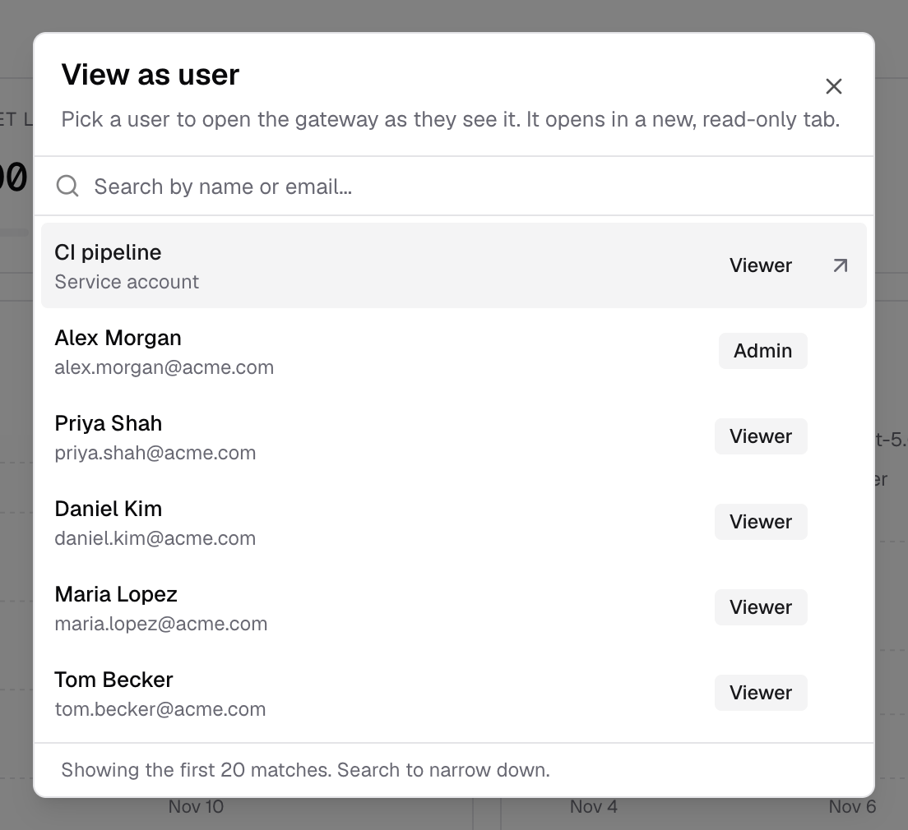
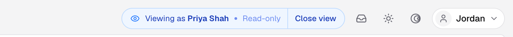

## Overview

View as User lets an admin open the Bifrost dashboard as a chosen user and see what that user sees. The view opens in a new browser tab and is read-only.

Your own dashboard is built from your role, your [access profiles](/enterprise/access-profiles) and your [data access scope](/enterprise/data-access-control). A user with a different role sees a different set of models, logs, budgets and pages. View as User shows you that set directly, so you can answer "why can't I see X?" without a screen share or a test account.

In a view tab:

- [RBAC](/enterprise/rbac) permissions, data access scope and `/me` resolve as the viewed user.
- Only `GET`, `HEAD` and `OPTIONS` requests are allowed. Every write is refused with `403`.
- Your original tab is unchanged and keeps your own access.

<Info>
	View as User is available in Bifrost Enterprise from v2.4.0.
</Info>

---

## Who can use it

Starting a view needs the **Users → ViewAs** permission. The `ent_add_users_view_as_permission` migration adds it and grants it to the **Admin** role only. To let another role use it, enable **ViewAs** on the **Users** resource in **Governance** → **Roles & Permissions**. See [Managing Permissions](/enterprise/rbac#managing-permissions).

The permission is checked on every request in a view tab, not only when the view starts. If you lose it, the next request in the view tab returns `403`.

A local admin signed in with a password session can also start a view. The audit log records the actor as `local-admin`.

---

## Start a view

You can start a view from three places:

- **Top bar:** open the user menu, choose **View as user**, search by name or email, and pick the user.
- **Users list:** open the row menu (•••) on a user and choose **View as user**.
- **User detail sheet:** click **View as user**.



Bifrost opens a new tab on **Home** as that user. The option is hidden for your own account, and inside a view tab, so you can't start a view from a view.

---

## What the view tab shows

The view tab shows the dashboard as the viewed user gets it:

- **Pages and actions** follow the user's role. Pages they can't open are hidden or show the same access message they would see.
- **Data** follows the user's data access scope. Logs, MCP logs, virtual keys, users and dashboards list only the records that user can see.
- **Home** shows the user's own usage, budgets, models and MCP servers.

To mark the tab, the center of the top bar shows a **Viewing as** pill with the user's name and a **Read-only** badge, and the browser tab title starts with **Viewing as** and the user's name. The user menu shows **Close view** in place of **Sign out**.



The view belongs to that tab only. Opening another tab, or returning to your original one, gives you your own session.

<Tip>
	Keep both tabs open while you debug. Change the setting in your own tab, then reload the view tab to check the result from the user's side.
</Tip>

---

## End a view

Click **Close view** in the pill, or choose **Close view** from the user menu, or close the tab. Nothing is stored on the server, so there is nothing else to undo. If the browser doesn't allow the tab to close itself, it returns to your own **Home** page.

---

## Limits

View as User is for reading. These limits are enforced by the gateway, not only by the UI:

| Request in a view tab | Result |
|---|---|
| `GET`, `HEAD` or `OPTIONS` | Runs as the viewed user |
| Any other method (`POST`, `PUT`, `PATCH`, `DELETE`) | `403` "View-as mode is read-only" |
| Authenticated with a Bifrost API key | `403` "View-as is not available for API keys" |
| Caller without **Users → ViewAs** | `403` |
| Viewed user does not exist | `404` "User not found" |

Some behavior to expect in a view tab:

- **Reads sent as `POST` are refused.** A page that loads its data with a `POST` request shows an error in the view tab, even though the user can open it normally.
- **Live updates aren't switched.** Updates the dashboard receives over its WebSocket connection, such as new rows streaming into the logs table, are not scoped to the viewed user. Reload the page to see the user's current list.
- **Inference isn't covered.** View as User applies to dashboard sessions. It doesn't let you send model, MCP or agent requests as another user.

---

## Audit

Starting a view writes a `user.view_as_started` event to the [audit log](/enterprise/audit-logs). The actor is the admin who started the view, and the resource is the viewed user, identified by ID and email.

Only the start is recorded. Individual pages read during the view are not audited one by one.

---

## API

The dashboard uses two calls, which you can also make with a dashboard session token. Bifrost API keys can't use them.

**Start a view.** Confirms the user exists and writes the audit event. It changes nothing else.

```bash
curl -X POST http://localhost:8080/api/governance/users/view-as \
  -H "Authorization: Bearer <session_token>" \
  -H "Content-Type: application/json" \
  -d '{"user_id": "<user_id>"}'
```

```json
{
  "user_id": "<user_id>",
  "name": "Jane Doe",
  "email": "jane@example.com"
}
```

It returns `400` when `user_id` is missing and `404` when the user doesn't exist.

**Read as the user.** Add the `X-Bifrost-View-As` header with the user's ID to any read request:

```bash
curl http://localhost:8080/api/governance/users/me \
  -H "Authorization: Bearer <session_token>" \
  -H "X-Bifrost-View-As: <user_id>"
```

The header is listed in the gateway's default CORS allowed headers, so a dashboard served from another origin can send it.

---

## Next steps

- **[Role-Based Access Control](/enterprise/rbac)** - Decide what each role can do
- **[Data Access Control](/enterprise/data-access-control)** - Decide which records each role can see
- **[Access Profiles](/enterprise/access-profiles)** - Attach provider, model and budget policies to users, teams and roles
- **[Audit Logs](/enterprise/audit-logs)** - Review who started a view and when
