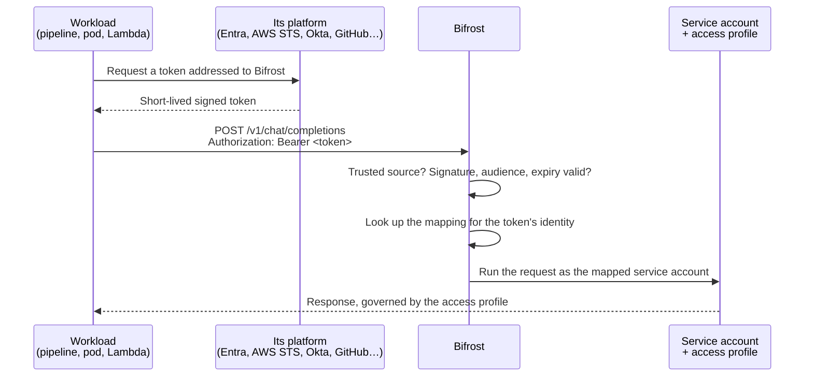

A CI pipeline, an AKS service, an AWS Lambda or an internal batch job usually calls Bifrost with a virtual key. That key is a long-lived secret: someone has to store it in the workload, rotate it, and revoke it when it leaks.

With **workload identity**, service accounts don't need a virtual key. You map a workload to a **service account**, and the workload calls Bifrost with a short-lived token that its own platform already gives it, such as an Entra managed identity token, an AWS STS token or a GitHub Actions OIDC token. Bifrost checks that the token comes from a source you trust, finds the service account it is mapped to, and runs the request as that service account. The service account's access profile decides the models, MCP tools, budget and rate limits, and logs and audit entries name it.

<Info>
  Workload identity is about callers authenticating **to** Bifrost. It is separate from how Bifrost authenticates to model providers, such as IRSA or GKE Workload Identity for Bedrock and Vertex AI.
</Info>

## How it works



Three pieces make this work:

| Piece | What it is | Where you set it |
|---|---|---|
| **Token source** | Who issues the tokens Bifrost accepts: a **trusted issuer** (an AWS account, Okta, Auth0, Keycloak, a Kubernetes cluster, GitHub Actions or any OIDC provider), or **Azure workload identity federation** when your SSO is Microsoft Entra. | **User Provisioning**, on the SSO provider |
| **Service account** | A non-human Bifrost user. Its access profile governs what the workload may do. | **Governance → Users** |
| **Workload identity** | A mapping from one workload, named by a claim in its token, to one service account. | The service account's **Workload identities** tab |

Workload identities only ever map to service accounts, never to people.

## How tokens map to service accounts

Each token source names the workload with one claim. That value is what you enter when you map the workload, and it decides which service account the request runs as.

| Token source | Claim that names the workload | Example value | Matched |
|---|---|---|---|
| AWS trusted issuer | `sub`, the IAM role or user ARN | `arn:aws:iam::123456789012:role/payments-batch` | Exactly |
| Generic OIDC trusted issuer | The **workload ID claim** you choose, such as `cid`, `azp` or `sub` | `0oa1b2c3d4e5f6g7h8i9` or `repo:acme/payments:ref:refs/heads/main` | Exactly |
| Azure workload identity federation | `oid`, the service principal's object ID | `6a1f0c3e-2b4d-4f8a-9c7e-5d3b2a1f0e9d` | Ignoring case |

A workload maps to one service account, and several workloads can map to the same one. For example, the AKS pod, the Lambda and the deploy workflow behind one payments service can all run as a `payments-api` service account:

<Frame caption="One service account with three workloads mapped to it, one from each kind of token source.">
  
</Frame>

## Before you start

- Create a service account for the workload under **Governance → Users**, and attach an access profile that grants the models and tools it needs. A service account with no access profile is refused by governance, as for any user without one.
- Make sure you have the [permissions](#permissions) to set up token sources and map workloads.

Workload identity turns on once at least one mapping exists. Until then, every request goes through the rest of authentication unchanged, and virtual keys keep working throughout, so you can move workloads over one at a time.

## Set up a token source

Token sources are part of your SSO provider's settings. Open **Governance → User Provisioning**, select the gear on the **Connection** card, and scroll to **Workload identity** at the end of **Provider Configuration**.

<Frame caption="The Workload identity section of an Entra SSO provider: Azure workload identity federation on top, then the additional trusted issuers. With any other SSO provider, only the trusted issuers appear.">
  
</Frame>

Pick the tab for where your workloads get their tokens. You can use both: with Entra SSO, Azure workloads come through Azure workload identity federation and everything else through trusted issuers.

<Tabs>

<Tab title="Trusted issuers">

A **trusted issuer** is a token issuer, other than your SSO provider's own sign-in, whose workload tokens Bifrost accepts. Trusted issuers work with every SSO provider, not only Entra. Bifrost trusts only the issuers you add, by exact URL: adding an AWS account trusts that account's tokens, never AWS as a whole.

Under **Additional trusted issuers**, select **Add issuer** and fill in:

| Field | What to enter |
|---|---|
| **Name** | A name unique among this provider's issuers, ignoring case, such as `AWS prod`. Mappings refer to the issuer by this name, and **Token from** lists it. |
| **Kind** | **AWS** or **Generic OIDC**, as in the tabs below. |
| **Issuer URL** | The issuer exactly as its tokens carry it in `iss`. It must be https (http only on localhost) with no user info, query or fragment. |
| **Audiences** | What workloads request their tokens for, usually Bifrost's own URL. Separate several with commas. A token must carry one of them in `aud`. |
| **Workload ID claim** | Generic OIDC only. The claim whose value you enter when mapping a workload. AWS always uses `sub`. |

Select **Test** next to the issuer URL before you save. Bifrost fetches the issuer's discovery document and signing keys, and if that fails it says why, such as an HTTP error, a discovery document naming another issuer, or an address the gateway's outbound network policy blocks. To stop accepting an issuer's tokens without losing its mappings, turn off **Trust this issuer**, the switch on its row.

<Tabs>

<Tab title="AWS">

With AWS IAM outbound identity federation, any workload that runs as an IAM role or user, such as a Lambda function, ECS task, EC2 instance or EKS pod, can ask AWS STS for a signed JWT addressed to Bifrost. The token's `sub` is the ARN of that role or user, and that ARN is what you map. Add one issuer per AWS account.

<Steps>

<Step title="Turn on outbound identity federation">

Do this once per AWS account, in the IAM console under **Account settings → Outbound web identity federation**, or with the AWS CLI:

```bash
aws iam enable-outbound-web-identity-federation
```

AWS returns the account's issuer URL, of the form `https://<id>.tokens.sts.global.api.aws`. Read it again at any time with `aws iam get-outbound-web-identity-federation-info`.

</Step>

<Step title="Add the account as a trusted issuer">

Add an issuer with the **AWS** kind, a name such as `AWS prod`, the account's issuer URL, and Bifrost's URL as the audience. Select **Test**, then save the provider.

<Frame caption="An AWS account trusted as an issuer. The AWS kind always names a workload by the token's sub claim.">
  
</Frame>

</Step>

<Step title="Let the role request tokens">

Add `sts:GetWebIdentityToken` to the policy of the role the workload runs as: the Lambda execution role, ECS task role, EC2 instance profile or EKS pod role.

```json
{
  "Version": "2012-10-17",
  "Statement": [{ "Effect": "Allow", "Action": "sts:GetWebIdentityToken", "Resource": "*" }]
}
```

</Step>

<Step title="Map the role to a service account">

[Add a workload identity](#map-a-workload-to-a-service-account) with your AWS issuer and the **IAM role or user ARN** exactly as IAM shows it, including the case of the name.

<Frame caption="Mapping an IAM role to a service account.">
  
</Frame>

Use the role's ARN, not a role session's. `aws sts get-caller-identity` run inside a role prints a session ARN such as `arn:aws:sts::123456789012:assumed-role/payments-batch/session`; Bifrost refuses it and tells you which role's ARN to copy from the IAM console.

</Step>

<Step title="Call Bifrost from the workload">

The workload requests a token from a regional STS endpoint and sends it as the bearer token:

```python
import boto3
import requests

sts = boto3.client("sts", region_name="us-east-1")
token = sts.get_web_identity_token(
    Audience=["https://bifrost.example.com"],
    SigningAlgorithm="RS256",
    DurationSeconds=300,
)["WebIdentityToken"]

requests.post(
    "https://bifrost.example.com/v1/chat/completions",
    headers={"Authorization": f"Bearer {token}"},
    json={"model": "openai/gpt-4o-mini", "messages": [{"role": "user", "content": "ping"}]},
)
```

Request a new token before the current one expires. `GetWebIdentityToken` is not available on the global STS endpoint, and needs a recent AWS SDK.

</Step>

</Steps>

- **A recreated role has the same ARN.** If a role is deleted and another is created with the same name, its tokens match the same mapping. Disconnect the mapping when you retire a role.
- **Once roles are mapped on an issuer, its URL can't change.** Add a new account as another issuer.

</Tab>

<Tab title="Generic OIDC">

Any OIDC issuer can be a **Generic OIDC** trusted issuer, as long as it publishes a discovery document and signing keys Bifrost can reach. That covers identity providers with a client-credentials flow and platforms that hand their workloads an OIDC token. You choose the **workload ID claim**, the claim whose value names a workload, such as a client ID or `sub`. Its value is matched exactly, including case.

<Steps>

<Step title="Make tokens addressed to Bifrost">

Configure the issuer so the workload's tokens carry Bifrost's URL, or another audience you choose, in `aud`, and a claim that names the workload.

</Step>

<Step title="Add the issuer">

Add an issuer with the **Generic OIDC** kind, the issuer URL exactly as tokens carry it in `iss`, the audience, and the **Workload ID claim**. Select **Test**, then save the provider.

<Frame caption="A Generic OIDC issuer after a successful test, naming workloads by their sub claim.">
  
</Frame>

Bifrost takes a token from a generic issuer only when its workload ID is mapped to a service account. Every other token, including your people's when the same provider runs your SSO, goes to the normal sign-in path untouched, so a generic issuer usually needs no rule.

The exception is your SSO app's own client ID. People's tokens carry it too, so mapping it would let anyone who signs in run as that service account. To map it, turn on **Tell people's tokens apart with a rule** and set a rule that only workload tokens pass, such as the client ID claim equals the token's `sub`:

<Frame caption="A rule that accepts only tokens where cid equals the token's sub, which holds for client-credentials tokens but not for a person's.">
  
</Frame>

Without the rule, Bifrost refuses that mapping, and refuses a provider save that removes the rule while such a mapping exists. A mapping that loses its rule another way, such as through `config.json`, shows **Needs a people rule** and takes no tokens until the rule is back.

</Step>

<Step title="Map the workload to a service account">

[Add a workload identity](#map-a-workload-to-a-service-account) with the issuer and, as **Workload identifier**, the value of the workload ID claim in the workload's token.

<Frame caption="Mapping a workload by the value of its token's workload ID claim.">
  
</Frame>

</Step>

<Step title="Call Bifrost">

The workload gets a token from its issuer and sends it as the bearer token:

```bash
# TOKEN is a token from the trusted issuer, addressed to Bifrost.
curl https://bifrost.example.com/v1/chat/completions \
  -H "Authorization: Bearer $TOKEN" \
  -H "Content-Type: application/json" \
  -d '{"model": "openai/gpt-4o-mini", "messages": [{"role": "user", "content": "Hello"}]}'
```

</Step>

</Steps>

</Tab>

</Tabs>

**How mappings follow an issuer.** Mappings refer to an issuer by its name, and each records the issuer's kind, URL and workload ID claim from when it was made, so a mapping never silently moves to a different issuer:

- While any workload is mapped on an issuer, Bifrost refuses a provider save that changes its kind, issuer URL or workload ID claim. Disconnect those mappings first, or add the new issuer under another name.
- Renaming or removing an issuer is allowed. Its mappings take no tokens, and show the issuer as turned off or removed, until an issuer with that name is back.
- If an issuer changes anyway, for example in `config.json`, its mappings show that the issuer changed and take no tokens until you map the workloads again.

Trusted issuers are saved with the provider, so they are replaced if you switch to another identity provider. They can also be set in `config.json` or Helm; see [Declarative configuration](#declarative-configuration).

</Tab>

<Tab title="Azure Workload Identity Federation">

With Azure workload identity federation, a workload calls Bifrost with an **app-only access token** that Microsoft Entra issues for the Bifrost SSO app registration. This covers AKS services using Azure workload identity, Azure VMs and Functions with a managed identity, and Azure DevOps or GitHub pipelines that sign in to Entra with federated credentials. The token's `oid`, the object ID of the workload's service principal, is what you map. There is no issuer to add: Bifrost already trusts your Entra tenant through SSO.

<Card title="Prerequisite: Microsoft Entra SSO" icon="microsoft" href="/enterprise/setting-up-entra/oidc" horizontal>
  Azure workload identity federation reuses your Entra SSO configuration: the same tenant and app registration. Set up Entra SSO first.
</Card>

- Entra must be your SSO provider, with a single tenant. Multi-tenant (`common`) configurations are not supported.
- To pick workloads from Entra in the dashboard, grant the app registration the **Application.Read.All** Graph application permission, as in Step 5 of the [Entra SSO setup](/enterprise/setting-up-entra/oidc). Without it, paste object IDs instead.

Once Entra SSO is set up, the provider's **Workload identity** section shows that Azure workload identity federation is available, and the scope workloads request tokens for.

<Steps>

<Step title="Expose the Bifrost app to applications">

Workloads request a token for the Bifrost app registration, so it needs an identifier. In the Entra admin center, open **App registrations**, select the Bifrost SSO app, and under **Expose an API** set the **Application ID URI**. Entra suggests `api://<client ID>`, which Bifrost accepts as is. If you choose another, such as `api://bifrost`, enter the same value as **App ID URI** in Bifrost's Entra SSO settings.

</Step>

<Step title="Assign the workload to the Bifrost app">

The [Entra SSO setup](/enterprise/setting-up-entra/oidc#step-7-enable-assignment-requirement) turns on **Assignment required**, so Entra issues a token for Bifrost only to people and apps assigned to it. A workload is assigned through an app role:

1. In the Bifrost app registration, open **App roles** and create a role with **Allowed member types** set to **Applications**, for example with the value `Bifrost.Workload`.
2. Assign that role to the workload's service principal. Managed identities can't be assigned in the portal, so use Microsoft Graph:

```bash
BIFROST_SP=$(az ad sp show --id <Bifrost client ID> --query id -o tsv)
ROLE_ID=$(az ad sp show --id <Bifrost client ID> --query "appRoles[?value=='Bifrost.Workload'].id" -o tsv)
az rest --method POST \
  --uri "https://graph.microsoft.com/v1.0/servicePrincipals/<workload object ID>/appRoleAssignments" \
  --body "{\"principalId\": \"<workload object ID>\", \"resourceId\": \"$BIFROST_SP\", \"appRoleId\": \"$ROLE_ID\"}"
```

Without the assignment, Entra refuses the workload's token request with `AADSTS501051`.

</Step>

<Step title="Map the workload to a service account">

[Add a workload identity](#map-a-workload-to-a-service-account) with **Azure workload identity federation**. Under **Workload**, search Entra for the managed identity or app by name, or select **Enter an object ID instead** and paste its service principal's object ID. Use the object ID, not the application (client) ID: Bifrost refuses a client ID and names the object ID to use.

<Frame caption="Mapping a managed identity by its object ID.">
  
</Frame>

For a managed identity, the object ID is its **principal ID** (`az identity show --name <identity> --resource-group <rg> --query principalId -o tsv`). For an app registration, it is the object ID of its service principal under **Enterprise applications** (`az ad sp show --id <app client ID> --query id -o tsv`), not the app registration's own object ID.

</Step>

<Step title="Call Bifrost from the workload">

The workload requests a token for the scope Bifrost shows in the provider's **Workload identity** section: your App ID URI plus `/.default`. The examples assume `api://bifrost/.default`. The workload must sign in as itself, the managed identity or app you mapped; a token a person gets after a normal sign-in carries that person's identity and goes through the normal sign-in path instead.

```bash
# Sign in as the workload, not as yourself. On an Azure resource with a managed
# identity; add --client-id <managed identity client ID> for a user-assigned one.
az login --identity --allow-no-subscriptions

TOKEN=$(az account get-access-token --scope api://bifrost/.default --query accessToken -o tsv)
curl https://bifrost.example.com/v1/chat/completions \
  -H "Authorization: Bearer $TOKEN" -H "Content-Type: application/json" \
  -d '{"model": "openai/gpt-4o-mini", "messages": [{"role": "user", "content": "ping"}]}'
```

An app registration with a federated credential signs in with `az login --service-principal --username <app client ID> --tenant <tenant ID> --federated-token "$(cat "$AZURE_FEDERATED_TOKEN_FILE")" --allow-no-subscriptions` instead.

</Step>

</Steps>

**Troubleshooting**

<AccordionGroup>

<Accordion title="401 invalid workload identity token">
The token is expired, was issued for another app, or is valid for over 24 hours. Check that the scope is the Bifrost app's App ID URI or client ID with `/.default`. If the app registration issues v1 tokens (`accessTokenAcceptedVersion` unset or 1), the token's audience is the App ID URI: Bifrost accepts `api://<client ID>` on its own, and any other App ID URI once it is set in Bifrost's Entra SSO settings.
</Accordion>

<Accordion title="403 not connected to a Bifrost service account">
The message includes the token's object ID. Map it to a service account.
</Accordion>

<Accordion title="Entra refuses the token request with AADSTS501051">
The workload isn't assigned to the Bifrost app. Assign it an app role, as above. Don't turn **Assignment required** off to get around this: that also lets every person in your tenant sign in to Bifrost through SSO.
</Accordion>

<Accordion title="The workload isn't in the Entra search">
Without a search, Bifrost lists managed identities and apps registered in your tenant; search by name to find others, or paste the object ID. The list needs the app registration's **Application.Read.All** permission.
</Accordion>

<Accordion title="The token runs as a person, or is refused as one">
It was requested after a person's sign-in, such as a plain `az login`. Sign in as the managed identity or app instead. A person's SSO is unaffected: workload identity only takes app-only tokens, and a person's token always carries the `scp` claim.
</Accordion>

</AccordionGroup>

</Tab>

</Tabs>

## Map a workload to a service account

<Steps>
  <Step title="Open the service account's Workload identities tab">
    Under **Governance → Users**, select the service account. Open **Workload identities**; when the sheet is narrow, it sits in the overflow menu at the end of the tab bar.

    <Frame caption="The Workload identities tab appears only on service accounts.">
      
    </Frame>
  </Step>
  <Step title="Choose where the token comes from">
    Select **Add workload identity**. **Token from** lists every trusted issuer that is turned on, by name, and Azure workload identity federation when your SSO is Entra.

    <Frame caption="Token from lists every source Bifrost can accept tokens from.">
      
    </Frame>

    If no source is set up yet, the form says so instead of showing the list.
  </Step>
  <Step title="Identify the workload">
    Enter the value the token carries:

    | Token from | Field | Enter |
    |---|---|---|
    | An AWS issuer | **IAM role or user ARN** | The ARN exactly as IAM shows it, such as `arn:aws:iam::123456789012:role/payments-batch`. |
    | A Generic OIDC issuer | **Workload identifier** | The value of the issuer's workload ID claim, such as a client ID or a `sub`. |
    | Azure workload identity federation | **Workload** | Pick the managed identity or app from Entra, or select **Enter an object ID instead** and paste its service principal's object ID. |

    **Name** is optional and defaults to the workload's name. Select **Add**.
  </Step>
</Steps>

The workload can call Bifrost straight away, and its requests appear in the logs under the service account.

- **Turn a mapping off** with its **Enabled** switch to stop accepting the workload's tokens without losing the mapping.
- **Disconnect** a workload from its row menu to remove the mapping. Deleting a service account removes all of its mappings.
- **Automate** mappings through the API at `/api/governance/users/{user_id}/workload-identities`. Mappings can't be set in `config.json` or Helm; trusted issuers can.

## Declarative configuration

Trusted issuers can live in `config.json`, or in Helm values under `bifrost.scim.config`, on the SSO provider under `workloadIdentity.additionalTrustedIssuers`.

```json
{
  "scim_config": {
    "enabled": true,
    "provider": "okta",
    "config": {
      "issuerUrl": "https://acme.okta.com",
      "clientId": "env.OKTA_CLIENT_ID",
      "clientSecret": "env.OKTA_CLIENT_SECRET",
      "workloadIdentity": {
        "additionalTrustedIssuers": [
          {
            "name": "AWS prod",
            "kind": "aws",
            "issuerUrl": "https://<id>.tokens.sts.global.api.aws",
            "audiences": ["https://bifrost.example.com"]
          },
          {
            "name": "GitHub Actions",
            "kind": "generic",
            "issuerUrl": "https://token.actions.githubusercontent.com",
            "audiences": ["https://bifrost.example.com"],
            "identityClaim": "sub",
            "machineCheck": { "kind": "any" }
          },
          {
            "name": "Okta workloads",
            "kind": "generic",
            "issuerUrl": "https://acme.okta.com/oauth2/default",
            "audiences": ["api://bifrost"],
            "identityClaim": "cid",
            "machineCheck": { "kind": "sub_equals_claim", "claim": "cid" }
          }
        ]
      }
    }
  }
}
```

| Field | Notes |
|---|---|
| `name`, `kind`, `issuerUrl`, `audiences` | Required. `kind` is `aws` or `generic`. |
| `identityClaim` | Required for `generic`; AWS always uses `sub`. |
| `machineCheck` | Required for `generic`. `{"kind": "any"}` takes only tokens whose workload ID is mapped. A rule is `sub_equals_claim`, `claim_equals` or `claim_prefix` with its `claim` and, for the last two, a non-empty `value`. |
| `maxLifetimeSeconds` | Optional cap on a token's total lifetime, between 300 and 172800. The default is 24 hours. |
| `disabled` | Optional. `true` keeps the issuer and its mappings but refuses its tokens. |

## What Bifrost checks on every request

1. The token comes from a source Bifrost trusts: its `iss` matches a trusted issuer's URL exactly, or your Entra tenant.
2. It is addressed to Bifrost: its audience is one the source is configured with.
3. It belongs to a workload. A generic issuer takes only tokens whose workload ID is mapped, or that pass its rule when it has one. Entra takes only app-only tokens. Anything else, including a person's token, is left to the normal sign-in path, even when the same identity provider runs your SSO.
4. The signature verifies against the source's published keys, and the token is unexpired and valid for no longer than the source's lifetime cap (24 hours by default).
5. A mapping exists for the token's identity, it is turned on, and its source hasn't changed since it was made.
6. The request runs as the mapped service account. The token is removed from the request, so it is never forwarded to a provider.

<Info>
  Tokens are verified on every request and are never stored. A workload's access ends when its token expires and it can't get a new one, or as soon as you turn off or disconnect its mapping.
</Info>

## Responses

| Status | When |
|---|---|
| `400` | A virtual key was sent together with a workload token. Send one credential. |
| `401` | The token is invalid: bad signature, expired, issued for another audience, or valid for longer than the source's lifetime cap. Get a new token. |
| `403` | The token is valid, but no service account is mapped to it, the mapping or issuer is turned off, the issuer changed since the mapping was made, or the service account was deleted. An admin needs to act. |
| `503` | Bifrost couldn't fetch the source's signing keys. Retry after the `Retry-After` delay. |

## MCP gateway

Workload tokens work on `/mcp` too, governed by the service account's access profile like any other request. When the MCP gateway's auth mode is **OAuth only**, it accepts only tokens Bifrost issued, so workload tokens are refused there.

## Permissions

| Action | Permission |
|---|---|
| View a service account's workload identities | **Users → View** |
| Add, change or disconnect a mapping, and search Entra for workloads | **User Provisioning → `UpdateWorkloadIdentities`** |
| Add, change or test trusted issuers | **User Provisioning → Update** |

A mapping lets whoever holds the workload's token act as the service account, so it has its own permission. Admins have it by default; grant it to other roles explicitly. **Users → Update** alone is not enough.
