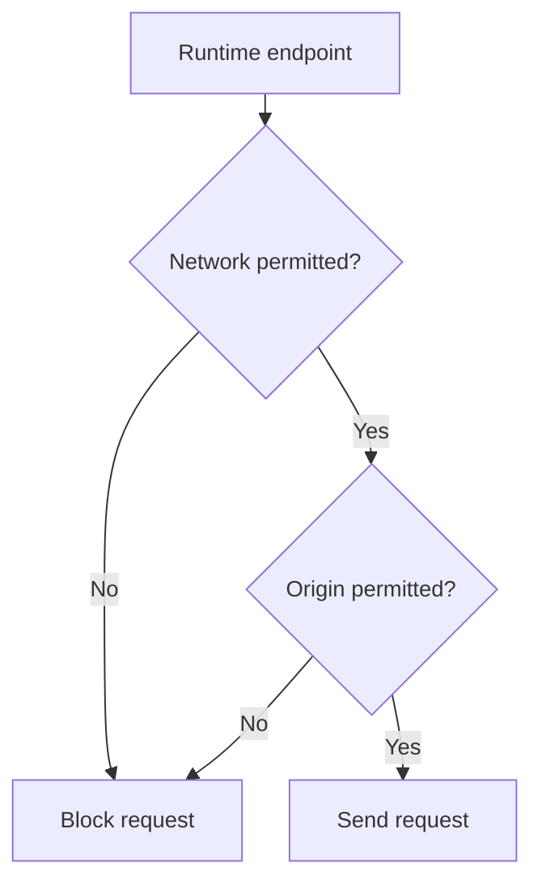
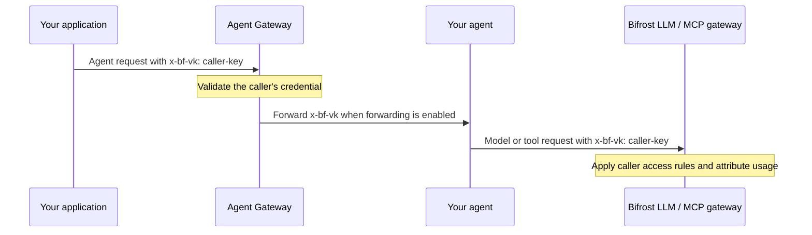

A request can cross several authentication boundaries. Configure each one for the service receiving it.

| Who is connecting? | What authenticates the call? | Where do you set it? |
| --- | --- | --- |
| Your application calls an agent through Bifrost | Your application's Bifrost virtual key or supported enterprise identity | Send it with the request from your application. |
| Bifrost fetches the agent card | Credentials required by the server hosting the card, if it is protected | **Card fetch options** in the registration form. |
| Bifrost sends work to your agent | Credentials required by your agent's API | **Request authentication** in the registration form. |
| Your agent calls Bifrost for models or tools | A Bifrost credential sent by your agent, such as the caller's forwarded virtual key | Configure your agent server to send it on its LLM and MCP requests. |

The Agent Card is an A2A discovery document. It describes what an agent can do, where to call it, and which authentication its requests require. Bifrost needs to fetch that document before it can read those requirements.

## Fetch a protected card

In **Agent Gateway**, add or edit an agent. Expand the card options next to the Agent Card URL and configure authentication before fetching the card.

<Frame>
  
</Frame>

Choose **No authentication** for a public card, **Headers** for a token or custom header, or **OAuth 2.0 client credentials** when Bifrost must obtain an access token.

Using `env.` or `vault.` references for card credentials, request credentials, or TLS settings requires dashboard authentication when inspecting, creating, or editing an agent. Preserving stored secrets through masked placeholders on an update also requires dashboard authentication. Operator declarations in config.json can use secret references even when dashboard authentication is disabled.

<Note>
Card authentication only authenticates the card fetch. Configure request authentication separately, even if both connections use the same credential.
</Note>

## Authenticate agent requests

After you fetch the card, **Request authentication** selects the authentication type and required fields advertised by the agent. Enter the credentials your agent expects in those fields. For example, a card advertising bearer authentication adds an `Authorization` field where you enter `Bearer YOUR_AGENT_TOKEN`.

<Frame>
  
</Frame>

If the card offers alternatives, select a **Card requirement**. Names joined with `+` are requirements that must be satisfied together.

<Frame>
  
</Frame>

| Type | What to supply |
| --- | --- |
| Headers | The required header values, such as `Authorization: Bearer …` or `X-Agent-Key` |
| OAuth 2.0 client credentials | Client ID, client secret, token endpoint or discovery information, and any required scopes or resource |
| No authentication | No runtime credential. Custom TLS can still be configured. |

### Additional agent endpoints

The card's origin is automatically permitted for runtime requests. If the card advertises a runtime endpoint on another origin, add that origin under **Additional agent endpoints** in the agent's create or edit form. Every runtime endpoint must pass this check, even when no request authentication is configured, because callers can supply their own upstream credential headers.

An origin includes the scheme, hostname, and port. For example, `https://research.internal:9000` permits that service. It does not permit `http://research.internal:9000` or `https://research.internal:9443`. Do not include a path, query, fragment, username, or password.



The origin check protects configured runtime authentication, caller-provided upstream headers, the caller's accepted Bifrost credential when forwarding is enabled, and runtime TLS client certificates. A private destination also needs permission in the global [Private Network Allowlist](./configuration#permit-private-agent-destinations). Adding a credential origin does not grant private-network access.

For a bare gRPC target such as `research.internal:9000`, use `https://research.internal:9000` as the credential origin because the bare target uses TLS. Default ports match their implicit forms, so `https://research.example.com:443` and `https://research.example.com` identify the same origin.

For a card at `https://cards.example.com/.well-known/agent-card.json` that advertises `https://research.internal:9000`, configure both:

| Setting | Value |
| --- | --- |
| Agent Settings → Private Network Allowlist | `research.internal` |
| Agent registration → Additional agent endpoints | `https://research.internal:9000` |

<Tabs group="config-method">
<Tab title="Web UI">
After fetching the card, expand **Additional agent endpoints** under **Request authentication**. A red approval badge identifies advertised addresses outside the card's origin. Select **Allow** for each address you trust. Pending suggestions stay above added endpoints.

Approved card addresses appear as read-only labels with a remove button. Select **Add endpoint** to enter another origin manually; these entries remain editable. Save the registration to apply the changes. Suggestions are not granted automatically.

The section links to **Agent Settings** because private addresses also need permission in the global Private Network Allowlist. Supplying additional origins requires dashboard authentication.

The example below uses a local card with separate HTTP and gRPC interfaces to show a pending suggestion, an approved address, and a manually entered endpoint. Replace these addresses with your agent's origins.

<Frame>
  
</Frame>
</Tab>
<Tab title="API">
Include `credential_origins` in an authenticated `POST /api/agents` or `PUT /api/agents/{name}` request. Updates replace the registration, so include the authentication and access settings you intend to keep.

```json
{
  "name": "library-research",
  "agent_card_url": "https://cards.example.com/.well-known/agent-card.json",
  "enabled": true,
  "credential_origins": ["https://research.internal:9000"],
  "runtime_auth": {
    "type": "headers",
    "advanced": true,
    "headers": {
      "Authorization": "env.RESEARCH_AGENT_AUTHORIZATION"
    }
  }
}
```

See the [registration API reference](/api-reference/agent-gateway/register-agent) for the complete request.
</Tab>
<Tab title="config.json">
```json
{
  "client": {
    "a2a_private_allowlist": ["research.internal"]
  },
  "agents": [
    {
      "name": "library-research",
      "agent_card_url": "https://cards.example.com/.well-known/agent-card.json",
      "credential_origins": ["https://research.internal:9000"],
      "runtime_auth": {
        "type": "headers",
        "advanced": true,
        "headers": {
          "Authorization": "env.RESEARCH_AGENT_AUTHORIZATION"
        }
      }
    }
  ]
}
```
</Tab>
<Tab title="Helm">
```yaml
bifrost:
  client:
    a2aPrivateAllowlist:
      - research.internal
  agents:
    - name: library-research
      agent_card_url: https://cards.example.com/.well-known/agent-card.json
      credential_origins:
        - https://research.internal:9000
      runtime_auth:
        type: headers
        advanced: true
        headers:
          Authorization: env.RESEARCH_AGENT_AUTHORIZATION
```
</Tab>
</Tabs>

| Field | Type | Required | Description |
| --- | --- | --- | --- |
| `agents[].credential_origins` | array of strings | No | Up to 32 additional HTTP or HTTPS origins permitted for this agent's runtime requests and credentials. Empty by default; the card origin is always permitted. |

OAuth discovery and token requests follow the network allowlist. The credential-origin list controls runtime destinations. A discovered token endpoint must still share the discovery document's origin. Configure `token_url` explicitly when your authorization server uses a separate token origin.

### Override the card

Turn on **Configure manually** when the card's requirements are incorrect, cannot be represented by the automatic selection, or differ from the authentication you want Bifrost to send. You can then choose the type and headers yourself.

For example, if the card requires an `Authorization` header but your server accepts `X-Agent-Key`, enable **Configure manually**, select **Headers**, and configure `X-Agent-Key` with the value your server expects.

<Frame>
  
</Frame>

This option applies to request authentication. Card authentication is always configured independently because Bifrost has not read the card yet.

<Warning>
Selecting **No authentication** means Bifrost sends no configured runtime credential. Use it when your agent accepts unauthenticated requests or authenticates with the caller's forwarded credential.
</Warning>

<span id="forward-bifrost-authentication" />

## Forward the caller's Bifrost authentication

Bifrost strips the caller's Bifrost authentication credential before forwarding a request to an agent by default. This keeps the gateway credential from being sent to an external server unless you explicitly configure that registration to receive it.

If your agent uses **Bifrost's LLM or MCP gateway**, enable **Forward Bifrost authentication** so it can reuse the caller's Bifrost credential on those calls. Configure the agent server to send that credential to Bifrost, preserving the original caller's access rules and usage attribution.

This toggle controls the accepted Bifrost credential. Other application headers follow the normal forwarding rules; they do not require this toggle.

Bifrost forwards the credential it accepted for the incoming request, using that credential's header. For a caller using `x-bf-vk`, the agent receives `x-bf-vk`. This is opt-in and disabled by default.

With forwarding enabled, the caller's credential follows this path:



<Note>
The gateway toggle covers Bifrost → agent. Your server must handle agent → Bifrost. Keep the forwarded credential scoped to the request, including asynchronous task work, and send it only to your Bifrost endpoint.
</Note>

### If both use the same header

Configured request authentication and forwarded Bifrost authentication can coexist when their headers differ. For example, `X-Agent-Key` authenticates the agent server while `x-bf-vk` identifies the caller for later Bifrost calls.

When both need the same header, select a policy:

| Option | Result |
| --- | --- |
| **Keep the configured agent authentication** | The configured credential wins on a collision. The accepted Bifrost credential is forwarded when its header has no configured value. This is the default. |
| **Use the incoming Bifrost authentication** | The accepted Bifrost credential replaces the configured credential on the same header. |

<Frame>
  
</Frame>

<Tip>
For an agent that relies entirely on the forwarded credential, enable **Configure manually**, select **No authentication**, then enable **Forward Bifrost authentication**. Leave card authentication configured if fetching the card still requires a separate secret.
</Tip>

Once your agent reuses the caller's credential, [attach the correlation headers](./integrating-your-agent#attach-the-correlation-headers) to its model and tool calls too. These headers let you follow the calls from the agent's task in **Agent Logs**.

## TLS and certificates

Expand **TLS and certificates** for card authentication or request authentication. Each connection has its own settings.

<Frame>
  
</Frame>

| Setting | Use it when |
| --- | --- |
| CA certificate, PEM | The upstream uses a private certificate authority that Bifrost does not already trust. |
| mTLS client certificate and key | The upstream requires a client certificate. Supply both PEM values. |
| Skip TLS verification | You deliberately need to bypass server certificate verification in an isolated test environment. |

TLS settings here configure Bifrost's upstream connections. They do not configure the certificate clients use to connect to Bifrost.

<Accordion title="OAuth requirements and discovery">
Agent authentication supports the shared OAuth client-credentials grant. Interactive sign-in and per-user OAuth consent are not part of agent registration.

Bifrost sends the client ID and secret in the token request form, then uses the returned access token as a Bearer credential. Your authorization server must accept this client-authentication method. Configure scopes and resource when your authorization server requires them.

Provide `token_url` directly, or use `discovery_url`. With only `provider_url`, Bifrost reads `/.well-known/oauth-authorization-server` at that URL. A discovered token endpoint must have the same origin as its discovery document. If your authorization server publishes a token endpoint on another origin, set `token_url` explicitly.

The connection's TLS settings also apply to OAuth discovery and token requests. Card authentication and request authentication remain separate, even when they use the same OAuth client.
</Accordion>

<Accordion title="Configure authentication through config.json or Helm">
This example uses different credentials for card discovery and runtime requests. Replace the URLs with your agent's endpoints and provide the referenced environment variables.

<Tabs>
<Tab title="config.json">
```json
{
  "agents": [
    {
      "name": "library-research",
      "agent_card_url": "https://research.example.com/.well-known/agent-card.json",
      "discovery_auth": {
        "type": "headers",
        "headers": {
          "Authorization": "env.AGENT_CARD_AUTHORIZATION"
        }
      },
      "runtime_auth": {
        "type": "headers",
        "advanced": true,
        "headers": {
          "X-Agent-Key": "env.AGENT_RUNTIME_KEY"
        },
        "tls": {
          "ca_cert_pem": "env.AGENT_CA_CERT_PEM"
        }
      },
      "forward_accepted_credential": true,
      "forward_accepted_credential_overrides_auth": false
    }
  ]
}
```
</Tab>
<Tab title="Helm values">
```yaml
bifrost:
  agents:
    - name: library-research
      agent_card_url: https://research.example.com/.well-known/agent-card.json
      discovery_auth:
        type: headers
        headers:
          Authorization: env.AGENT_CARD_AUTHORIZATION
      runtime_auth:
        type: headers
        advanced: true
        headers:
          X-Agent-Key: env.AGENT_RUNTIME_KEY
        tls:
          ca_cert_pem: env.AGENT_CA_CERT_PEM
      forward_accepted_credential: true
      forward_accepted_credential_overrides_auth: false
```
</Tab>
</Tabs>

`advanced` records the manual configuration choice. `security_schemes`, when supplied, names the card requirements your configuration satisfies. `forward_accepted_credential_overrides_auth: true` selects the incoming credential on a header collision. Use `runtime_auth: { "type": "none", "advanced": true }` when the forwarded credential is the only runtime authentication.

Agent registrations are reconciled at startup. Keep the complete registration, including access grants, in the declaration you manage. See [configuration](/features/agent-gateway/configuration) for source-of-truth behavior.
</Accordion>

## When authentication fails

| Symptom | Check first |
| --- | --- |
| Card fetch fails | Card URL, card credentials, and the card connection's TLS settings. Runtime credentials do not authenticate this fetch. |
| Card loads but requests are unauthorized upstream | Request authentication, selected card requirement, and the same-header forwarding policy. |
| Registration reports a requirement mismatch | Refetch the card and choose a complete requirement, or deliberately configure authentication manually. |
| LLM or MCP logs show a service key | Confirm your server reuses the forwarded caller credential instead of its shared service key. |
| Bifrost refuses the caller | Check the client's Bifrost credential and [agent access](/features/agent-gateway/access-control). |

Next, configure [Agent access](./access-control) to choose who can call the registered agent.
