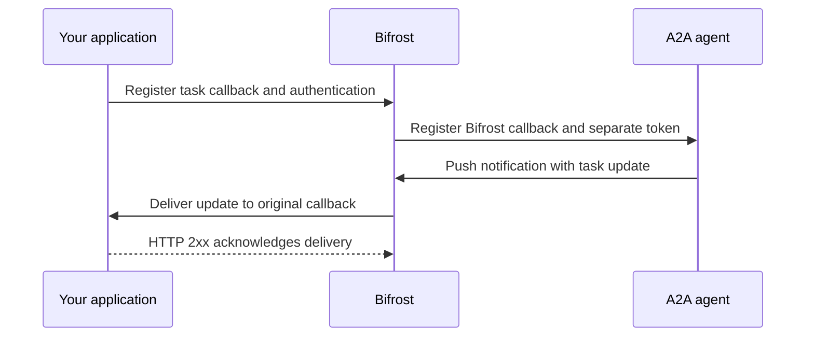

Your client connects to Bifrost. Bifrost connects to the registered agent. Those two connections can use different A2A transports.

## Copy the client-facing endpoints

Open a registration in **Agents → Agent Catalog** and copy its **Gateway endpoints**.

| Transport | Endpoint for `library-research` |
| --- | --- |
| Agent card | `https://bifrost.example.com/agents/a2a/library-research/.well-known/agent-card.json` |
| JSON-RPC | `https://bifrost.example.com/agents/a2a/library-research/json-rpc` |
| HTTP+JSON, labeled REST | `https://bifrost.example.com/agents/a2a/library-research/rest` |
| gRPC, when enabled | `library-research.a2a.example.com:443` |

An A2A client can discover the available interfaces from the gateway's served card. The upstream card determines the agent-facing interfaces. Bifrost can bridge any of these transports; your agent does not need to expose the same transport as your client.

The upstream card's eligible interface order determines the initial choice. See [transport selection and recovery](./transports-and-recovery) for preference, failover, card refresh, and the cases where Bifrost deliberately does not replay a request.

The gateway accepts A2A v1. An explicitly incompatible `A2A-Version` is rejected. Let an A2A v1 SDK negotiate the wire format, or use the v1 method and field names in the [registration example](./registration#make-your-first-request).

## Set the public base URL

Set **External Client URL** to enable Agent Gateway protocol operations. Use Bifrost's public base URL, reachable by your clients and upstream agents. Bifrost uses it for endpoints advertised in served agent cards and for push-notification callback URLs, including behind a reverse proxy.

When this URL is unset or its reference resolves to an empty value, HTTP agent-card, JSON-RPC, REST, and push-callback endpoints return **503 Service Unavailable**. A2A gRPC operations return **UNAVAILABLE**, even if the gRPC listener is configured. Agent registration, editing, and other management APIs remain available.

<Frame>
  
</Frame>

<Tabs group="config-method">
<Tab title="Web UI">
Open **Agents → Agent Settings**, set **External Client URL**, and select **Save Changes**. Use a base URL such as `https://bifrost.example.com`, not an individual agent's route.
</Tab>
<Tab title="config.json">
```json
{
  "client": {
    "a2a_external_client_url": "https://bifrost.example.com"
  }
}
```

You can use `env.BIFROST_EXTERNAL_URL` instead of a literal URL.
</Tab>
<Tab title="Helm">
```yaml
bifrost:
  client:
    a2aExternalClientUrl: https://bifrost.example.com
```
</Tab>
</Tabs>

Bifrost does not infer this URL from `Host` or forwarded request headers. Configure it explicitly.

### Push callback routing

When you register a callback through Bifrost, the agent sends updates to Bifrost, which delivers them to your application's callback.



Bifrost constructs the agent's callback URL as `<base-url>/agents/a2a/<agent-name>/push/callback`. Allow the upstream agent to reach this route through your proxy or ingress.

For example, a research agent can notify your application's `/callbacks/research` endpoint when a report is ready. The agent receives Bifrost's callback URL, and Bifrost forwards the updates to `/callbacks/research`. This keeps push notifications and delivery attempts observable through the gateway.

Once the gateway is configured, follow [Push notifications](./push-notifications) to register your application's callback.

## Enable gRPC

Enable the shared gRPC listener when clients need to call agents through Bifrost using the A2A gRPC transport.

HTTP requests identify the agent in the URL path. A2A gRPC clients call the same service methods for every agent, so the method path cannot identify which registration to use. Bifrost solves this by giving each agent its own hostname on a shared listener. The client's HTTP/2 `:authority` contains the hostname it dialed, and Bifrost uses that hostname to select the agent. No custom routing metadata is required.

Configure the base domain and public port in `config.json` or Helm. These settings create the listener and determine the gRPC endpoints advertised in agent cards. Bifrost reads them at startup, so they are not editable in **Agent Settings** and changes require a restart. Helm writes the same server settings into the generated `config.json`.

<Tabs group="config-method">
<Tab title="config.json">
```json
{
  "server": {
    "read_buffer_size": 65536,
    "a2a_grpc_base_domain": "a2a.example.com",
    "a2a_grpc_port": 443
  }
}
```
</Tab>
<Tab title="Helm">
```yaml
bifrost:
  server:
    a2aGrpcBaseDomain: a2a.example.com
    a2aGrpcPort: 443
extraEnv:
  BIFROST_A2A_GRPC_LISTEN_PORT: "9095"
```

These values configure the listener and advertised endpoint. The chart's default Service does not expose the A2A gRPC port. Add a Service and ingress or load-balancer mapping for the listener, using HTTP/2 support.
</Tab>
</Tabs>

Both domain and advertised port are required. Configure wildcard DNS for `*.a2a.example.com` to point at the gateway's gRPC entry point. The hostname's first label identifies the registration, for example `library-research`.

With the configuration above, the served agent cards advertise these endpoints:

| Registration | gRPC endpoint |
| --- | --- |
| `library-research` | `library-research.a2a.example.com:443` |
| `travel-planner` | `travel-planner.a2a.example.com:443` |

Both hostnames reach the same gateway listener. Have your A2A client use the selected agent's advertised gRPC endpoint. Bifrost routes the call to that registration and forwards it using the agent's configured upstream transport. Dialing only `a2a.example.com:443` does not identify an agent.

The shared listener uses plaintext gRPC. Terminate TLS at your ingress or load balancer for public deployments and forward to the listener over your protected network. Preserve the agent-specific authority when proxying. Sending every request with a generic authority loses the registration name.

When the public port differs from the local bind port, set `BIFROST_A2A_GRPC_LISTEN_PORT`. The example advertises port `443` but binds locally on `9095`. Restart Bifrost after changing deployment settings.

<Accordion title="Minimal Kubernetes Service for the gRPC listener">
Use your deployment's actual pod selector. This example assumes a release named `bifrost`.

```yaml
apiVersion: v1
kind: Service
metadata:
  name: bifrost-a2a-grpc
spec:
  selector:
    app.kubernetes.io/name: bifrost
    app.kubernetes.io/instance: bifrost
    app.kubernetes.io/component: server
  ports:
    - name: a2a-grpc
      port: 9095
      targetPort: 9095
      protocol: TCP
```

Route the wildcard public hostname to this Service through a gRPC-capable ingress or load balancer. This Service alone does not configure TLS or public exposure.
</Accordion>

## Capture raw HTTP payloads

Raw capture is off by default. Enable **Capture Raw Request and Response** in **Agents → Agent Settings**, or set:

```json
{
  "client": {
    "a2a_store_raw_request_response": true
  }
}
```

Capture applies to new operations. Existing logs cannot gain payloads retroactively. gRPC raw capture is unavailable because it uses binary protobuf; its structured log details remain available.

The chart currently has no dedicated value that renders this field. For Helm deployments, use Agent Settings or provide the config.json field through your deployment's configuration mounting workflow. `bifrost.client.a2aStoreRawRequestResponse` is not a supported chart value.

See [raw capture and timing](./observability#inspect-raw-capture) for how to read captured payloads.

## Keep deployment and dashboard changes consistent

Registrations can be declared in [config.json or Helm](./registration#register-from-deployment-configuration). Authentication, extensions, credential forwarding, and explicit virtual-key IDs are registration fields.

The [source of truth](/deployment-guides/config-json/source-of-truth) determines whether file declarations merge with stored configuration or replace it. Choose it deliberately before editing the same agent in both places.

Next, read [Transport selection and recovery](./transports-and-recovery) to understand upstream choice and failure handling.
