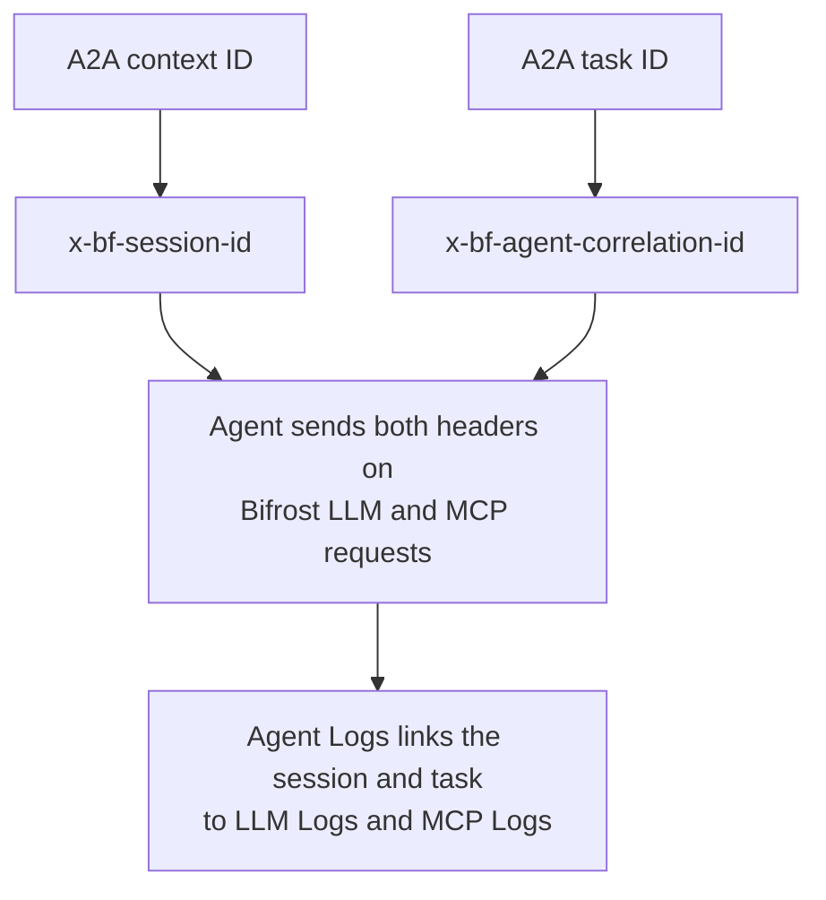

Agent Gateway sees the traffic between your client and agent. To see the model and tool calls inside that work, send those calls through Bifrost too.

Your agent must supply two pieces of information: who is making the call, and which conversation and task it belongs to.

## Reuse the caller's credential

Enable [**Forward Bifrost authentication**](/features/agent-gateway/authentication#forward-bifrost-authentication) on the registration. In your agent server, read the accepted credential that Bifrost forwards and reuse it on requests to Bifrost's LLM and MCP endpoints.

For a client authenticated with `x-bf-vk`, this means forwarding that same header value. If you use a supported enterprise identity credential, preserve its accepted header and value. See [authentication](./authentication#forward-bifrost-authentication) for header collisions and server configuration.

The caller also needs permission to use the requested model and MCP tools. Permission to call the agent is a separate grant.

## Attach the correlation headers

<Tip>
On every LLM and MCP request made for an A2A task, send `x-bf-session-id` with the A2A context ID and `x-bf-agent-correlation-id` with the A2A task ID. The agent correlation ID is the task ID itself.
</Tip>

| Header | Value from the A2A server's execution context | Used for |
| --- | --- | --- |
| `x-bf-session-id` | Context ID | The whole conversation's LLM and MCP logs. |
| `x-bf-agent-correlation-id` | Task ID | The model and tool calls for this task. |
| `x-bf-vk`, or the accepted identity header | Forwarded caller credential | Access checks and caller attribution. |



Use the task and context IDs assigned by your A2A server. For a new task, read them from the server's execution context before making its first model call. Do not substitute the JSON-RPC request ID, message ID, or an unrelated tracing UUID.

### LLM request

The following is the outgoing request your agent makes. The environment variables represent values read from the current task, not one global credential shared across callers.

```bash
curl http://localhost:8080/v1/chat/completions \
  -H "Content-Type: application/json" \
  -H "x-bf-vk: $CALLER_BIFROST_VK" \
  -H "x-bf-session-id: $A2A_CONTEXT_ID" \
  -H "x-bf-agent-correlation-id: $A2A_TASK_ID" \
  -d '{
    "model": "openai/gpt-4o-mini",
    "messages": [
      {"role": "user", "content": "Explain how to reuse one HTTP client across requests."}
    ]
  }'
```

### MCP request

First connect an MCP server in **MCP Servers → Library** or **Catalog**, and grant the caller access to its tools. Use the exact registered tool name from the catalog.

```bash
curl 'http://localhost:8080/v1/mcp/tool/execute?format=chat' \
  -H "Content-Type: application/json" \
  -H "x-bf-vk: $CALLER_BIFROST_VK" \
  -H "x-bf-session-id: $A2A_CONTEXT_ID" \
  -H "x-bf-agent-correlation-id: $A2A_TASK_ID" \
  -d '{
    "id": "lookup-1",
    "type": "function",
    "function": {
      "name": "Context7-resolve-library-id",
      "arguments": "{\"libraryName\":\"Next.js\",\"query\":\"Find the Next.js documentation\"}"
    }
  }'
```

Tool names and argument schemas come from the registered MCP server. See [MCP tool execution](/mcp/tool-execution) for the API contract and [MCP filtering](/mcp/filtering) for permissions.

The same correlation headers apply when a Bifrost LLM request automatically executes permitted MCP tools. Configure [automatic tool execution](/mcp/agent-mode) only for the tools your workflow needs.

## Verify the connection

1. Send a fresh message to your agent through Bifrost.
2. Open that operation in **Observability → Agent Logs**.
3. Open **LLM Logs** or **MCP Logs** to see calls with the matching task ID.
4. Open the **Agent session** to inspect calls across the context ID.

These tabs appear when matching logs exist and you have permission to read them. If a tab is missing, check the outgoing headers, logging configuration, time window, and caller access before assuming the agent made no calls.

<Accordion title="Keep credentials and IDs with asynchronous work">
An agent may continue after the inbound HTTP request ends. Store the current task's credential and IDs in its own execution state so later calls use the same caller. Keep them separate across concurrent tasks. Reusing a global mutable header map can attribute one caller's work to another.

For follow-up messages, preserve the context ID. Use the current task's ID for its calls. If the agent starts a different task in the same conversation, the session ID stays the same and the task correlation ID changes.
</Accordion>

Next, [Read Agent Logs](./observability) to verify the session, task, model, and tool calls appear together.
