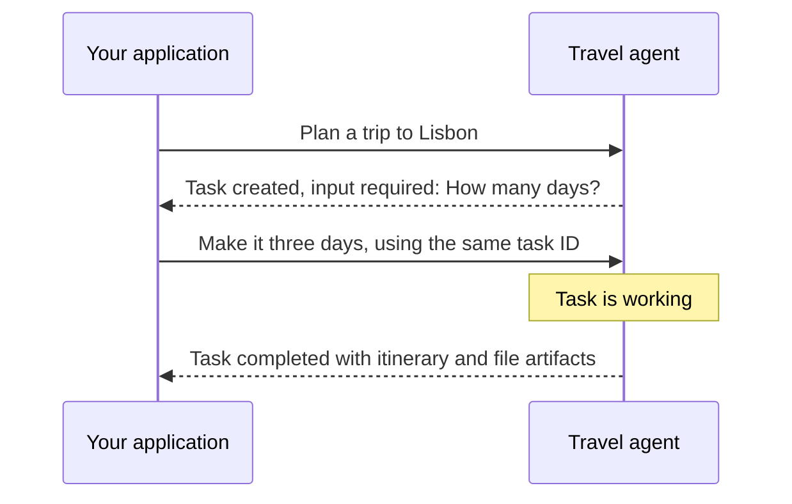

This guide introduces the A2A concepts you need to send work to an agent and follow its progress through Bifrost. Start with messages, tasks, and contexts, then learn how to read updates and results.

A message is what you send. A task is the work the agent does in response. A context keeps related work in the same conversation.

For example, you ask a travel agent to plan a trip. It may need your dates before it can finish. That is still one task, even though it takes more than one message.



## Follow the IDs

We used a `travel-planner` agent for the examples below. To try these request patterns with your own agent, replace the registration name and gateway address, and set `BIFROST_VK` to a key with access to your registration. Our requests used the JSON-RPC endpoint with `x-bf-vk`, `Content-Type: application/json`, and `A2A-Version: 1.0` headers.

| ID | What it identifies | When to reuse it |
| --- | --- | --- |
| Message ID | One message | Give each new message its own ID. |
| Task ID | One unit of work | Continue, retrieve, cancel, or subscribe to that task. |
| Context ID | A conversation | Send related work in the same conversation. |
| Bifrost request ID | One gateway operation | Use it to investigate that particular call and its events in Bifrost. |

Message, task, and context IDs belong to A2A. The **Bifrost request ID** is gateway metadata, separate from the JSON-RPC `id` used to match a protocol request with its response.

The agent creates and owns task and context IDs. Bifrost preserves them while routing requests. A task ID is also the value you pass as the [agent correlation ID](./integrating-your-agent#attach-the-correlation-headers) on the agent's LLM and MCP requests.

## Read the task state

| State | What to do |
| --- | --- |
| `submitted` | The agent has accepted the task. |
| `working` | Wait for progress, retrieve the task, or subscribe to updates. |
| `input-required` | Read the agent's message and send the missing information using the same task ID. |
| `auth-required` | Follow the agent's authentication instructions before continuing. |
| `completed` | Read the result and artifacts. |
| `failed` | Inspect the status message and underlying model or tool calls. |
| `rejected` | The agent declined the work. Read its reason. |
| `canceled` | The cancellation completed. |

A successful HTTP or JSON-RPC operation can return a task in `failed` state. The request reached the agent successfully; the work itself failed. Check both the gateway operation status and the task state when debugging.

## Choose how to receive updates

<Tabs>
<Tab title="One response">
Call `SendMessage` through the agent's Bifrost endpoint:

```bash
curl http://localhost:8080/agents/a2a/travel-planner/json-rpc \
  -H "x-bf-vk: $BIFROST_VK" \
  -H "Content-Type: application/json" \
  -H "A2A-Version: 1.0" \
  -d '{
    "jsonrpc": "2.0",
    "id": "trip-1",
    "method": "SendMessage",
    "params": {
      "message": {
        "messageId": "trip-message-1",
        "role": "user",
        "parts": [{"text": "Plan a trip to Lisbon."}]
      }
    }
  }'
```

Read `result.message` for a direct reply or `result.task` for task-based work. For a task, save its `id` and `contextId`, then inspect `status.state` and `status.message`.

If it is still working, send this body to the same endpoint with the same headers, replacing `TASK_ID` with the returned task ID:

```json
{
  "jsonrpc": "2.0",
  "id": "trip-status-1",
  "method": "GetTask",
  "params": {"id": "TASK_ID"}
}
```

`GetTask` reads the current snapshot. It does not start another task. When the task completes, read its `artifacts`.
</Tab>
<Tab title="Streaming">
Use `SendStreamingMessage` to receive events as the agent works. You may receive a task, status updates, and artifact updates. Bifrost groups those event records beneath the request in Agent Logs.

Use the `SendMessage` example above with `"method": "SendStreamingMessage"` and add `-N` to curl so it displays events as they arrive. The HTTP response uses server-sent events. Each `data:` payload contains a JSON-RPC result with a `task`, `statusUpdate`, or `artifactUpdate`.

To observe an existing task, send this body to the same endpoint using `curl -N` and the same headers:

```json
{
  "jsonrpc": "2.0",
  "id": "trip-subscribe-1",
  "method": "SubscribeToTask",
  "params": {"id": "TASK_ID"}
}
```

Disconnecting a stream does not cancel the task. Retrieve the task or use `SubscribeToTask` to resume observing it. To stop the work, call `CancelTask` and check the result.
</Tab>
<Tab title="Push notifications">
After obtaining a task ID, call `CreateTaskPushNotificationConfig` through the same Bifrost endpoint to register your callback. The agent sends updates to Bifrost, and Bifrost delivers them to your callback. You do not need to hold a stream open. Follow [Push notifications](./push-notifications) for the request body, external URL setup, and callback delivery behavior.
</Tab>
</Tabs>

### Continue a task that needs input

For `input-required`, read `task.status.message` to learn what is missing. Send another `SendMessage` request with a new `messageId`, the returned `taskId` and `contextId`, and your answer:

```json
{
  "jsonrpc": "2.0",
  "id": "trip-2",
  "method": "SendMessage",
  "params": {
    "message": {
      "messageId": "trip-message-2",
      "taskId": "TASK_ID",
      "contextId": "CONTEXT_ID",
      "role": "user",
      "parts": [{"text": "Make it three days."}]
    }
  }
}
```

To request cancellation, call `CancelTask` with `"params": {"id": "TASK_ID"}` and inspect the returned task state. See [Transport selection and recovery](./transports-and-recovery#streaming-recovery) for stream failure behavior.

## Read artifacts

Artifacts are the agent's outputs. One task can produce several, such as a report and a spreadsheet. Each can contain text, files, or structured data, plus a name, description, and metadata.

In Agent Logs, open the conversation or event payload to inspect the parts. File parts can contain inline bytes or an external URL. The dashboard renders supported media and provides file actions where available. Inspect the payload when you need the MIME type, filename, URI, or metadata.

An artifact update can append to an existing artifact. Several stream events do not necessarily mean several separate files.

In a task response, read `result.task.artifacts[].parts[]`. A text part has `text`; a file part includes its MIME type and either inline bytes or a URI. In a stream, use `artifactUpdate.artifact.artifactId` to match updates to the same artifact and its `append` flag to distinguish appended output from replacement output.

<Accordion title="See a travel task's report and files">

We sent our travel agent a request for a three-day Lisbon itinerary. After it completed, we opened its operation in **Agent Logs** and selected **Conversation**. The screenshot shows the returned `lisbon-itinerary.txt` and image artifacts for individual days. Each artifact has a name and description; **Download** saves the itinerary, and **Metadata** reveals the image's additional fields.

<Frame>
  
</Frame>

</Accordion>

<Accordion title="Which operations appear in Agent Logs?">

A2A operations appear under their protocol names:

| Operation | What it records |
| --- | --- |
| `GetAgentCard`, `GetExtendedAgentCard` | Public or authenticated discovery. |
| `SendMessage`, `SendStreamingMessage` | A new message and the returned result or stream. |
| `GetTask`, `ListTasks` | Reading agent-owned task state. |
| `CancelTask` | Asking the agent to cancel work. |
| `SubscribeToTask` | Receiving further events for an existing task. |
| Push configuration create, get, list, delete | Managing where task updates should go. |

Bifrost also records these gateway-specific push relay events. These labels are not A2A methods:

| Bifrost log event | What it records |
| --- | --- |
| `push_notification` | An update received from the agent. |
| `push_delivery` | An attempt to deliver that update to the client. |

Events have their own type, sequence, and available IDs. Some operations do not have a task or context ID, such as initial card discovery. They remain visible as individual operations.

Use `CancelTask` to ask the agent to stop work. `DeleteTaskPushNotificationConfig` removes a task's callback configuration.
</Accordion>

Next, [Connect model and tool calls](./integrating-your-agent) to preserve caller attribution and correlate the agent's work.
