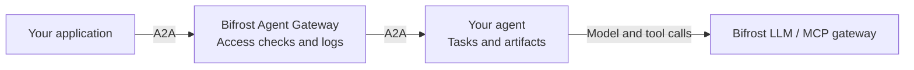

An application asks your research agent a question. The agent calls a model, looks up documentation with an MCP tool, and returns an answer. As you add agents and callers, you need a place to control who can call each agent and investigate what happened.

Agent Gateway puts Bifrost on that path. Register an existing agent, give callers its Bifrost endpoint, and inspect its requests in Agent Logs.

## Agent Gateway and A2A

Agent Gateway manages agent registrations, access, credential forwarding, push callbacks, and observability in Bifrost.

[Agent2Agent](https://a2a-protocol.org/latest/) is the protocol your application and agent use to communicate. Agent Gateway currently supports A2A.

You will meet a few A2A terms as you register and call your agent:

| Term | Think of it as |
| --- | --- |
| Agent card | The agent's directory entry. It describes its endpoints, skills, capabilities, and authentication. |
| Message | Something a user or agent says, with text, files, or structured data. |
| Task | A unit of work, such as researching a library. It has an ID and a state. |
| Context | The conversation that connects related work. Its ID becomes the session you inspect in Bifrost. |
| Artifact | An output of the work, such as a report or file. |

See [Messages, tasks, and events](./messages-and-tasks) for the A2A lifecycle.

## Start with one agent

1. [Register your first agent](./registration) using its agent card URL.
2. Set the [public base URL](./configuration#set-the-public-base-url) to enable gateway operations.
3. Configure [Agent access](./access-control).
4. Send requests to the Bifrost endpoint, then [Read Agent Logs](./observability).

<CardGroup cols={2}>
  <Card title="Register your first agent" icon="plus" href="./registration">Fetch its card, configure authentication, and copy its gateway endpoint.</Card>
  <Card title="Connect model and tool calls" icon="link" href="./integrating-your-agent">Forward the caller's credentials and attach the two correlation headers.</Card>
  <Card title="Push notifications" icon="bell" href="./push-notifications">Keep callbacks routed through Bifrost and manage their configuration.</Card>
  <Card title="Read Agent Logs" icon="magnifying-glass" href="./observability">Follow a session into its tasks, stream events, LLM calls, and MCP calls.</Card>
</CardGroup>

## Use the transport your client needs

Bifrost supports JSON-RPC, REST, and gRPC. The client-facing transport and the agent-facing transport can differ. A client can call Bifrost over JSON-RPC while Bifrost calls your agent over gRPC.

See [Gateway settings and transports](./configuration) for endpoints, gRPC deployment, config.json, and Helm examples.

Read [Transport selection and recovery](./transports-and-recovery) for upstream preference and recovery from endpoint or stream failures.

## Agent access

Virtual keys can grant access to individual agents. Bifrost Enterprise also supports agent grants through access profiles and projects, user attribution, and scoped log access. See [Agent access](./access-control) to choose the right scope for your callers.

Start with [Register your first agent](./registration). The [Messages, tasks, and events](./messages-and-tasks) guide explains A2A as you begin calling it.
