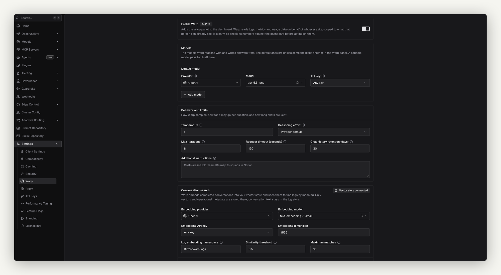
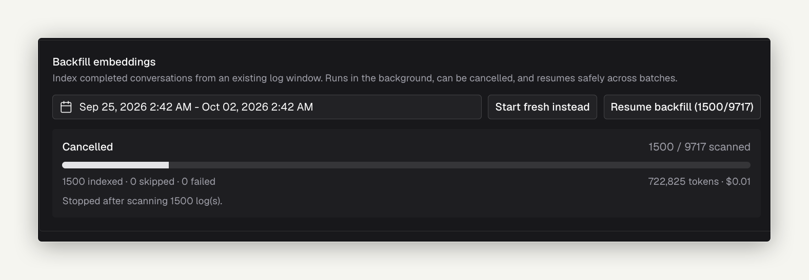
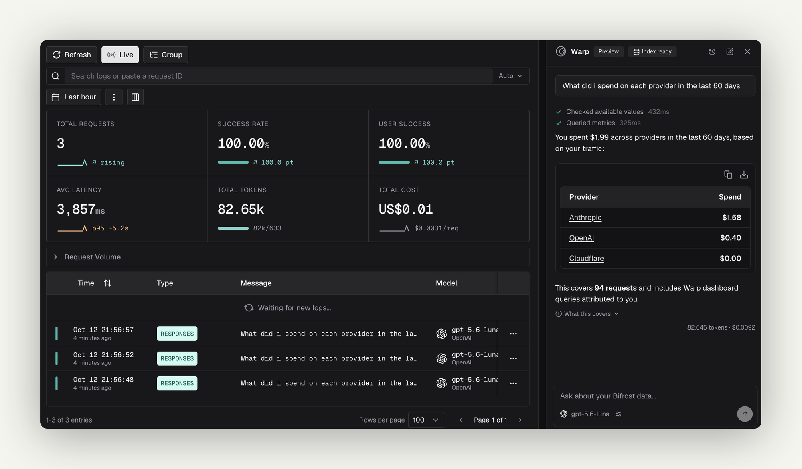

## Overview

Warp is an agent built into the Bifrost dashboard. You ask it a question about your deployment, such as "Who are my top 5 users by cost this week?", and it answers from your own data. It reads that data through a fixed set of read-only tools: request logs, metrics, usage rankings, model performance, request traces, and virtual key limits.

Warp runs on a model you choose, separate from the providers your gateway serves. Its own model calls go through Bifrost like any other request. They are logged, priced, and governed under the app name **Warp**, so you can always see what Warp costs.

**Key features:**
- **Answers from live telemetry** - Warp looks up costs, error rates, latency percentiles, and usage rankings, so the numbers come from your logs.
- **Semantic log search** - Warp finds conversations by meaning ("requests where users asked about refunds") using an embedding index of your logs.
- **Inline charts and log links** - Answers can include line and bar charts and links that open the matching rows on the **Logs** page.
- **Clarifying questions** - When a question is ambiguous, Warp asks a multiple-choice question instead of guessing.
- **Read-only and scoped** - Warp cannot change configuration. It reads only the data the person asking is allowed to see.

<Note>
Warp is in alpha. Its settings and behavior may change between releases.
</Note>

---

## Requirements

Warp answers questions only when all of the following are in place:

| Requirement | Why | Where to set it up |
|---|---|---|
| The `warp` feature flag is on | Gates the Warp API, the dashboard panel, and log indexing. On by default in OSS, off by default in Enterprise. | [Enable the feature flag](#enable-the-feature-flag) |
| A logs store | Warp's tools read from the logs store. Without one, the Warp launcher is hidden. | [Built-in observability](/features/observability/default) |
| A vector store | Holds the embedding index used for semantic log search. Warp cannot be enabled without one. | [Vector store](/architecture/framework/vector-store) |
| A provider for the agent model | Runs Warp's agent loop. It must already be configured in Bifrost. | [Provider configuration](/quickstart/gateway/provider-configuration) |
| A provider for the embedding model | Embeds logs for semantic search. It can be the same provider as the agent model. | [Provider configuration](/quickstart/gateway/provider-configuration) |

---

## Enable the feature flag

The `warp` flag is the master switch. While it is off, every `/api/warp` route returns `404`, new logs are not indexed for Warp, and the dashboard hides the launcher, chat panel, and settings page. Turning the flag on does not make Warp answer anything yet. You still need to [configure it](#configure-warp).

<Tabs group="config-method">
<Tab title="Web UI">

1. Go to **Settings** > **Feature Flags**.
2. Turn on **Warp**.

If the flag is set in `config.json`, it shows as locked here and can only be changed in the file.

</Tab>
<Tab title="API">

```bash
curl -X PUT http://localhost:8080/api/feature-flags/warp \
  -H "Content-Type: application/json" \
  -d '{
    "enabled": true
  }'
```

</Tab>
<Tab title="config.json">

```json
{
  "feature_flags": {
    "flags": {
      "warp": {
        "enabled": true
      }
    }
  }
}
```

`enabled` accepts a boolean, a literal string (`"true"`, `"false"`, `"1"`, `"0"`, `"yes"`, `"no"`, `"on"`, `"off"`), or `"env.NAME"` to read the value from an environment variable. A flag set here is locked in the UI.

</Tab>
</Tabs>

---

## Configure Warp

Warp's own settings are stored in the config store. Set them in the Web UI, through the API, or declare them in the `warp` section of `config.json`.

<Tabs group="config-method">
<Tab title="Web UI">



1. Go to **Settings** > **Warp**.
2. Under **Models**, choose the **Default model**: a **Provider**, a **Model**, and an **API key**. **Any key** load-balances across the provider's keys. Pin a specific key to keep Warp's spend separate from tenant traffic.
3. Optionally, click **Add model** to offer more models in the chat panel's model switcher.
4. Adjust **Behavior and limits** if needed (see [Settings reference](#settings-reference)).
5. Under **Conversation search**, choose the **Embedding provider**, **Embedding model**, **Embedding API key**, and **Embedding dimension**. The dimension must match what the embedding model returns, for example `1536` for `text-embedding-3-small`.
6. Turn on **Enable Warp** at the top of the page.
7. Click **Save Changes**.

The **Enable Warp** switch is disabled until a vector store is connected. If every field is filled in but the switch is off, Warp stays hidden from the dashboard.

</Tab>
<Tab title="API">

```bash
curl -X PUT http://localhost:8080/api/warp/config \
  -H "Content-Type: application/json" \
  -d '{
    "enabled": true,
    "provider": "anthropic",
    "model": "claude-sonnet-5-5",
    "api_key_id": "a1b2c3d4-warp-key",
    "additional_models": [
      { "provider": "openai", "model": "gpt-4o" }
    ],
    "max_iterations": 8,
    "request_timeout_seconds": 120,
    "history_retention_days": 30,
    "system_prompt_suffix": "Our production virtual keys are prefixed with prod-.",
    "embedding_provider": "openai",
    "embedding_model": "text-embedding-3-small",
    "embedding_dimension": 1536,
    "log_vector_store_namespace": "BifrostWarpLogs",
    "semantic_search_threshold": 0.5,
    "semantic_search_limit": 10,
    "topic_discovery_min_requests": 100
  }'
```

The response is the saved configuration, with a `configured` field that says whether Warp can answer.

`PUT` replaces the configuration. The exceptions are the embedding, search, and topic fields (`embedding_*`, `log_vector_store_namespace`, `semantic_search_*`, `topic_discovery_min_requests`). If you omit one of those, Bifrost keeps its stored value. `additional_models` is replaced as a whole, so leaving it out removes every additional model.

Read the current configuration with `GET /api/warp/config`.

</Tab>
<Tab title="config.json">

```json
{
  "feature_flags": {
    "flags": {
      "warp": { "enabled": true }
    }
  },
  "warp": {
    "enabled": true,
    "provider": "anthropic",
    "model": "claude-sonnet-5-5",
    "api_key_id": "a1b2c3d4-warp-key",
    "additional_models": [
      { "provider": "openai", "model": "gpt-4o" }
    ],
    "max_iterations": 8,
    "request_timeout_seconds": 120,
    "history_retention_days": 30,
    "system_prompt_suffix": "Our production virtual keys are prefixed with prod-.",
    "embedding_provider": "openai",
    "embedding_model": "text-embedding-3-small",
    "embedding_dimension": 1536,
    "log_vector_store_namespace": "BifrostWarpLogs",
    "semantic_search_threshold": 0.5,
    "semantic_search_limit": 10,
    "topic_discovery_min_requests": 100
  }
}
```

The `warp` section takes the same fields as the API, and Bifrost saves it at startup exactly as if it came from the settings page. It is validated the same way, and the log embedding namespace is created the same way. A section the settings page would refuse is logged as a warning and not applied. The stored settings stay as they were.

How the file and the dashboard share these settings depends on [`source_of_truth`](/deployment-guides/config-json/source-of-truth):

- **`split`** (default): the section is applied when it is new or has changed since the last startup. Edits made in the dashboard are kept until you change the section.
- **`config.json`**: the section is applied on every startup, so dashboard edits last only until the next restart.

Omit the section to manage Warp entirely from the dashboard. The `warp` feature flag is set separately. The section is saved whether or not the flag is on, but Warp stays hidden until the flag is on.

</Tab>
</Tabs>

### Settings reference

| Field | UI label | Default | Rules | Description |
|---|---|---|---|---|
| `enabled` | Enable Warp | `false` | Requires a connected vector store | Shows Warp in the dashboard. |
| `provider`, `model` | Default model | - | Required when enabled. Must be a known provider. | The model that runs Warp's agent loop. |
| `api_key_id` | API key | Any key | ID of one of the provider's configured keys | Pins Warp to one key. Leave it empty to load-balance, or for a provider that needs no key. Warp stores a reference to the key, never the secret itself. |
| `additional_models` | Model N | `[]` | Up to 20, each with `provider` and `model`, no duplicates | Extra models people can switch to in the chat panel. Each entry takes an optional `api_key_id`. |
| `max_iterations` | Max iterations | `8` | `0` (default) or `2`–`20` | How many tool-call rounds Warp may run before it must answer. The last round is reserved for answering, so `1` is rejected. |
| `request_timeout_seconds` | Request timeout (seconds) | `120` | Not negative | Deadline for each call to Warp's model. Raise it for slow self-hosted models. |
| `history_retention_days` | Chat history retention (days) | `30` | Not negative. `0` means the default. | How long a saved chat is kept after its last turn. Independent of log retention. |
| `system_prompt_suffix` | Additional instructions | - | - | Text appended to Warp's built-in prompt, such as your naming conventions or cost model. It cannot replace the built-in instructions. |
| `temperature` | Temperature | Provider default | `0`–`2` | Sampling temperature. Omit it to use the provider's default. `0` is valid and fully deterministic. |
| `reasoning_effort` | Reasoning effort | Provider default | `none`, `minimal`, `low`, `medium`, `high`, `xhigh`, `max` | Effort level for reasoning models. Leave it unset for models that are not reasoning models. |
| `embedding_provider`, `embedding_model` | Embedding provider / model | - | Required when enabled | The model used to index and search logs. |
| `embedding_api_key_id` | Embedding API key | Any key | - | Pins embedding calls to one key. |
| `embedding_dimension` | Embedding dimension | `1536` | Required when enabled | The vector size the embedding model returns. |
| `log_vector_store_namespace` | Log embedding namespace | `BifrostWarpLogs` | Must change when the embedding provider, model, or dimension changes | The vector store namespace holding Warp's log index. |
| `semantic_search_threshold` | Similarity threshold | `0.5` | Greater than `0`, at most `1` | Minimum similarity for a semantic search match. |
| `semantic_search_limit` | Maximum matches | `10` | `1`–`25` | Most matches one semantic search returns. |
| `topic_discovery_min_requests` | New topic threshold | `100` | `10`–`20000` | How many requests that matched no topic must be waiting before Warp clusters them into new topics. |

---

## Index logs for semantic search

Semantic search works over an embedding index of your logs, stored in the vector store under `log_vector_store_namespace`.

### What gets indexed

A log is indexed when all of these are true:

- It is a chat completion or Responses API request, streaming or not.
- It has finished: its status is success, error, or cancelled.
- Its content is logged. Logs with [content logging](/features/observability/content-logging) turned off are skipped.
- It is not Warp's own traffic.

For each log, Warp embeds the user input and the assistant output, up to 16 KB of text. Alongside the vector it stores filterable metadata: provider, model, status, latency, cost, token counts, app, virtual key, user, team, customer, and business unit.

### Live indexing

Once Warp is configured, each new log is embedded in the background as it is written. If logs arrive faster than they can be embedded, the queue fills and further logs are dropped from the index with a warning in the server log. They stay in the logs store, and a backfill can add them to the index later.

### Backfill

Logs written before Warp was configured, or dropped during a burst, are added with a backfill.

<Tabs group="config-method">
<Tab title="Web UI">



1. Go to **Settings** > **Warp** > **Backfill embeddings**.
2. Choose a date range. The default is the last 7 days.
3. Click **Start backfill**.

Save any configuration changes first: the button is disabled while the page has unsaved changes. Progress shows in the section, with indexed, skipped, and failed counts and the embedding spend so far. It also appears as **Indexing logs for Warp** under [Background jobs](/features/observability/default#background-jobs).

A cancelled or interrupted backfill can be continued with **Resume backfill**, or discarded with **Start fresh instead**.

</Tab>
<Tab title="API">

Start a backfill over a time range:

```bash
curl -X POST http://localhost:8080/api/warp/log-index/backfill \
  -H "Content-Type: application/json" \
  -d '{
    "start_time": "2026-10-01T00:00:00Z",
    "end_time": "2026-10-08T00:00:00Z"
  }'
```

Set `"restart": true` to discard a saved checkpoint and start over.

Check progress, or cancel:

```bash
curl http://localhost:8080/api/warp/log-index/backfill/status
curl -X POST http://localhost:8080/api/warp/log-index/backfill/cancel
```

`GET /api/warp/log-index/status` reports the index as a whole: whether the vector store is connected, whether embedding is configured, and the latest backfill.

</Tab>
</Tabs>

Only one backfill runs at a time. Starting a second one returns `409` with the running job's status. A backfill stops on its own after 100 consecutive embedding failures.

### Change the embedding model

Vectors from different embedding models cannot be compared. When you change the embedding provider, model, or dimension, you must also choose a new **Log embedding namespace**. Bifrost rejects the save otherwise. The new namespace starts empty, so run a backfill to fill it.

You cannot change the embedding configuration while a backfill is running. Cancel it first.

---

## Use Warp



Open Warp from **Ask Warp** in the top bar, or press <kbd>⌘</kbd> <kbd>I</kbd> (<kbd>Ctrl</kbd> <kbd>I</kbd> on Windows and Linux). On wide screens it opens as a resizable panel docked on the right. On narrow screens it opens full width.

Some questions to start with:

- "What did I spend on each provider in the last 7 days?"
- "Which model had the worst p99 latency yesterday?"
- "Who are my top 5 users by cost this week?"
- "Show me failed requests in the last 24 hours"

While Warp works, the panel shows each tool it calls and how long the call took. You can type follow-up questions while an answer is still streaming. They are sent in order.

**In the panel:**

- **Model switcher** - Under the input, choose any model an administrator exposed in [Models](#configure-warp). The default is marked **Default**. Your choice is remembered in the browser.
- **Clarifying questions** - When Warp needs to know something, such as which team or time window you mean, it shows a **Question** card with options. Pick one with the mouse or the arrow keys, or type your own answer when the card allows it. **Skip** tells Warp to use its best judgement and say what it assumed.
- **Charts** - Answers can include line or bar charts of requests, errors, error rate, cost, tokens, or latency. Each chart has an **Open in Logs** link to the underlying rows.
- **Log links** - Links in an answer open the **Logs** page with the matching filters applied. Warp only shows links built from queries it actually ran.
- **New chat** - Click **New chat** in the header, or type `/clear`.
- **Chat history** - Click **Chat history** to reopen or delete earlier conversations. Each one lists its token usage and cost.

If Warp is off or not configured, the panel says so and links to the settings page.

<Note>
When Warp runs out of iterations before it finishes researching, it still answers with what it found and marks the answer as partial. Raise **Max iterations** if this happens often.
</Note>

---

## What Warp can look up

Warp uses only these read-only tools:

| Tool | What it does |
|---|---|
| `query_logs` | Lists matching log rows: provider, model, status, latency, tokens, cost, virtual key, user, and error. |
| `count_logs` | Counts and summarizes matching requests without fetching rows. |
| `get_log_detail` | Fetches one log with a longer preview of its content. |
| `get_request_trace` | Shows one request's path: retries, fallbacks, guardrail and cache decisions, and a latency breakdown. |
| `query_metrics` | Totals and time series for requests, cost, tokens, latency percentiles, and throughput. |
| `query_usage_by` | Ranks a dimension (provider, model, user, virtual key, team, and so on) by cost, requests, or tokens, with the trend against the previous period. |
| `query_model_performance` | Ranks models by usage and spend, and compares latency and throughput across providers. |
| `semantic_search_logs` | Finds conversations by meaning. Available only when the [log index](#index-logs-for-semantic-search) is set up. |
| `render_chart` | Draws a line or bar chart from a query run on the server. Up to 6 charts per answer. |
| `describe_filter_space` | Lists who is asking, which teams, customers, and business units they could mean, and real values for each filter. |
| `describe_virtual_key` | Shows a virtual key's budget, rate limit, and allowed providers and models. |
| `describe_user_limits` | Shows a person's budgets and rate limits with current usage. Enterprise only. |
| `ask_user` | Asks you a multiple-choice question. |

Warp has no tool that changes configuration, sends requests to providers on your behalf, or reads data outside the logs store and governance settings.

---

## Access and scoping

### Who can use Warp

Without authentication, anyone who can open the dashboard can use Warp. With [RBAC](/enterprise/rbac) (Enterprise), access is split across two resources:

| Resource | Permission | Grants |
|---|---|---|
| **Warp** | View | See the Warp settings page. Also required to use the chat panel. |
| **Warp** | Update | Change Warp's settings, including which models it offers, and run backfills. |
| **WarpSession** | View | Use the chat panel and see your own conversation history. |
| **WarpSession** | Delete | Delete your own conversations. |

Saving the configuration and running a backfill require an administrator: the local admin, or (with RBAC) a role with Update on **Warp**. Other callers get `403`. When dashboard authentication is turned off, every caller counts as the local admin.

### What data Warp reads

Every tool call runs as the person asking. With Enterprise row-level access control, Warp sees exactly the logs that person could see on the **Logs** page, and semantic search results are filtered the same way.

When a question does not say whose traffic it means, Warp chooses a default:

- **A signed-in user with restricted access** - their own traffic.
- **An unrestricted caller**, such as an administrator - the whole deployment.
- **No user identity, and several teams, customers, or business units to choose from** - Warp asks which one you mean.

Naming a scope in the question ("for the payments team") always overrides the default.

---

## Cost and governance

Warp's model calls go through the full Bifrost pipeline, so they appear on the **Logs** page with the app name **Warp** and the user agent `bifrost-warp/1`. Calls from one conversation share a session ID equal to the conversation ID. MCP tools are never attached to Warp's calls.

Warp's traffic is subject to the same governance as any other request. If a budget, rate limit, or model restriction applies to the person asking, Warp reports that its model call was refused and why (`budget_exceeded`, `rate_limited`, or `model_blocked`).

Embedding calls made while indexing skip the plugin pipeline, so they do not appear on the **Logs** page and are not subject to governance. A backfill reports the embedding tokens and cost it used in its status.

Warp's own requests are never added to its log index, so asking about Warp does not pollute semantic search.

---

## Chat history

Conversations are saved in the logs store, so history requires a logs store that supports it. Without one, the history routes are not registered and the panel only keeps the current chat.

- **Ownership** - Each conversation belongs to the user who started it. On a deployment without authentication, all conversations share one owner and everyone sees the same history.
- **Retention** - An hourly sweep deletes conversations whose last turn is older than **Chat history retention (days)**, 30 by default.
- **Cap** - Each owner keeps at most 100 conversations. Past that, the oldest are deleted.
- **Titles** - A conversation is titled with its first question, up to 80 characters.

Through the API, `GET /api/warp/conversations` lists your conversations, `GET /api/warp/conversations/{id}` returns one with its messages, and `DELETE /api/warp/conversations/{id}` deletes one.

---

## Chat API

The dashboard talks to Warp through `POST /api/warp/chat`, which you can also call directly:

```bash
curl -N -X POST http://localhost:8080/api/warp/chat \
  -H "Content-Type: application/json" \
  -d '{
    "messages": [
      { "role": "user", "content": "Which provider had the most errors yesterday?" }
    ],
    "stream": true,
    "timezone": "America/New_York"
  }'
```

| Field | Type | Required | Description |
|---|---|---|---|
| `messages` | array | Yes | The conversation so far. Each entry has `role` (`user` or `assistant`) and `content`. The last message must be a non-empty user turn. |
| `conversation_id` | string | No | Continue a saved conversation. Omit it to start a new one. |
| `provider`, `model` | string | No | Run this turn on one of the configured models. Omit both for the default model. |
| `stream` | boolean | No | Stream the answer as server-sent events. |
| `timezone` | string | No | IANA time zone used to interpret "yesterday" and "this week". |
| `utc_offset_minutes` | integer | No | UTC offset, used when no time zone is sent. |

A streamed response emits these events: `start`, `delta` (answer text), `tool_call_start` and `tool_call_end`, `question` (a clarifying question), `error`, and `done`. The `done` event carries the `conversation_id`, the `finish_reason` (`partial` when Warp ran out of iterations), the iteration count, token usage, and the model and provider used.

See the [Warp API reference](/api-reference/warp/ask-warp-a-question) for full request and response schemas.

---

## Troubleshooting

### Every `/api/warp` route returns 404

**Cause:** The `warp` feature flag is off. It is off by default in Enterprise.
**Fix:** [Enable the feature flag](#enable-the-feature-flag).

### The Ask Warp button is missing

**Cause:** The feature flag is off, the deployment has no logs store, or (with RBAC) you lack View on **Warp** or **WarpSession**.
**Fix:** Check each in turn. Without a logs store, Warp has nothing to read and stays hidden.

### Chat returns 503

The response body has a `reason` field:

| `reason` | Meaning | Fix |
|---|---|---|
| `not_configured` | Warp is switched off or a required setting is missing. | Fill in the default model and the embedding settings, then turn on **Enable Warp**. |
| `no_log_store` | The deployment persists no logs. | Configure a logs store. |
| `no_vector_store` | No vector store is connected. | Configure a vector store. |

### The Enable Warp switch is disabled

**Cause:** No vector store is connected.
**Fix:** Configure a [vector store](/architecture/framework/vector-store). The settings page shows the connection status under **Conversation search**.

### Saving fails with "namespace must change"

**Cause:** You changed the embedding provider, model, or dimension but kept the old namespace.
**Fix:** Enter a new **Log embedding namespace**, save, then run a backfill to fill it.

### Saving or starting a backfill returns 409

**Cause:** A backfill is already running.
**Fix:** Wait for it to finish, or cancel it from the settings page or [Background jobs](/features/observability/default#background-jobs).

### Semantic search misses recent conversations

**Cause:** Logs were dropped from the indexing queue during a burst, the logs had content logging turned off, or they were written before Warp was configured.
**Fix:** Run a backfill over the missing window. Logs without content cannot be indexed.

---

## Next steps

- **[Built-in observability](/features/observability/default)** - The logs Warp reads, and the Background jobs panel
- **[Content logging](/features/observability/content-logging)** - Control which logs keep content and can be indexed
- **[Virtual keys](/features/governance/virtual-keys)** - Budgets and limits Warp can describe
- **[RBAC](/enterprise/rbac)** - The `Warp` and `WarpSession` resources
