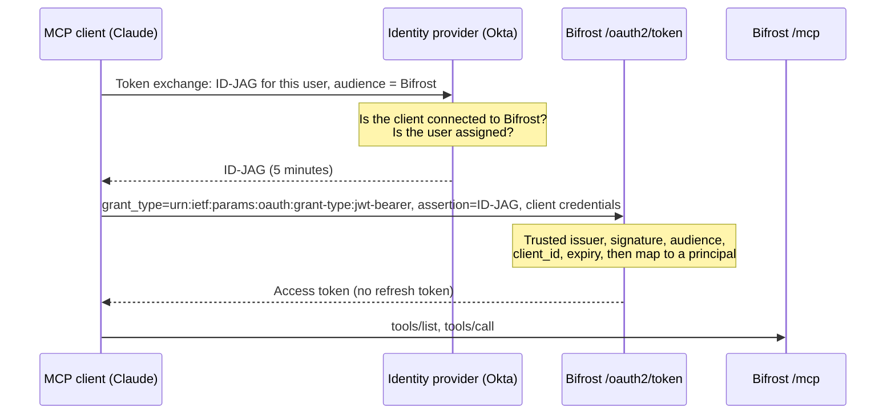

## Overview

Enterprise-managed authorization lets an administrator approve "this MCP client may reach Bifrost for our users" once, in the identity provider (IdP), instead of every user clicking through Bifrost's consent page. It implements the [MCP Enterprise-Managed Authorization extension](https://modelcontextprotocol.io/extensions/auth/enterprise-managed-authorization), which Okta ships as **Cross App Access (XAA)** and Claude supports as **managed authorization** for organization connectors.

The client signs the user in to the IdP as usual. When it needs Bifrost, it asks the IdP for an **ID-JAG** (Identity Assertion JWT Authorization Grant): a short-lived JWT, signed by the IdP, that names the user, the client and Bifrost as the audience. The client sends the ID-JAG to Bifrost's token endpoint with the `jwt-bearer` grant and receives a normal `/mcp` access token.



Three things decide what a user can reach: the IdP decides whether the client may get a token for this user at all, Bifrost applies the bound virtual key's or user's access (tool filtering, budgets, access profiles), and each upstream MCP server applies its own permissions.

<Note>
Enterprise-managed authorization is an alternative way to obtain a token. The [interactive OAuth flow](./gateway-auth) keeps working for every other client, including Claude Code connecting with its own browser sign-in.
</Note>

---

## Requirements

- `mcp_server_auth_mode` is `both` or `oauth`, with an `issuer_url` set. See [Gateway Authentication](./gateway-auth#configuration).
- An IdP that issues ID-JAGs. Okta is the IdP Claude supports today.
- One **managed client** registered in Bifrost per MCP client the IdP connects. Dynamic client registration cannot be used: the IdP writes a fixed `client_id` into every ID-JAG, so Bifrost must know that client before the first assertion arrives.

---

## What tokens act as

Each managed client decides which Bifrost principal its tokens represent.

| Identity | Behaviour | Availability |
|---|---|---|
| **Virtual key** | Every user the IdP admits shares one virtual key: its budgets, rate limits and MCP tool access. Bifrost logs the IdP subject of each grant, but requests are attributed to the key. | All editions |
| **User** | The ID-JAG subject is matched to a Bifrost user (by the IdP user ID, then email), so each user sees only the tools their own access profile allows. A subject with no Bifrost user is refused until they sign in to Bifrost once through SSO, unless **Create users on first use** is on (off by default). | Enterprise, with an identity provider configured |

---

## Setup

<Steps>
<Step title="Enable managed authorization in Bifrost">

<Tabs group="config-method">
<Tab title="Web UI">

1. Open **Config → MCP** and set **MCP Server Auth Mode** to `both` or `oauth`, with an **Issuer URL**.
2. Turn on **Enterprise-managed authorization (Cross App Access)**.
3. Set **Trusted issuer** to your IdP's issuer. For Okta, this is the **org** authorization server, for example `https://acme.okta.com`, not a custom authorization server.
4. Click **Save**.

</Tab>
<Tab title="config.json">

```json
{
  "client": {
    "mcp_server_auth_mode": "both",
    "oauth2_server_config": {
      "issuer_url": "https://bifrost.example.com",
      "managed_auth": {
        "enabled": true,
        "trusted_issuer": "https://acme.okta.com",
        "access_token_ttl": 86400
      }
    }
  }
}
```

| Field | Type | Required | Description |
|---|---|---|---|
| `managed_auth.enabled` | boolean | No | Accepts the `jwt-bearer` grant at `/oauth2/token` and advertises it in discovery. |
| `managed_auth.trusted_issuer` | string | Yes, when enabled | The only IdP issuer whose ID-JAGs are accepted. Must be `https`; plain `http` is accepted only on a loopback host (`localhost`, `127.0.0.0/8`, `::1`) for local testing. |
| `managed_auth.jwks_url` | string | No | Overrides the signing keys discovered from the issuer's `/.well-known/openid-configuration`. Same `https` rule as `trusted_issuer`. |
| `managed_auth.access_token_ttl` | integer | No | Lifetime in seconds of tokens minted from an ID-JAG (default `86400`, range `60`–`86400`). |
| `managed_auth.provision_users` | boolean | No | Enterprise. For user-identity clients, create a Bifrost user for a subject that has none instead of refusing the grant (default `false`). The ID-JAG carries only the user's ID and email, plus Okta profile attributes when an Okta API token is configured, and no groups. So the new user gets a role only if your role mapping matches those attributes; otherwise the grant is still refused. |

</Tab>
</Tabs>

<Note>
Bifrost fetches the issuer's discovery document and signing keys through the same guarded client it uses for MCP OAuth, which refuses private and loopback addresses. If your IdP is only reachable on a private network, add its host to `mcp_oauth_private_allowlist` in the client config.
</Note>

</Step>
<Step title="Register a managed client">

In the same section, click **Add client**:

- **Client ID**: leave empty to generate one, or enter the identifier the MCP client uses for itself. Claude Code identifies itself as `https://claude.ai/oauth/claude-code-client-metadata`.
- **Require a client secret**: keep on for clients that can store a secret, such as Claude's hosted apps configured with a client ID and secret. Turn off for public clients. The secret is shown once; rotate it from the table if it is lost.
- **Tokens act as**: a virtual key, or the signed-in user on enterprise deployments.

The same operations are available at `GET`/`POST /api/oauth2/managed-clients`, `PATCH`/`DELETE /api/oauth2/managed-clients/{id}` and `POST /api/oauth2/managed-clients/{id}/rotate-secret`. Creating or changing a client requires an authenticated admin session.

</Step>
<Step title="Connect Bifrost in Okta">

1. Create an app integration in Okta that represents Bifrost (a custom OIDC app is fine), and assign the users who may use it.
2. On that app's **Machine Assignments** tab, enable **Cross App Access (XAA)** and fill in its fields with Bifrost's values. With `issuer_url` set to `https://bifrost.example.com`:

   | Okta field | Value |
   |---|---|
   | **Resource URL** | Bifrost's MCP endpoint, `https://bifrost.example.com/mcp` |
   | **Issuer URL** | Bifrost's `issuer_url`, `https://bifrost.example.com` |
   | **Audience/tenant ID** | Bifrost's `issuer_url` again, `https://bifrost.example.com` |

   Copy `issuer_url` exactly as it is set in Bifrost. Bifrost rejects an ID-JAG whose `aud` is anything else. Okta checks that the issuer is reachable when you save, so Bifrost must already be serving its discovery document at that URL.
3. In **Directory → AI Agents**, open the agent registered for the requesting app (for example Claude), add a **resource connection** to the Bifrost app, and enter the managed client's **Client ID** as the client ID registered in the resource app. If the connection limits scopes, include `mcp`.

</Step>
<Step title="Enable the connector in Claude">

In Claude's organization settings, add Bifrost's `/mcp` URL as a custom connector, enter the managed client's ID (and secret, if it has one), and turn on managed authorization for the roles that should have it. Users then see Bifrost's tools without connecting anything.

</Step>
</Steps>

---

## Token lifetime and revocation

- Bifrost issues **no refresh token** for this grant. When the access token expires, the client re-presents its ID-JAG while that is still valid, or fetches a new one from the IdP. Removing a user's assignment in the IdP therefore takes effect within one token lifetime plus the ID-JAG's own lifetime.
- An ID-JAG may be presented more than once while it is valid; this is how the grant replaces a refresh token. Bifrost checks its audience, client and expiry on every presentation, but does not refuse a repeat. Issued tokens are logged at debug level with the ID-JAG's `jti`, and denials as warnings. Enterprise also records every outcome in the audit log.
- Okta limits Cross App Access to **250 ID-JAGs per user, per resource app, per month**. A client that fetches a new ID-JAG for every Bifrost token spends one per token lifetime, so the default `access_token_ttl` is `86400` (24 hours).
- Bifrost-side changes apply immediately: a deleted or disabled virtual key, or a deleted or deactivated user, is refused on the next `/mcp` request.
- Disabling or deleting a managed client, or turning managed auth off, also refuses the tokens it already issued. Each token names its client, and `/mcp` checks the client on every request against a cache that lasts 30 seconds. The change applies at once on the node that handled it, and within 30 seconds on other nodes. Enterprise clusters apply it on every node at once.
- Grants from this flow do not appear on the **OAuth Grants** page, which lists refresh-token grants. The managed clients table shows when each client last obtained a token.

---

## Validation performed

For every `jwt-bearer` request Bifrost:

1. Authenticates the managed client (`client_secret_basic`, `client_secret_post`, or no secret for a public client).
2. Rejects an ID-JAG whose `iss` is not the trusted issuer **before** verifying the signature, so an attacker-run IdP can never influence key lookup.
3. Requires the header `typ` to be `oauth-id-jag+jwt` and an asymmetric signing algorithm, then verifies the signature against the issuer's JWKS.
4. Requires `aud` to be Bifrost's `issuer_url`, `client_id` to equal the authenticated client, a valid `exp`/`iat`, and `sub` and `jti` to be present.
5. When the ID-JAG or the request carries a `resource`, requires it to be Bifrost's `/mcp` URL.
6. Refuses an ID-JAG bound to a key (`cnf` claim), since Bifrost does not check proof of possession.
7. Applies the ID-JAG's `scope`. With no scope claim, the token gets the `mcp` scope. A scope claim must include `mcp`; other scopes in it are ignored. What the token can reach is still decided by the bound virtual key or user.

The same ID-JAG may be presented again while it is valid, as the profile allows. Every denial is logged with its reason and the client ID. The issuer, subject and `jti` are added once the ID-JAG has passed verification. When verification fails they are empty, and the reason says what failed: an untrusted issuer, for example, is named in the reason. The assertion itself is never logged.

---

## Troubleshooting

### Claude does not offer managed authorization

Fetch `/.well-known/oauth-authorization-server`. When managed authorization is enabled it lists `urn:ietf:params:oauth:grant-type:jwt-bearer` in `grant_types_supported`. If it does not, check that the setting is saved with a trusted issuer and that the auth mode is `both` or `oauth`.

### `invalid_client`

The client ID is not registered, the client is disabled, or the secret is wrong. A secret sent for a public client is also refused.

### `invalid_grant`

The Bifrost log line `[ManagedAuth] denied jwt-bearer grant` gives the reason. The usual causes are an issuer mismatch (Okta must use the org authorization server), an audience mismatch (the Okta app's **Audience/tenant ID** must equal Bifrost's `issuer_url`), a client ID mismatch between Okta's resource connection and the managed client, an expired assertion (check clock skew), or a user who cannot be matched to a Bifrost user.

### `invalid_scope`

The ID-JAG has a `scope` claim that doesn't include `mcp`. Add `mcp` to the scopes allowed on the resource connection in Okta, and to the scopes the client requests.
