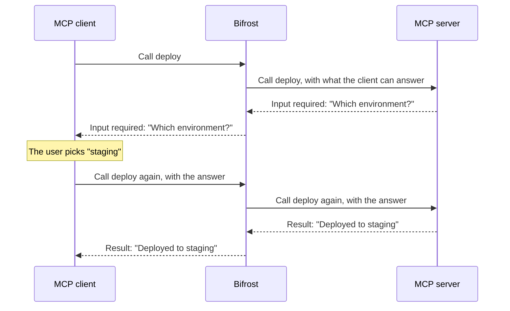

## Overview

Some tools need one more answer before they run. A `deploy` tool may ask the user which environment to deploy to, and a tool that needs an account may ask the user to connect it first.

MCP `2026-07-28` standardizes this as **Multi Round-Trip Requests**. The server answers the tool call with the questions it needs answered instead of a result. The client asks the user, then calls the tool again with the answers, and the server completes the call.

Bifrost passes these questions through its [MCP gateway](./gateway-auth):

- **Questions reach the user.** The question goes to the MCP client connected to Bifrost, the user answers it there, and the answer goes back to the server on the retry.
- **Servers only ask what the client can answer.** Bifrost tells the server which kinds of questions the calling client supports.
- **Any Bifrost node can take the retry.** Bifrost keeps nothing between rounds, so in a cluster the retry can land on any node.
- **Every round is logged.** **MCP Logs** records each round, linked together, so you can follow the call from start to finish.

---

## How a question travels through Bifrost



Each round is an ordinary tool call, so it goes through authentication, governance and logging like any other, and counts as a tool call toward governance limits. Each round has its own tool execution timeout, so the time the user takes to answer doesn't count against it.

---

## What gets passed on

| What the server asks | Passed to the client | What the client must support |
|---|---|---|
| A question for the user, as a form | Yes | Form questions (elicitation) |
| A link for the user to open, such as connecting an account | Yes | Link questions (URL elicitation) |
| To retry the call later, with no question | Yes | Nothing |
| A completion from the client's model (sampling) | No | |
| The client's filesystem roots | No | |

Bifrost passes a round on only when the client can answer every question in it. Sampling is deprecated in MCP `2026-07-28`, and Bifrost doesn't pass it on.

---

## Requirements

Questions are passed on when both sides of the call are on MCP `2026-07-28`:

- **The MCP client** connects to Bifrost's gateway on `2026-07-28`, at `/mcp`, a server's own `/mcp/<slug>` endpoint or a [Virtual MCP](./virtual-mcps) (under a `server.base_path`, `/<prefix>/mcp`), and declares the kinds of questions it can answer.
- **The MCP server** is connected on `2026-07-28`. A server connected on an earlier version asks its questions in a way Bifrost can't pass on, so its tool fails with an error instead. SSE servers can't use `2026-07-28`, so connect the server over HTTP or STDIO.

Bifrost connects to each server on the newest version both support, up to the max protocol version. New installs use `auto`, the newest version. Deployments upgraded with existing MCP servers stay on `2025-06-18` until you change it.

<Tabs group="config-method">
<Tab title="Web UI">

1. Open **MCP Servers** and then **MCP Settings**.
2. Set **Max Protocol Version** to **Auto (latest)**.
3. Save. Bifrost reconnects the affected servers without a restart.

</Tab>
<Tab title="config.json">

Set the global `max_protocol_version` to `auto`, or set it on one server with `max_protocol_version` on its `client_configs[]` entry:

```json
{
  "mcp": {
    "max_protocol_version": "auto",
    "client_configs": [
      {
        "name": "deploy",
        "connection_type": "http",
        "connection_string": "https://deploy.example.com/mcp",
        "tools_to_execute": ["*"],
        "max_protocol_version": "auto"
      }
    ]
  }
}
```

| Field | Type | Required | Description |
|-------|------|----------|-------------|
| `max_protocol_version` | string | No | `auto`, `2026-07-28`, `2025-11-25` or `2025-06-18`. `auto` means the newest version Bifrost supports. |

</Tab>
</Tabs>

See [Max Protocol Version](./connecting-to-servers#max-protocol-version) for the defaults and every way to set it.

---

## Where questions can't be passed on

Some callers have no user to ask. A tool that asks a question fails on these paths, with an error that names the server and what it asked for:

- MCP clients on an earlier MCP version, or that don't support the kind of question asked
- Chat completions and the Responses API, when Bifrost runs the tool in [agent mode](./agent-mode)
- [Tool execution](./tool-execution) through `/v1/mcp/tool/execute`
- [Code mode](./code-mode)
- Prompts and resource reads, through any path

When the server asks the user to open a link, such as connecting an account, the error includes the link. Complete the step and call the tool again.

When the server asks only to retry later, Bifrost retries the call itself, straight away, and fails after three attempts.

---

## Logs

Every round of a call is its own entry in **MCP Logs**:

- **A round that asked a question** has the status **Needs input**, and shows what the server asked under **Input requested**.
- **The retry** shows the client's answers under **Answered**, and the final result.
- **A round that asked to retry later** is marked **Retry later**.

The rounds of one call share a round trip ID. Open any of them and select the **Rounds** tab to see every round of the call, or filter the logs by **Round trip ID**. An entry that is still waiting for an answer refreshes while you view it.

What the server asked and what the client answered are recorded only when content logging is on. The **Needs input** status and the round trip ID are always recorded. See [Content Logging](/features/observability/content-logging).


---

## Troubleshooting

### The client gets an error instead of the question

- **The client connects on an earlier MCP version.** Check that it supports MCP `2026-07-28`.
- **The client doesn't support that kind of question.** A client that declares only form questions can't answer a link question, and the other way around.
- **The call didn't come through the MCP gateway.** Chat completions, the Responses API, agent mode and code mode can't ask a user.

### The client supports questions, but the tool still fails

The server is connected on an earlier MCP version. Set its max protocol version to `auto`, and check that the server supports MCP `2026-07-28`.

### The server keeps asking to retry

A client connected through the gateway on MCP `2026-07-28` retries as the server asks. On other paths, Bifrost retries the call itself and, after three attempts, returns an error saying the server kept asking to retry.

---

## Next Steps

<CardGroup cols={2}>
  <Card title="MCP Apps" icon="window-maximize" href="./apps">
    Serve your servers' interactive interfaces
  </Card>
  <Card title="Tool Execution" icon="play" href="./tool-execution">
    Run MCP tools through Bifrost
  </Card>
  <Card title="Connecting to Servers" icon="plug" href="./connecting-to-servers">
    Add MCP servers and set their protocol version
  </Card>
  <Card title="Gateway Authentication" icon="lock" href="./gateway-auth">
    Connect MCP clients to Bifrost
  </Card>
</CardGroup>
