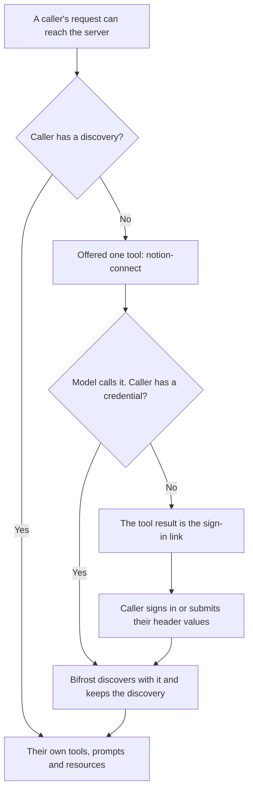

## Overview

By default, a per-user MCP server shows every caller the same tools: the ones Bifrost discovered with the admin's credential when the server was verified. Each caller's own credential is used only to run their tool calls.

Some servers return different tools to different accounts, for example by workspace, plan or role. With **Per-Caller Discovery** on (`per_user_discovery: true`), Bifrost discovers each caller's tools, prompts, resources and server instructions with that caller's own credential, and serves each caller only what their account has. The server then keeps no admin credential and no discovery of its own.

|                          | Off (default)                                           | On                                                        |
| ------------------------ | ------------------------------------------------------- | --------------------------------------------------------- |
| Tools a caller sees      | What the admin credential discovered                    | What their own credential discovered                      |
| Admin credential         | Kept, used only to refresh the tool list                | Not kept: the admin's step only verifies the server       |
| Periodic tool sync       | Every `tool_sync_interval`                              | None: each caller's discovery is made when they connect   |
| Before a caller connects | The full tool list; a tool call returns a sign-in link  | One tool, `<server>-connect`                              |

Per-Caller Discovery applies to the per-user auth types: [Per-User OAuth](./auth/per-user-oauth), [Per-User Headers](./auth/per-user-headers) and [Token Exchange](./auth/token-exchange). It does not apply to [OpenAPI servers](./openapi-servers), whose tools come from their OpenAPI document.

<Note>
A discovery is kept per user or per virtual key. A caller identified only by `x-bf-mcp-session-id` (see [Identity modes](./auth/overview#identity-modes)) has none, so a server with Per-Caller Discovery on offers them none of its tools.
</Note>

---

## Turn it on

<Tabs group="config-method">
<Tab title="Web UI">

**On a new server:**

1. Navigate to **MCP Gateway** in the sidebar and click **New MCP Server**
2. Pick **HTTP** as the connection type and fill in the **Connection URL**
3. Set **Auth Type** to **Per-User OAuth 2.0**, **Per-User Headers** or **Token Exchange (On-Behalf-Of)**, and fill in its fields
4. Turn on **Per-Caller Discovery**
5. Click **Create** and complete the admin's one-time step. With Per-Caller Discovery on, it only verifies the server (see [Verification](#verification))

<Frame>
  
</Frame>

**On an existing server:**

1. Open the server's actions menu (**⋯**) in **MCP Gateway** and click **Edit**
2. On the **General** tab, turn **Per-Caller Discovery** on or off
3. Read the warning under the toggle: it says what saving deletes (see [Turning it on or off](#turning-it-on-or-off))
4. Click **Save**

<Frame>
  
</Frame>

With Per-Caller Discovery on, the **Tool sync interval** field on the same tab is disabled: the server keeps no discovery of its own to sync.

</Tab>
<Tab title="API">

Set `per_user_discovery` when creating the server:

```bash
curl -X POST http://localhost:8080/api/mcp/client \
  -H "Content-Type: application/json" \
  -d '{
    "name": "acme_api",
    "connection_type": "http",
    "connection_string": "https://api.acme.example.com/mcp",
    "auth_type": "per_user_headers",
    "per_user_header_keys": ["X-API-Key"],
    "user_headers": {
      "X-API-Key": "your-admin-sample-key"
    },
    "per_user_discovery": true,
    "tools_to_execute": ["*"]
  }'
```

```json
{
  "status": "success",
  "message": "MCP client registered and verified. Each user will submit their own headers and discover their own tools on first tool use."
}
```

The sample values in `user_headers` only verify the connection. They are not kept.

To turn it on or off for an existing server, send only the field. Fields left out of the body keep their values:

```bash
curl -X PUT http://localhost:8080/api/mcp/client/{id} \
  -H "Content-Type: application/json" \
  -d '{ "per_user_discovery": true }'
```

A server whose auth type is not a per-user one, or whose connection type is `openapi`, is refused with `400`.

</Tab>
<Tab title="config.json">

Add `per_user_discovery` to the server's entry under `mcp.client_configs`:

```json
{
  "mcp": {
    "client_configs": [
      {
        "name": "notion",
        "connection_type": "http",
        "connection_string": "https://mcp.notion.com/mcp",
        "auth_type": "per_user_oauth",
        "oauth_config": {
          "client_id": "your-client-id",
          "scopes": ["read"]
        },
        "per_user_discovery": true,
        "tools_to_execute": ["*"]
      }
    ]
  }
}
```

| Field                | Type    | Required | Description                                                                                                       |
| -------------------- | ------- | -------- | ----------------------------------------------------------------------------------------------------------------- |
| `per_user_discovery` | boolean | No       | `true` discovers each caller's tools with their own credential. Only for `per_user_oauth`, `per_user_headers` and `token_exchange`, and not for `connection_type` `openapi`. Default `false`. |

An entry whose `per_user_discovery` does not fit its auth or connection type is skipped at startup with an error in the log. A stored server of that name keeps its current configuration. Changing the value in the file later has the same effect as changing it in the UI (see [Turning it on or off](#turning-it-on-or-off)).

The Helm chart takes the same setting as `perUserDiscovery` on an entry of `bifrost.mcp.clientConfigs`.

</Tab>
</Tabs>

---

## Verification

Each per-user auth type keeps its one-time admin step. With Per-Caller Discovery on, the step only checks that the server works with its configuration, and nothing from it is kept:

- **Per-User OAuth:** the admin signs in once. Bifrost checks the sign-in, then deletes it.
- **Per-User Headers:** the admin's sample header values verify the connection and are not stored.
- **Token Exchange:** Bifrost exchanges the admin's identity token to verify the server, then keeps nothing.

Until the step completes, the server is `pending_verification` and serves no caller, not even its connect tool. A `config.json`-declared server starts there, and is verified from its view sheet as for any other per-user server.

Once the server is verified, it has no admin credential to repair. `POST /api/mcp/client/{id}/reauthorize`, and a repeat `verify-headers` or `verify-exchange` call, return `400`. For a Per-User OAuth server, `POST /api/mcp/client/{id}/reregister` still works: it registers a new OAuth client with the provider, every caller signs in again, and the admin's sign-in afterwards only verifies the new registration.

---

## How a caller gets their tools



### The connect tool

Until a caller has a discovery for a server, Bifrost offers them one tool in its place, `<server>-connect` (for example `notion-connect`). Bifrost answers the call itself; it never reaches the upstream server. Its result is always a normal tool result:

- **The caller has a credential:** Bifrost discovers the server's tools with it and keeps them as the caller's discovery. The result reads `Connected to notion: 12 tools are available from your next turn.`
- **The caller has none yet:** the result is the sign-in link, the same `mcp_auth_required` message a tool call returns (see [How per-user auth works](./auth/overview#how-per-user-auth-works-lazy-auth)). Its description tells the model to give the link to the user exactly as returned.
- **The caller is already connected:** `Already connected to notion; its tools are in your tool list.`

Once the caller has a discovery, their tools replace the connect tool. In an [agent mode](./agent-mode) loop that happens from the next turn, and connect calls run there without waiting for approval.

A caller is offered a server's connect tool when the server is enabled and verified, allows at least one tool (`tools_to_execute` is not empty), and is reachable by the request: in its client list, and named by its tool list when it carries one. A virtual key may call it when it allows at least one of that server's tools, since no key can name a tool its caller has not discovered yet. In [code mode](./code-mode), the connect tool is offered as a direct tool, not as a code binding.

<Note>
If the upstream server has its own tool named `connect`, its name on Bifrost is also `<server>-connect`. Once the caller's discovery holds that tool, the name is the upstream tool's.
</Note>

### At sign-in

Per-User OAuth and Per-User Headers callers don't need the connect tool after signing in. Bifrost discovers their tools as part of the sign-in (the OAuth callback, or submitting their header values), so their next request has them.

Token Exchange callers have no sign-in step: their first discovery is made through the connect tool, with their exchanged identity token.

If discovery fails at sign-in, for example because the upstream server is down, the sign-in still succeeds: the credential is stored. The page shows **Discovery not finished yet**, and the caller is offered the connect tool, which retries. Over the API, the per-user headers submit response carries a `discovery_error` field in that case.

---

## What each caller sees

A caller is served only their own discovery of the server, on both the **LLM Gateway** and the **MCP Gateway** (`/mcp`). On `/mcp`, the tools, prompts, resources and resource templates a caller lists are their own, with their own descriptions and schemas. A name the caller does not hold behaves as if it did not exist, so calling names reveals nothing about another caller's account.

The server's own settings still apply to every caller's tools, by tool name: which tools are enabled (`tools_to_execute`), which run without approval (`tools_to_auto_execute`), and their pricing. Request-level [filters](./filtering) can only narrow that further. In the server's **Tools** settings, these are set on the names seen in callers' discoveries so far (see [Seeing what callers have](#seeing-what-callers-have)); `"*"` covers names no caller has yet.

---

## Keeping discoveries current

There is no periodic sync: a caller's discovery stays as it was made until it is replaced or deleted. When the upstream server adds or removes tools, a caller's discovery is made again when:

- **Their session is refreshed:** **Refresh tools** on the [MCP Sessions](./sessions#refresh-tools-per-caller-discovery) page, or `POST /api/mcp/sessions/{id}/refresh`. It uses the credential the session stores, so the caller does not sign in again.
- **They sign in again:** re-authenticating an OAuth session, or editing a header session's values, discovers again as any sign-in does.
- **Their discovery was deleted:** they are offered the connect tool, and their next connect discovers again (see below).

Token Exchange callers have no session rows, so their discovery is made again only after it is deleted.

`POST /api/mcp/client/{id}/refresh-tools` does not apply: the server keeps no tool list of its own, and the call returns `400`.

---

## When a discovery is deleted

A caller's discovery is deleted in the same write as the stored credential it was made with, so an OAuth or header caller never keeps tools they can no longer call. It is deleted when:

- the caller's session is revoked on the [MCP Sessions](./sessions) page;
- their OAuth token is rejected on refresh, or is found expired with no way to refresh it, and the session needs re-authentication;
- the server's `oauth_config` is rotated, which sends every OAuth session to `needs_reauth`;
- the server's required header names change, which sends every header session to `needs_update`;
- the server's token exchange settings change;
- a Token Exchange caller's tool call can't get a token, because the identity provider declines the exchange or the caller has no valid identity token or sign-in;
- an `orphaned` credential is cleaned up after the retention period;
- the caller's virtual key is deleted;
- the server is deleted, or Per-Caller Discovery is turned off.

Token Exchange stores no per-caller credential, so a caller whose identity token is revoked or expires keeps their discovery until one of these happens, usually at their next tool call.

Afterwards, the caller is offered the connect tool again while the server still [offers one](#the-connect-tool). A deleted server, or one with Per-Caller Discovery turned off, offers none.

---

## Turning it on or off

Changing the setting changes what the server keeps, so saving deletes something either way. The UI shows a warning under the toggle before you save.

- **Turning it on** deletes the server's admin credential and the discovery made with it. Callers' own credentials are kept, and each caller's tools are discovered with them when they next connect or sign in. A verified server stays verified.
- **Turning it off** deletes every caller's discovery. The server goes back to `pending_verification` until an admin completes its admin step again, which discovers with the admin's credential and keeps it:
  - **Per-User OAuth:** the server keeps its OAuth registration, so callers keep their sign-ins. Verify it from its view sheet, or with `POST /api/mcp/client/{id}/initiate-verification` or `/reauthorize`, which sign the admin in on that registration.
  - **Per-User Headers:** verify it with sample values (`POST /api/mcp/client/{id}/verify-headers`).
  - **Token Exchange:** verify it as yourself (`POST /api/mcp/client/{id}/verify-exchange`).

---

## Seeing what callers have

On a server with Per-Caller Discovery on, the view sheet's **Tools** tab lists **Tools Seen in Callers' Discoveries**: every tool name found in at least one caller's discovery, with how many callers have it. Descriptions are not shown, since they can differ from one caller to another. On a Per-User OAuth or Per-User Headers server, the **Callers** tab lists its sessions.

<Frame>
  
</Frame>

Over the API, `GET /api/mcp/clients` returns the same: the server's `tools` are the names seen in callers' discoveries, and `callers_by_tool` maps each name to its caller count. `callers_by_tool` is left out until a caller has connected.

On the [MCP Sessions](./sessions#columns) page, the **Discovery** column shows what was discovered with each session's credential and when, for example `3 tools · 1 prompt · 2 resources`, discovered 4 min ago.

---

## Troubleshooting

### A caller only sees `<server>-connect`

**Cause:** the caller has no discovery for the server yet: they have not signed in, discovery failed at sign-in, or their discovery was [deleted](#when-a-discovery-is-deleted).

**Fix:** have the model call the connect tool, then follow the sign-in link it returns if there is one. On the next request, the caller has their tools.

### A caller sees none of the server's tools, not even the connect tool

**Cause:** one of these:

- the request carries no user or virtual-key identity, only `x-bf-mcp-session-id`, or none;
- the server is still `pending_verification`;
- the server allows no tools (`tools_to_execute` is empty);
- the request's client or tool list leaves the server out.

**Fix:** send a virtual key or sign in, complete the server's [verification](#verification), and check the server's tool settings and the request's filters.

### A tool the upstream server added doesn't appear

**Cause:** the caller's discovery was made before the tool existed. There is no periodic sync.

**Fix:** for a Per-User OAuth or Per-User Headers caller, use **Refresh tools** on their session (see [Keeping discoveries current](#keeping-discoveries-current)). A Token Exchange caller has no session to refresh, so their discovery is made again only after it is [deleted](#when-a-discovery-is-deleted).

### `reauthorize`, `verify-headers` or `verify-exchange` returns `400`

**Cause:** with Per-Caller Discovery on, a verified server keeps no admin credential to refresh or verify again.

**Fix:** nothing to repair. To pick up tools the upstream server added, see [A tool the upstream server added doesn't appear](#a-tool-the-upstream-server-added-doesnt-appear).

---

## Next Steps

- **[Per-User OAuth](./auth/per-user-oauth)**: each user authenticates themselves
- **[Per-User Headers](./auth/per-user-headers)**: each user submits their own header values
- **[Token Exchange](./auth/token-exchange)**: each caller's identity token is exchanged automatically
- **[MCP Sessions](./sessions)**: per-user credentials, their discoveries, and Refresh tools
