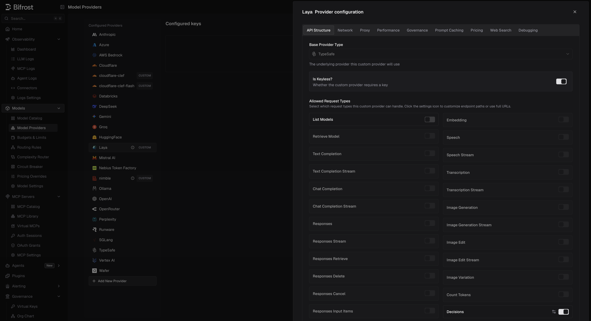
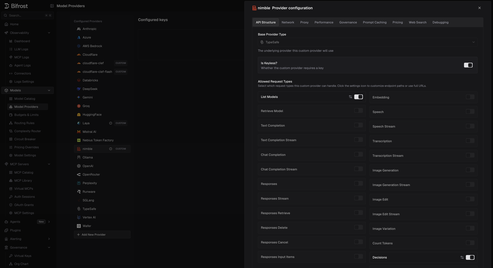

## Overview

[Laya](https://github.com/NandhaKishorM/laya) and [Nimble](https://github.com/bespokelabsai/nimble) are open decision models you run yourself. Both serve TypeSafe's System One API (`POST /v1/systemone`), so you add each one as a [custom provider](/providers/custom-providers) on the **Typesafe** base format. They then work like any other decision model: on [`/v1/decisions`](/quickstart/gateway/decisions), on `/typesafe/v1/systemone`, and as the [Complexity Router](/features/complexity-router) classifier.

| | Laya | Nimble |
|---|---|---|
| **Runs as** | `laya-serve`, a local Python server | An SGLang server deployed on Modal |
| **Models** | `english`, `multilingual`, `typed-decisions` | `nimble-latest` |
| **Model listing** | No `/v1/models`: turn **List Models** off | Has `/v1/models`: leave it on |
| **Auth** | Optional bearer token (`LAYA_API_KEY`) | None on a public deployment |
| **Input** | Text only | Text only |

<Tip>
Running these models in Ollama, vLLM or SGLang? Use the [Ollama](/providers/supported-providers/ollama#6-decisions), [vLLM](/providers/supported-providers/vllm#decisions) or [SGLang](/providers/supported-providers/sgl#decisions) provider instead; each serves `/v1/systemone` natively and needs no custom provider. The custom TypeSafe provider below is for servers that are none of these, such as `laya-serve` or Nimble's own SGLang app.
</Tip>

---

## Laya

### 1. Run the server

```bash
pip install "laya[serve]"
laya-serve
```

It listens on `0.0.0.0:8000` and loads all three checkpoints at startup. Useful settings:

| Variable | Default | Purpose |
|----------|---------|---------|
| `LAYA_PORT` | `8000` | Port to listen on |
| `LAYA_API_KEY` | unset | When set, every request must send `Authorization: Bearer <key>` |
| `LAYA_PRELOAD` | `1` | Load checkpoints at startup instead of on first use |
| `LAYA_MODELS` | all | Comma-separated checkpoints to preload |
| `LAYA_MAX_LOADED` | `2` | Checkpoints kept in memory, for those loaded on demand |

### 2. Add the provider

<Tabs group="config-method">
<Tab title="Web UI">



1. Navigate to **Models** > **Model Providers** and click **Add New Provider**.
2. In **Add Custom Provider**, set **Name** (for example `laya`) and **Base Format** to **Typesafe**.
3. Set **Base URL** to your server, for example `http://localhost:8000`.
4. Under **Allowed Request Types**, turn on **Decisions** and turn **List Models** off.
5. If `LAYA_API_KEY` is set, add a key with that value. Otherwise, turn on **Is Keyless?**.
6. In the key's **Allowed Models**, type the checkpoints you use: `english`, `multilingual`, `typed-decisions`.
7. Save.

</Tab>
<Tab title="config.json">

```json
{
  "providers": {
    "laya": {
      "keys": [
        {
          "name": "laya-key",
          "value": "env.LAYA_API_KEY",
          "models": ["english", "multilingual", "typed-decisions"],
          "weight": 1
        }
      ],
      "network_config": {
        "base_url": "http://localhost:8000"
      },
      "custom_provider_config": {
        "base_provider_type": "typesafe",
        "allowed_requests": {
          "list_models": false,
          "decisions": true
        }
      }
    }
  }
}
```

Without `LAYA_API_KEY`, drop `keys` and add `"is_key_less": true` to `custom_provider_config`.

</Tab>
</Tabs>

<Warning>
**Two settings make the provider look broken if missed.**

- **List Models off.** Laya has no `/v1/models`. With listing on, the provider is marked `list_models_failed` and the Complexity Router reports it as failing its checks.
- **Allowed Models set.** A key that allows every model, on a provider that lists none, makes Bifrost treat Laya as serving *every* model. Requests without a provider prefix, of any type, are then tried on Laya first.
</Warning>

### 3. Send a decision

```bash
curl http://localhost:8080/v1/decisions \
  -H "Content-Type: application/json" \
  -H "x-bf-passthrough-extra-params: true" \
  -d '{
    "model": "laya/english",
    "input": "Customer message: I was double charged and nobody replied to my two emails.",
    "questions": [
      { "type": "predicate", "name": "is_frustrated", "instructions": "Is the customer frustrated?" }
    ],
    "min_confidence": 0.8
  }'
```

- **Choosing a checkpoint.** `english` reads 512 tokens, `multilingual` 1,024, and `typed-decisions` 1,024; longer input is truncated (see `usage.truncated`). Any other name without a slash, such as `auto`, lets Laya's router pick by language. A name with a slash is a `422`.
- **Laya-only fields** (`min_confidence`, `lang`, `max_len`, `task`) need the `x-bf-passthrough-extra-params: true` header on `/v1/decisions`. On `/typesafe/v1/systemone` they pass through without it.
- **Extra response fields** such as `answer_confidence`, `abstention`, and `routing` are listed under [Provider-Specific Fields](/quickstart/gateway/decisions#provider-specific-fields). A server started with `LAYA_JEV_STRICT=1` leaves them out.
- **Images** are rejected with a `400` before the call, so a [fallback](/quickstart/gateway/decisions#fallbacks) can serve the request.

---

## Nimble

### 1. Run the server

Nimble ships as an SGLang deployment on Modal with its own server app. Follow Nimble's [serving guide](https://github.com/bespokelabsai/nimble/blob/main/docs/MODAL_SERVING.md) to deploy your own; the public demo URL it once offered has been answering `503 no upstreams available`. Because the Modal app wraps SGLang with Nimble's own prompt format, add it as a custom TypeSafe provider as below. A plain `sglang serve` deployment of a decision checkpoint (Clef, Kev, PPLX-Decider) needs no custom provider: use the [SGLang provider](/providers/supported-providers/sgl#decisions).

### 2. Add the provider

<Tabs group="config-method">
<Tab title="Web UI">



1. Navigate to **Models** > **Model Providers** and click **Add New Provider**.
2. In **Add Custom Provider**, set **Name** (for example `nimble`) and **Base Format** to **Typesafe**.
3. Set **Base URL** to your deployment's URL.
4. Under **Allowed Request Types**, turn on **Decisions** and **List Models**.
5. Turn on **Is Keyless?**. For a private deployment, send its auth headers through **Network** > **Extra Headers** instead.
6. Save.

</Tab>
<Tab title="config.json">

```json
{
  "providers": {
    "nimble": {
      "network_config": {
        "base_url": "https://<your-nimble-deployment>.modal.run"
      },
      "custom_provider_config": {
        "base_provider_type": "typesafe",
        "is_key_less": true,
        "allowed_requests": {
          "list_models": true,
          "decisions": true
        }
      }
    }
  }
}
```

Replace `base_url` with your own deployment's URL before use.

</Tab>
</Tabs>

### 3. Send a decision

```bash
curl http://localhost:8080/v1/decisions \
  -H "Content-Type: application/json" \
  -d '{
    "model": "nimble/nimble-latest",
    "input": "Customer message: I was double charged and nobody replied to my two emails.",
    "questions": [
      { "type": "predicate", "name": "is_frustrated", "instructions": "Is the customer frustrated?" }
    ]
  }'
```

- **Limits.** Choice and score questions take 2-26 options, a request takes at most 64 questions, and each question's prompt must fit in 8,192 tokens. Oversized prompts are rejected, not truncated.
- **Question names matter.** Nimble keeps names and option keys in its prompt, so renaming a question can change its answer.
- **Cold starts.** A Modal deployment scales to zero after 2 idle minutes and takes a few minutes to wake, returning `503` meanwhile. Under load it can return `529`; retry.
- **Images** are rejected with a `400` before the call.

---

## Pricing

A custom provider has no price in Bifrost's model catalog, so its decisions cost `$0` until you add a [pricing override](/providers/custom-pricing):

- **Scope**: the provider (optionally one key)
- **Match**: **Exact** on a model name such as `english`, or **Wildcard** for several
- **Request types**: `decisions`
- **Rates**: `input_cost_per_token_decisions` and `output_cost_per_token_decisions`, in **USD per token**. For $0.50 per million input tokens, set `0.0000005`.

Laya reports 0 output tokens, so only its input rate is charged. Nimble reports one output token per question plus one.

```json
{
  "governance": {
    "pricing_overrides": [
      {
        "id": "8a1f6c2e-3b7d-4e59-9c1a-2f4d6e8b0a13",
        "name": "Laya english",
        "scope_kind": "provider",
        "provider_id": "laya",
        "match_type": "exact",
        "pattern": "english",
        "request_types": ["decisions"],
        "pricing_patch": "{\"input_cost_per_token_decisions\":0.0000005}"
      }
    ]
  }
}
```

---

## Using them in the Complexity Router

Pick the custom provider as the decision model in [**Complexity Router**](/features/complexity-router#choosing-the-decision-model). Nimble's models come from its listing. For Laya, which lists none, the UI offers the known checkpoints, starting on `english` when the provider is named after Laya.

- **Keep guidance short on Laya.** All tier guidance is sent on every request, and `english` reads only 512 tokens. `multilingual` reads 1,024.
- **Keep the model loaded.** A request that waits for a model to load goes unclassified once it passes `decision.timeout` (`1.5s` by default). For Laya, keep `LAYA_PRELOAD=1` with every checkpoint you use, or raise `LAYA_MAX_LOADED`. For Nimble on Modal, keep the deployment warm, since waking takes minutes.

---

## Troubleshooting

| Symptom | Cause | Fix |
|---------|-------|-----|
| Laya shows `list_models_failed`, and the Complexity Router says it is failing its checks | List Models is on | Turn **List Models** off |
| Unrelated requests (chat, embeddings) go to Laya | The key allows every model | List the checkpoints in **Allowed Models** |
| `401` from Laya | `LAYA_API_KEY` is set but the provider is keyless, or the key differs | Add a key with the same value |
| `422` from Laya | The model name contains a slash | Use a checkpoint name, or a name like `auto` |
| `min_confidence` has no effect | Extra params are not passed through | Add `x-bf-passthrough-extra-params: true` |
| `503` from Nimble | The deployment is waking from idle | Wait and retry |
| Cost is `$0` | No pricing override | Add a `decisions` override |

---

## Next Steps

- **[Decisions](/quickstart/gateway/decisions)** - Request and response format
- **[TypeSafe](/providers/supported-providers/typesafe)** - How System One requests are converted
- **[Complexity Router](/features/complexity-router)** - Route requests by complexity with a decision model
- **[Custom Pricing](/providers/custom-pricing)** - Price self-hosted models
