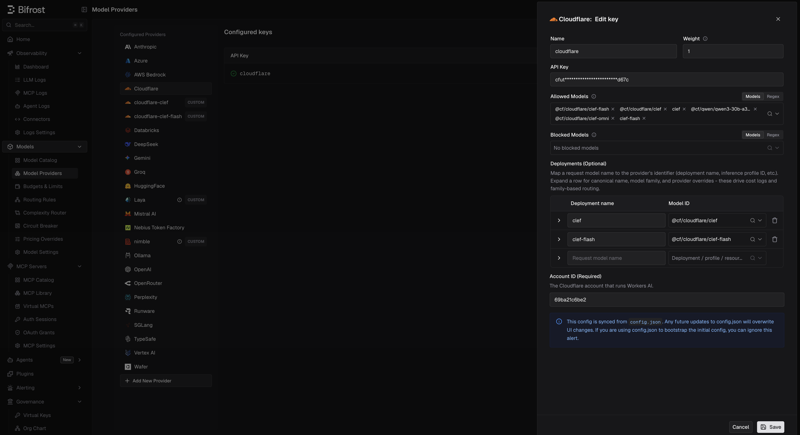

## Overview

Cloudflare Workers AI is a built-in Bifrost provider (`cloudflare`). Use it for:

- **Chat and Responses** with Workers AI text models, streaming included
- **Embeddings**, including as the embedding provider for [semantic caching](/features/semantic-caching)
- **Decisions** with Cloudflare's Clef models (`clef`, `clef-flash`, `clef-omni`), including image inputs

Each key carries its own Cloudflare account ID, so one provider can serve several accounts.

### Supported Operations

| Operation | Non-Streaming | Streaming | Endpoint |
|-----------|---------------|-----------|----------|
| Chat Completions | ✅ | ✅ | `/accounts/{account_id}/ai/v1/chat/completions` |
| Responses API | ✅ | ✅ | `/accounts/{account_id}/ai/v1/chat/completions` |
| Embeddings | ✅ | - | `/accounts/{account_id}/ai/v1/embeddings` |
| Decisions | ✅ | - | `/accounts/{account_id}/ai/run/@cf/cloudflare/{model}` |
| List Models | ✅ | - | `/accounts/{account_id}/ai/models/search` |
| Image Generation | Not yet | Not yet | - |
| Speech (TTS) | Not yet | Not yet | - |
| Transcriptions (STT) | Not yet | Not yet | - |
| Rerank | Not yet | - | - |
| Text Completions | ❌ | ❌ | - |
| Files | ❌ | ❌ | - |
| Batch | ❌ | ❌ | - |

<Note>
**Not supported yet:** Workers AI hosts image generation, text-to-speech, speech recognition, and reranking models, but Bifrost does not route these operations to Cloudflare yet. Until it does, they return `UnsupportedOperationError`, like the other operations marked ❌ (Text Completions, Video, Files, Batch, Containers, OCR, Count Tokens, and Passthrough).
</Note>

## Setup & Configuration

You need a Cloudflare API token with **Workers AI** permission and your Cloudflare account ID. Each request goes to the account of the key that serves it.

<Tabs>
<Tab title="Web UI">



1. Navigate to **Models** > **Model Providers**. Click **Add New Provider** and select **Cloudflare**.
2. Click **Add Key**.
3. Set a name for the key.
4. Paste your API token, or use an environment variable such as `env.CLOUDFLARE_API_TOKEN`.
5. Set **Account ID (Required)**, for example `env.CLOUDFLARE_ACCOUNT_ID`.
6. Set **Allowed Models** to **All Models** (default) or a specific allowlist.
7. Save the provider configuration.

</Tab>
<Tab title="config.json">

```json
{
  "providers": {
    "cloudflare": {
      "keys": [
        {
          "name": "cloudflare-key-1",
          "value": "env.CLOUDFLARE_API_TOKEN",
          "models": ["*"],
          "weight": 1.0,
          "cloudflare_key_config": {
            "account_id": "env.CLOUDFLARE_ACCOUNT_ID"
          }
        }
      ]
    }
  }
}
```

| Field | Type | Required | Description |
|-------|------|----------|-------------|
| `cloudflare_key_config.account_id` | string | Yes | Cloudflare account ID that serves Workers AI. Supports the `env.` prefix |

</Tab>
<Tab title="API">
Refer to the API documentation for [Provider Keys Management](https://docs.getbifrost.ai/api-reference/providers/create-a-key-for-a-provider). Include `cloudflare_key_config.account_id` in the key body.
</Tab>
<Tab title="Go SDK">

```go
case schemas.Cloudflare:
    return []schemas.Key{{
        Name:   "cloudflare-key-1",
        Value:  *schemas.NewSecretVar("env.CLOUDFLARE_API_TOKEN"),
        Models: []string{"*"},
        Weight: 1.0,
        CloudflareKeyConfig: &schemas.CloudflareKeyConfig{
            AccountID: *schemas.NewSecretVar("env.CLOUDFLARE_ACCOUNT_ID"),
        },
    }}, nil
```

</Tab>
</Tabs>

A key without an account ID fails with `no account ID configured: set cloudflare_key_config.account_id on the key`.

### Migrating a custom `cloudflare` provider

If you added Workers AI earlier as a custom provider named `cloudflare`, that name is now reserved: the custom provider can no longer be saved, and its `config.json` entry is skipped.

Open it in **Model Providers** and the UI offers to migrate it to the built-in provider, as long as its base URL is a Workers AI URL (`https://api.cloudflare.com/client/v4/accounts/<ACCOUNT_ID>/ai`, with or without `/v1`):

1. Review the preview. The account ID is read from the base URL, and the token from the `Authorization` header if the old provider was keyless. Fill in either by hand if it could not be read.
2. Re-enter any secret stored as a masked literal; `env.` references carry over.
3. Confirm. Keys, virtual key grants, budgets, and rate limits keep working. Request path overrides and allowed-request restrictions are not carried over.

If the migration fails partway, Bifrost tries to restore the old provider. Keys stored only as masked literals cannot be restored, and the dialog warns about this first.

A custom provider pointing anywhere else, such as AI Gateway, cannot be migrated. Recreate it under another name, such as `cloudflare-custom`.

---

# 1. Chat Completions

Cloudflare uses the OpenAI-compatible chat format. See [OpenAI Chat Completions](/providers/supported-providers/openai#1-chat-completions) for the parameter reference. Models use Cloudflare's full IDs:

```bash
curl -X POST http://localhost:8080/v1/chat/completions \
  -H "Content-Type: application/json" \
  -d '{
    "model": "cloudflare/@cf/meta/llama-4-scout-17b-16e-instruct",
    "messages": [{"role": "user", "content": "Hello!"}]
  }'
```

Streaming uses the same endpoint with `"stream": true`.

---

# 2. Responses API

Responses requests are converted to Chat Completions and back, for both non-streaming and streaming calls:

```
BifrostResponsesRequest
  → ToChatRequest()
  → ChatCompletion
  → ToBifrostResponsesResponse()
```

---

# 3. Embeddings

```bash
curl -X POST http://localhost:8080/v1/embeddings \
  -H "Content-Type: application/json" \
  -d '{
    "model": "cloudflare/@cf/baai/bge-large-en-v1.5",
    "input": "Bifrost is an AI gateway"
  }'
```


---

# 4. Decisions

Clef models answer [`/v1/decisions`](/quickstart/gateway/decisions):

| Model | Notes |
|-------|-------|
| `clef` | 65k-token context |
| `clef-flash` | Smaller and cheaper. Rejects inputs over 24,576 tokens with a `413` instead of truncating. Cold starts can take 4-6 seconds |
| `clef-omni` | |

```bash
curl http://localhost:8080/v1/decisions \
  -H "Content-Type: application/json" \
  -d '{
    "model": "cloudflare/clef-flash",
    "input": "Customer message: I was double charged and nobody replied to my two emails.",
    "questions": [
      { "type": "predicate", "name": "is_frustrated", "instructions": "Is the customer frustrated?" }
    ]
  }'
```

You can also write the full Workers AI ID, `cloudflare/@cf/cloudflare/clef-flash`; it is the same model. Clef uses TypeSafe's System One format, so questions are converted as on [TypeSafe](/providers/supported-providers/typesafe#field-mapping-reference). Differences from TypeSafe:

- **Images are supported.** `input_image` parts are moved into Clef's `images` field. Send them as base64 data URLs.
- **Validation is strict.** Clef returns a `422` for a `null` input or for any field it does not define, so do not pass extra params to it.

A model Workers AI does not serve returns Cloudflare's own error. The [complexity router](/features/complexity-router#choosing-the-decision-model) can use Clef as its classifier; pick **Cloudflare** and it starts on `@cf/cloudflare/clef-flash`.

---

# 5. List Models

The model list comes from each key's Workers AI account. It includes text generation and embedding models, plus the Clef models, under Cloudflare's IDs: for example `cloudflare/@cf/meta/llama-4-scout-17b-16e-instruct` and `cloudflare/@cf/cloudflare/clef-flash`. Models for operations Bifrost does not support yet (image, speech) are left out.

To list only the decision models, call `GET /api/models?provider=cloudflare&decisions=true`.

---

## Caveats

<Accordion title="Errors come from Cloudflare's envelope">
Cloudflare wraps every failure in `{"success": false, "errors": [...]}`. Bifrost keeps Cloudflare's status and joins the messages with `; `, for example `AiError: No such model: ...; Expected array, received string`.
</Accordion>

<Accordion title="Self-hosted Clef">
To run Clef on your own hardware, pull it in [Ollama](/providers/supported-providers/ollama#6-decisions).
</Accordion>
