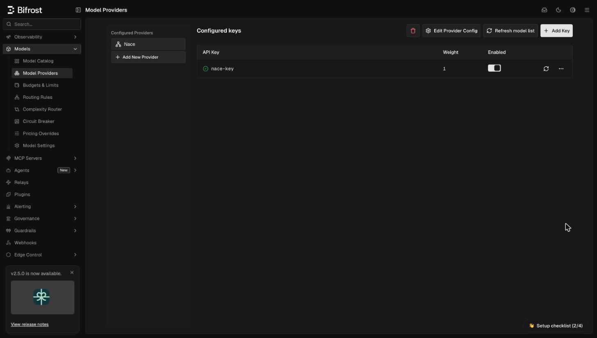

## Overview

Nace is a decision provider serving Drex models. Bifrost converts typed decision questions to Nace's System One API and normalizes the answers. See the [Drex documentation](https://console.nace.ai/docs) for the upstream API.

### Supported Operations

| Operation | Non-Streaming | Streaming | Endpoint |
|-----------|---------------|-----------|----------|
| Decisions | ✅ | - | `/v1/decisions` |
| List Models | ✅ | - | `/v1/models` |
| Chat Completions | ❌ | ❌ | - |
| Responses API | ❌ | ❌ | - |
| Text Completions | ❌ | ❌ | - |
| Embeddings | ❌ | ❌ | - |

<Note>
**Unsupported operations:** Every operation other than decisions and model listing returns `UnsupportedOperationError`. Image input to a decision is supported on the Drex Max models below; image generation is unsupported.

**Model listing:** Bifrost calls Nace's live `GET /v1/models`. The listing is subject to the key's allowed and blocked models.
</Note>

## Setup & Configuration

Configure the built-in `nace` provider with a bearer API key. The default base URL is `https://console.nace.ai`.

<Tabs>
<Tab title="Web UI">

1. Navigate to **Models** > **Model Providers**. Click **Add New Provider** and select **Nace**.
2. Click **Add Key**, give it a name, and enter your API key or `env.NACE_API_KEY`.
3. Set **Allowed Models** to **All Models** or an allowlist, enable the key, and save.



Use **Edit Provider Config** if you need to change the base URL.

</Tab>
<Tab title="config.json">

```json
{
  "providers": {
    "nace": {
      "keys": [
        {
          "name": "nace-key",
          "value": "env.NACE_API_KEY",
          "models": ["*"],
          "weight": 1
        }
      ],
      "network_config": {
        "base_url": "https://console.nace.ai"
      }
    }
  }
}
```

| Field | Type | Required | Description |
|-------|------|----------|-------------|
| `keys[].value` | string | Yes | API key; use `env.NACE_API_KEY` to read it from the environment |
| `network_config.base_url` | string | No | Defaults to `https://console.nace.ai`; Bifrost appends `/v1/systemone` or `/v1/models` |

</Tab>
<Tab title="API">

```bash
curl -X POST http://localhost:8080/api/providers \
  -H "Content-Type: application/json" \
  -d '{"provider": "nace"}'

curl -X POST http://localhost:8080/api/providers/nace/keys \
  -H "Content-Type: application/json" \
  -d '{
    "name": "nace-key",
    "value": "env.NACE_API_KEY",
    "models": ["*"],
    "weight": 1
  }'
```

</Tab>
<Tab title="Go SDK">

Have your account return `schemas.Nace` from `GetConfiguredProviders`. In `GetKeysForProvider`, return this key for Nace:

```go
case schemas.Nace:
    return []schemas.Key{{
        Name:   "nace-key",
        Value:  *schemas.NewSecretVar("env.NACE_API_KEY"),
        Models: []string{"*"},
        Weight: 1,
    }}, nil
```

Return `&schemas.ProviderConfig{}` from `GetConfigForProvider` for the default endpoint, or set `NetworkConfig.BaseURL` for an override. After [initializing the client](/quickstart/go-sdk/setting-up), call decisions with `Provider: schemas.Nace` and `Model: "drex-v2.0"`; see the [Go SDK decision example](/quickstart/go-sdk/decisions#basic-example).

</Tab>
</Tabs>

Bifrost sends `Authorization: Bearer <key>`, `X-Nace-Client: bifrost/<version>`, and `User-Agent: bifrost/<version>` on decision and model-list requests. The version is sanitized and the client identifier is capped at 64 bytes; an empty version uses `dev`.

## Decisions API

Use `nace/<model>` on any of these gateway routes:

| Route | Request shape |
|-------|---------------|
| `POST /v1/decisions` | Bifrost's unified input and questions |
| `POST /openai/v1/decisions` | OpenAI's Decisions API |
| `POST /typesafe/v1/systemone` | TypeSafe's System One API (`state` and questions keyed by name) |
| `GET /v1/models` | Model listing, including the configured Nace provider |

Decisions reach Nace's `POST /v1/systemone`; model listing calls its live `GET /v1/models`. The listing is subject to the key's allowed and blocked models. Use that listing for available models and metadata.

```bash
curl -X POST http://localhost:8080/v1/decisions \
  -H "Content-Type: application/json" \
  -d '{
    "model": "nace/drex-v2.0",
    "input": "The customer was charged twice and requests a refund.",
    "questions": [{
      "type": "predicate",
      "name": "billing_issue",
      "instructions": "Is this a billing issue?"
    }]
  }'
```

| Question type | Native type | Answer |
|---------------|-------------|--------|
| `predicate` | `noul` | Probability between 0 and 1 |
| `choice` | `choice` | One of the supplied choices |
| `score` | `score` | Rubric score using the supplied ordered levels |
| `box` | Unsupported | Rejected locally with HTTP 400 |

## Images

Only `drex-max`, `drex-max-v1.1`, and `drex-max-finance` read images. The alias `drex-v1.0` follows `drex-max` for this check. On `/v1/decisions` and `/openai/v1/decisions`, text-only models, including `drex-v2.0` and `drex-v1.5`, reject `input_image` parts before an upstream request.

On these two routes, send ordered inline `input_image` parts without an `id`. Bifrost removes them from the message state and sends a top-level `images` array to Nace in encounter order. Images must be base64 data or PNG, JPEG, or WebP base64 data URLs. HTTP URLs, file paths, and image asset references are rejected. Bifrost accepts at most eight images, with a 16 MiB limit per image.

See [decision input](/quickstart/gateway/decisions#input) for the message and image part shape. On `/typesafe/v1/systemone`, use Nace's top-level `images` array rather than TypeSafe's `assets` references. Bifrost passes this array through as an extra parameter, and Nace validates it. Bifrost's local checks above apply only to `input_image` parts, not this top-level array.

## Field Mapping Reference

Nace uses the [TypeSafe question and state conversion](/providers/supported-providers/typesafe#field-mapping-reference), with these differences:

- Structured instructions and criteria descriptions become sorted JSON strings; plain strings and null descriptions keep their representation. A score level without a description keeps its index as a string.
- `box` questions and TypeSafe image assets are rejected; inline images use the ordered array described above.
- Native score legends are arrays; Bifrost converts them for its shared answer format.
- Native `request_id` becomes the response ID when the request has a score question or an `input_image` part. An `x-request-id` response header supplies the ID when it is otherwise empty.
- `usage.input_tokens` and `usage.output_tokens` become prompt and completion tokens. When the request has a score question or an `input_image` part, a supplied `usage.image_tokens` becomes `usage.prompt_tokens_details.image_tokens`.

### Errors

Upstream HTTP status codes are preserved. Nace's `error.message` maps to the Bifrost error message, and `error.type` maps to its type when present. Shared provider error handling retains `Retry-After` for retry scheduling.

Invalid converted requests, including `input_image` parts on text-only models and `box` questions, return HTTP 400 with `caller_invalid_request` before an upstream call.

## Model Naming

The provider recognizes these model IDs for metadata and image support. Other IDs are forwarded to Nace for validation, except that requests with `input_image` parts on models outside the image-capable list are rejected locally. Availability comes from the live model list.

| Model | Input |
|-------|-------|
| `drex-v2.0` | Text |
| `drex-v1.5` | Text |
| `drex-max` | Text and images |
| `drex-max-v1.1` | Text and images |
| `drex-max-finance` | Text and images |

| Alias or retired ID | Resolves to |
|---------------------|-------------|
| `drex-latest` | `drex-v2.0` |
| `nacedm-latest` | `drex-v2.0` |
| `drex-v1.0` | `drex-max` |
| `drex-v1.1` | `drex-v1.5` |

Bifrost uses these mappings for metadata and image validation; the requested ID is sent upstream unchanged after stripping the `nace/` routing prefix.

## Complexity Router

Use `nace/drex-v2.0` as the [Complexity Router decision model](/features/complexity-router#choosing-the-decision-model) by setting `decision.provider` to `nace` and `decision.model` to `drex-v2.0`. The default remains `typesafe/jev-latest` when both are omitted.

In **Models** > **Complexity Router**, open **Edit model configuration**, select **Nace**, then choose a Drex model from its live listing.

<Frame>
  
</Frame>
