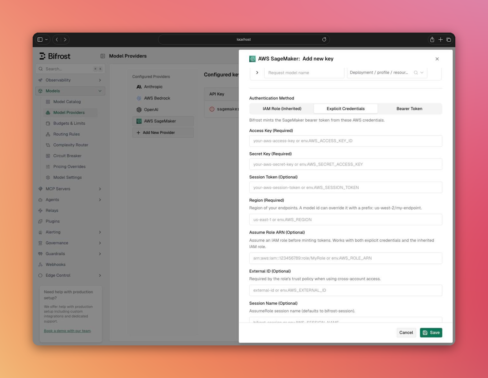

## Overview

The **SageMaker** provider (`sagemaker`) sends requests to models you host on **SageMaker real-time endpoints**. Chat requests go to the endpoint's OpenAI-compatible route (`/openai/v1/chat/completions`), so vLLM, SGLang, LMI and llama.cpp containers work behind Bifrost without a custom adapter.

Bifrost signs every request itself. It mints the SageMaker bearer token from your AWS credentials and caches it, or it sends a pre-minted token you supply.

For containers that do not speak the OpenAI format (TEI, LMI's native format, custom images), use the [SageMaker passthrough](../../integrations/passthrough#sagemaker-passthrough) route instead. It forwards raw `InvokeEndpoint` calls.

### Supported Operations

| Operation | Supported | Notes |
| --- | --- | --- |
| Chat Completions (+ streaming) | ✅ | Streams accept both SSE (vLLM, SGLang, llama.cpp) and JSON lines (LMI) |
| Responses API (+ streaming) | ✅ | Bifrost converts it to chat, because SageMaker routes only `chat/completions` |
| List models | ✅ | Lists the key's `InService` endpoints (see [Listing models](#listing-models)) |
| Passthrough (+ streaming) | ✅ | Through `/sagemaker_passthrough`; requires AWS credentials |
| Text completion, embeddings, images, audio, rerank, files, batch | ❌ | SageMaker's `/openai/v1` route answers `404` for these |

---

## Model IDs

A SageMaker model id names the endpoint, not the model inside it:

```text
sagemaker/[region/]endpoint-name[/inference-component-name]
```

| Example | Meaning |
| --- | --- |
| `sagemaker/my-qwen-endpoint` | Endpoint in the key's region |
| `sagemaker/us-west-2/my-qwen-endpoint` | Endpoint in `us-west-2`, whatever region the key has |
| `sagemaker/my-endpoint/my-component` | An inference component on a multi-model endpoint |
| `sagemaker/eu-west-1/my-endpoint/my-component` | Both a region and an inference component |

- Endpoint and inference-component names follow SageMaker's naming rules: up to 63 letters, digits and hyphens, starting and ending with a letter or digit. Bifrost rejects any other id with a configuration error before calling AWS.
- **Region precedence:** the model id prefix wins, then the region on a [model alias](../aliasing-models), then the key's `region`. There is no default region, because endpoints are regional.
- The `model` field in the body sent to the container is always empty. SageMaker routes by URL, and vLLM rejects an endpoint name in `model` but accepts an empty one.

Use `models` on the key to restrict which endpoints a key can reach, and [aliases](../aliasing-models) to give an endpoint a friendlier name.

---

## Authentication

Every SageMaker key needs a `region`. Credentials come from one of three places:

| Method | Key `value` | `sagemaker_key_config` | When to use |
| --- | --- | --- | --- |
| **Inherited IAM role** | empty | `region` only | IRSA, EC2 instance profiles, ECS task roles, `AWS_*` environment variables |
| **Explicit credentials** | empty | `access_key`, `secret_key`, optional `session_token` | Static or temporary IAM user credentials |
| **Bearer token** | `sagemaker-api-key-...` | `region` only | A token minted outside Bifrost |

Both credential methods can assume an IAM role first: add `role_arn`, and optionally `external_id` and `session_name`.

With AWS credentials, Bifrost mints a `sagemaker-api-key-...` bearer token locally (no AWS call), the same way `sagemaker-core`'s `generate_token` does:

- Tokens are cached per credential set and region, so a warm request is a single cache lookup.
- A token lasts one hour, or less when temporary credentials expire sooner.
- If SageMaker rejects a cached token as expired (`403`), Bifrost drops it and mints a new one on the next request.

A bearer token in the key `value` is sent as-is and never cached. Such tokens expire within 12 hours, so you must rotate them yourself.

<Note>
A bearer-token key works only for chat and Responses. [Listing models](#listing-models) skips it, and [passthrough](../../integrations/passthrough#sagemaker-passthrough) refuses it with a `400`, because both need AWS credentials to sign the request.
</Note>

### IAM permissions

The principal Bifrost runs as (or assumes) needs:

| Action | Used for |
| --- | --- |
| `sagemaker:CallWithBearerToken` | Calling the runtime with the minted bearer token |
| `sagemaker:InvokeEndpoint` | Chat and Responses requests, and `/invocations` passthrough |
| `sagemaker:InvokeEndpointWithResponseStream` | `/invocations-response-stream` passthrough |
| `sagemaker:ListEndpoints` | [Listing models](#listing-models) (optional) |
| `sts:AssumeRole` | Only when `role_arn` is set |

---

## Setup & Configuration

<Tabs group="config-method">
<Tab title="Web UI">

1. Go to **Model Providers**, select **AWS SageMaker**, and click **+** to add a key.
2. Under **Allowed Models**, list the endpoints this key may reach, or keep **All Models**.
3. Under **Authentication Method**, pick **IAM Role (Inherited)**, **Explicit Credentials**, or **Bearer Token**.
4. For explicit credentials, enter the **Access Key** and **Secret Key**, and the **Session Token** if the credentials are temporary. For a bearer token, paste the `sagemaker-api-key-...` value or an `env.` reference.
5. Enter the **Region** of your endpoints (required).
6. Optionally fill in **Assume Role ARN**, **External ID** and **Session Name**, and a **Runtime** host under **VPC Endpoints**.
7. Click **Save**.



</Tab>
<Tab title="API">

```bash
curl -X POST http://localhost:8080/api/providers/sagemaker/keys \
  -H "Content-Type: application/json" \
  -d '{
    "name": "sagemaker-iam",
    "value": "",
    "models": ["my-qwen-endpoint", "my-endpoint/my-component"],
    "weight": 1.0,
    "sagemaker_key_config": {
      "region": "us-east-1",
      "role_arn": "env.SAGEMAKER_ROLE_ARN"
    }
  }'
```

Partial key updates keep the stored `sagemaker_key_config`, and masked credential values sent back unchanged keep their stored values. Listing providers and keys redacts the credentials. The region stays visible unless it comes from an environment variable or vault.

</Tab>
<Tab title="config.json">

**Inherited IAM role** (IRSA, instance profile, environment):

```json
{
  "providers": {
    "sagemaker": {
      "keys": [
        {
          "name": "sagemaker-iam",
          "value": "",
          "models": ["*"],
          "weight": 1.0,
          "sagemaker_key_config": {
            "region": "us-east-1"
          }
        }
      ]
    }
  }
}
```

**Explicit credentials with AssumeRole:**

```json
{
  "providers": {
    "sagemaker": {
      "keys": [
        {
          "name": "sagemaker-static",
          "value": "",
          "models": ["my-qwen-endpoint"],
          "weight": 1.0,
          "sagemaker_key_config": {
            "region": "us-west-2",
            "access_key": "env.AWS_ACCESS_KEY_ID",
            "secret_key": "env.AWS_SECRET_ACCESS_KEY",
            "session_token": "env.AWS_SESSION_TOKEN",
            "role_arn": "env.SAGEMAKER_ROLE_ARN",
            "external_id": "env.SAGEMAKER_EXTERNAL_ID",
            "session_name": "bifrost-sagemaker"
          }
        }
      ]
    }
  }
}
```

**Pre-minted bearer token:**

```json
{
  "providers": {
    "sagemaker": {
      "keys": [
        {
          "name": "sagemaker-token",
          "value": "env.SAGEMAKER_API_KEY",
          "models": ["my-qwen-endpoint"],
          "weight": 1.0,
          "sagemaker_key_config": {
            "region": "us-east-1"
          }
        }
      ]
    }
  }
}
```

| Field | Type | Required | Description |
| --- | --- | --- | --- |
| `region` | string | Yes | AWS region of the endpoints. A model id region prefix overrides it per request. |
| `access_key` | string | No | AWS access key. Leave it and `secret_key` empty to use the default AWS credential chain. |
| `secret_key` | string | No | AWS secret key. Set together with `access_key`. |
| `session_token` | string | No | Session token for temporary credentials. |
| `role_arn` | string | No | IAM role to assume before minting tokens. |
| `external_id` | string | No | External ID for AssumeRole. |
| `session_name` | string | No | Role session name for AssumeRole. |
| `endpoints.runtime` | string | No | Runtime host override (see [VPC endpoints](#vpc-fips-and-dual-stack-endpoints)). |

All fields accept the `env.` prefix.

</Tab>
</Tabs>

### VPC, FIPS and dual-stack endpoints

By default Bifrost calls `runtime.sagemaker.{region}.amazonaws.com` (`.amazonaws.com.cn` for `cn-*` regions). To use an interface VPC endpoint, a FIPS host or a dual-stack host, set `endpoints.runtime`:

```json
{
  "sagemaker_key_config": {
    "region": "us-east-1",
    "endpoints": {
      "runtime": "vpce-0abc123-x1y2z3.runtime.sagemaker.us-east-1.vpce.amazonaws.com"
    }
  }
}
```

`region` is still required with an override, because it sets the token's credential scope.

---

## Usage

```bash
curl -X POST http://localhost:8080/v1/chat/completions \
  -H "Content-Type: application/json" \
  -d '{
    "model": "sagemaker/my-qwen-endpoint",
    "messages": [{"role": "user", "content": "Hello!"}]
  }'
```

Streaming, tools and other chat parameters are passed to the container unchanged, so what works depends on the engine and how it was launched (for example, vLLM needs a tool-call parser for tool calling).

The Responses API works the same way:

```bash
curl -X POST http://localhost:8080/v1/responses \
  -H "Content-Type: application/json" \
  -d '{
    "model": "sagemaker/us-west-2/my-endpoint/my-component",
    "input": "Summarize SageMaker inference components in one sentence."
  }'
```

---

## Listing models

SageMaker has no models endpoint on `/openai/v1`. Instead, a list-models request calls `ListEndpoints` in each key's region and returns the `InService` endpoints, filtered by the key's `models`, `blacklisted_models` and aliases. Entries in the key's `models` allowlist are always returned, even when discovery cannot see them, so inference components you list explicitly show up too.

Discovery is skipped for a key with no `region` or with a bearer token, and it stops after 5,000 endpoints per key.

---

## Errors

SageMaker wraps container failures in a `ModelError` envelope with a CloudWatch link. Bifrost unwraps it and returns the container's own message and error type, for vLLM, SGLang and LMI error formats. LMI reports client errors as `424` or `500`; when the wrapped error carries a `4xx` code, Bifrost returns that status instead. Unrecognized envelopes keep SageMaker's original message.

---

## Next Steps

- **[SageMaker passthrough](../../integrations/passthrough#sagemaker-passthrough)** - Call `InvokeEndpoint` directly for non-OpenAI containers
- **[Aliasing models](../aliasing-models)** - Map friendly names to endpoint ids
- **[AWS Bedrock](./bedrock)** - AWS's managed model catalog
