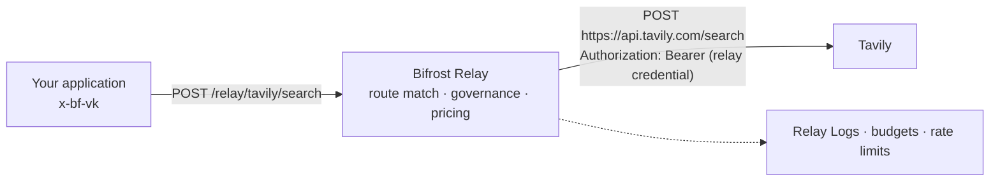

Your application searches the web with Tavily, extracts a document with AWS Textract and synthesises speech with Azure. None of these is an LLM, so none of them goes through Bifrost's provider routing, yet each one spends money, needs a credential and should land on the same budgets as the model calls next to it.

A **Relay** puts Bifrost on that path. You register the upstream API once with its credential, list the operations callers may use and the price of each, and callers send their requests to `/relay/{name}/{path}` with a virtual key instead of the upstream's secret.



## What a relay does on every call

| Step | What Bifrost does |
| --- | --- |
| **Pin the host** | The request is sent to the relay's `base_url` plus the caller's path. A caller can never reach another origin. |
| **Swap credentials** | The caller's `Authorization`, `x-api-key` and similar headers are dropped; the relay's own credential is injected as a bearer token, header, query parameter, basic auth or AWS SigV4 signature. |
| **Match a route** | The method, path and optional request headers select one of the relay's routes. With no match the call is refused with `404` unless **Relay Any Path** is on. |
| **Govern** | The caller's virtual key must hold a grant for the relay; its budgets and rate limits are evaluated before the upstream is contacted. |
| **Relay** | Buffered calls are read in full; event streams are forwarded as they arrive. |
| **Price** | A counted call costs `cost_per_request + billed units × cost_per_unit + reported cost`, read from the request or response with the relay's usage mapping. |
| **Record** | A Relay Logs row keeps the route, status, latency split, cost breakdown, attribution and (subject to content logging) the bodies. |

A relay is not a provider. There is no key selection, no routing rule, no model catalog and no per-model budget on this path. The cost is charged to the caller's overall budgets: virtual key, team, customer and, in Enterprise, business unit and project.

## Where relays fit

| You want to | Use |
| --- | --- |
| Call an LLM through one API with fallbacks and model budgets | [Providers](/providers/supported-providers/overview) and the inference endpoints |
| Let a model call tools | [MCP Gateway](/mcp/overview) |
| Put an A2A agent behind Bifrost | [Agent Gateway](/features/agent-gateway/overview) |
| Relay a plain HTTP API, price its calls and govern who may use it | **Relays** (this section) |

## Start with one relay

1. [Create a relay](./configuration) with its base URL and credential.
2. [Add routes](./routes) for the operations callers may use, or import them from an OpenAPI document.
3. [Set the pricing](./pricing) and check it with **Test Pricing**.
4. [Grant a virtual key](./access) access to the relay.
5. Send a request to `/relay/{name}/{path}` and [read Relay Logs](./logs).

```bash
curl -X POST "http://localhost:8080/relay/tavily/search" \
  -H "Content-Type: application/json" \
  -H "x-bf-vk: sk-bf-your-virtual-key" \
  -d '{"query": "Bifrost AI gateway"}'
```

<CardGroup cols={2}>
  <Card title="Create a relay" icon="plus" href="./configuration">Name, base URL, credential, extra headers, network and proxy settings.</Card>
  <Card title="Routes and header matchers" icon="route" href="./routes">Which operations are relayed, counted, streamed or refused.</Card>
  <Card title="Usage mapping and pricing" icon="calculator" href="./pricing">The cost formula, every mapping field and worked examples.</Card>
  <Card title="Virtual key access" icon="key" href="./access">Grants, budgets and rate limits on the relay path.</Card>
  <Card title="Streaming" icon="wave-square" href="./streaming">When a reply is streamed and how a stream is priced.</Card>
  <Card title="Relay Logs" icon="magnifying-glass" href="./logs">Find a call, read its cost breakdown and latency split.</Card>
</CardGroup>

<Note>
Relays are managed through the config store. When the config store is disabled, no relay is served, the `/api/relays` management API is not registered (it answers `404`), and relays declared in `config.json` are not loaded.
</Note>
