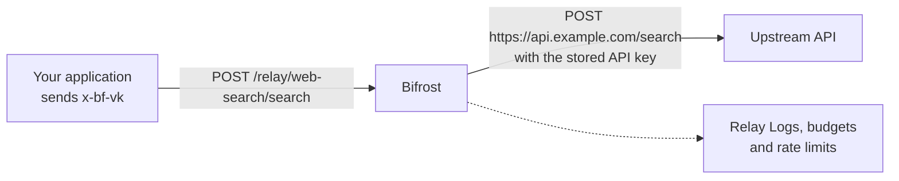

Your application probably calls more than LLMs. It may search the web, read text out of a PDF, turn text into speech or translate a message. Each of those APIs needs its own secret, costs money per call and usually sits outside the budgets you already set up for model usage.

A **relay** puts one of those APIs behind Bifrost. You register the API once with its base URL and secret. Your application then calls `/relay/<name>/...` on Bifrost with a virtual key, and Bifrost forwards the call to the API, signs it in with the stored secret, prices it and records it.

<Frame>
  
</Frame>

---

## How it works

On every call, Bifrost does five things:

1. **Sends it to one fixed address.** The call goes to the relay's base URL plus the path the caller asked for. A caller cannot point it at any other host.
2. **Signs in for you.** Credential headers the caller sends (`Authorization`, `x-api-key` and similar) are removed, and the relay's stored credential is added instead. Your application never holds the API's key.
3. **Allows only the operations you listed.** Each operation you expose is a **route**, such as `POST /search`. A call that matches no route is refused, unless **Relay Any Path** is on.
4. **Checks access and limits.** The caller's virtual key must be allowed to use the relay, and its budgets and rate limits must have room left. This requires a credential: with `client.enforce_auth_on_inference` off, a call with no credential at all is forwarded without this check.
5. **Prices and records the call.** Bifrost works out the cost from the pricing you set, charges it to the caller's budgets and writes a row to **Relay Logs**.

Calls to non-LLM APIs then follow the same rules as your model traffic: one place to manage secrets, one set of budgets, one set of logs.

### What a relay is not

A relay forwards plain HTTP requests. It does not translate formats, pick between keys or fall back to another API. Use the feature that matches the job:

| You want to | Use |
| --- | --- |
| Call an LLM through one API, with fallbacks and model budgets | [Providers](/providers/supported-providers/overview) |
| Let a model call tools | [MCP Gateway](/mcp/overview) |
| Put an A2A agent behind Bifrost | [Agent Gateway](/features/agent-gateway/overview) |
| Put any other HTTP API behind Bifrost, priced and governed | **Relays** |

---

## Quick start

<Steps>
  <Step title="Create the relay">
    Give it a name, the API's base URL and its secret. See [Create a relay](./configuration).
  </Step>
  <Step title="Add routes">
    List the operations callers may use, such as `POST /search`, or import them from an OpenAPI file. See [Routes](./routes).
  </Step>
  <Step title="Set the price">
    Set a fee per call, a price per unit, or both, and check it with **Test Pricing**. See [Pricing](./pricing).
  </Step>
  <Step title="Give a virtual key access">
    Add the relay under **Relay access** on the virtual key. See [Virtual keys: relay access](/features/governance/virtual-keys#relay-access).
  </Step>
  <Step title="Send a request">
    Call `/relay/<name>/<path>` with the virtual key in `x-bf-vk`. The reply is the upstream API's reply, unchanged. See [Relay a POST request](/api-reference/relays/relay-a-post-request) in the API reference.
  </Step>
</Steps>

---

## See every call

Every relayed call is listed under **Observability → Relay Logs**, a log page of its own next to LLM Logs and MCP Logs.

<Frame>
  
</Frame>

Each row shows the relay, the method and path, the route that matched, the status, how long the call took, the units billed and the cost. Use the filters on the left to narrow by relay, status, method, billable or not, cost, virtual key, team or customer. **Export CSV** downloads the current view. Bodies and headers are left out of the export.

Select a row to open its details, including how the cost was worked out. Request and response bodies, including streamed replies, are kept in full, unless [content logging](/features/observability/content-logging) is turned off for that request; a binary body (audio, images) is not kept. To query the same data over the API, see the [API reference](/api-reference/relays/get-relay-logs).

---

## Next steps

<CardGroup cols={2}>
  <Card title="Create a relay" icon="plus" href="./configuration">
    Base URL, credential, extra headers, timeouts and proxy.
  </Card>
  <Card title="Routes" icon="route" href="./routes">
    Which operations callers may use, which are charged, and which stream.
  </Card>
  <Card title="Pricing" icon="calculator" href="./pricing">
    How each call is priced, with examples and a way to test.
  </Card>
  <Card title="Troubleshooting" icon="wrench" href="./troubleshooting">
    What each error means and how to fix it.
  </Card>
</CardGroup>
