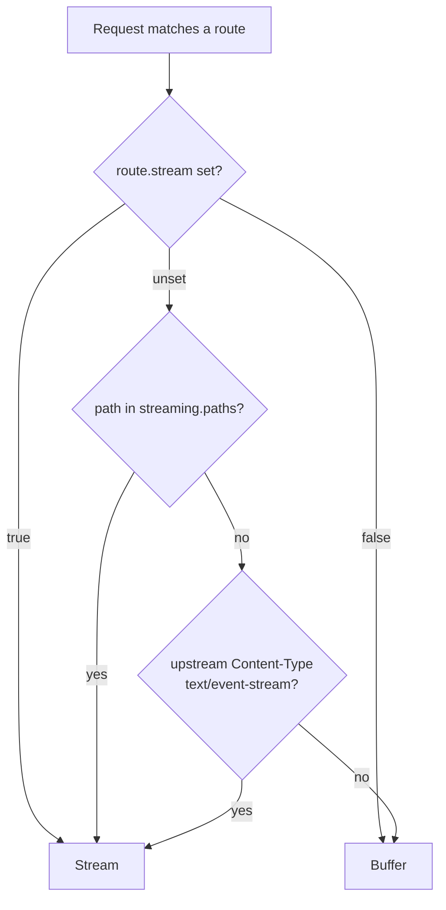

A relay serves a reply in one of two ways. A **buffered** call is read in full, priced and returned. A **streamed** call is forwarded to the caller as bytes arrive, and priced when the stream ends. Nothing the caller sends chooses between them; the relay decides from its configuration and the upstream's reply.

## How the mode is chosen

In order:

1. A route with `stream: true` always streams; `stream: false` always buffers.
2. A path matching one of the relay's `streaming.paths` globs always streams.
3. Otherwise the upstream's reply decides: a `Content-Type` of `text/event-stream` is streamed, anything else is read in full and priced.



A caller's `Accept: text/event-stream` or a `"stream": true` field in the body changes nothing on its own. A reply that is not an event stream is always read and priced, so a caller can never route around response-side billing by asking for a stream.

<Tabs group="config-method">
<Tab title="Web UI">

- **Edit Relay Config → Advanced → Always-Stream Paths**: one route glob per line, such as `/v1/chat/**`.
- **Add Route / Edit Route → Streaming**: **Auto**, **Always stream** or **Never stream**.
- **Edit Relay Config → Network → Stream Idle Timeout**: how long a stream may stay silent.

</Tab>
<Tab title="config.json">

```json
{
  "relays": [
    {
      "name": "elevenlabs",
      "base_url": "https://api.elevenlabs.io",
      "auth": { "type": "header", "header_name": "xi-api-key" },
      "credential": { "value": "env.ELEVENLABS_API_KEY" },
      "streaming": { "paths": ["/v1/text-to-speech/*/stream"] },
      "network": { "stream_idle_timeout_in_seconds": 120 },
      "usage": {
        "units_source": "request",
        "units_path": "text",
        "units_measure": "chars",
        "cost_per_unit": 0.00003
      },
      "routes": [
        { "method": "POST", "path": "/v1/text-to-speech/*" },
        { "method": "POST", "path": "/v1/text-to-speech/*/stream", "stream": true }
      ]
    }
  ]
}
```

| Field | Description |
| --- | --- |
| `streaming.paths` | Rooted segment globs (same syntax as [route paths](./routes#path-globs)) that always stream. |
| `routes[].stream` | `true` forces the streaming relay, `false` the buffered one, for that route. |
| `network.stream_idle_timeout_in_seconds` | Max silence between chunks before the stream is closed (default `60`). |

</Tab>
</Tabs>

## What the caller receives

Bytes are forwarded unchanged with the upstream's status and headers (minus framing headers), plus `Cache-Control: no-cache` and `X-Accel-Buffering: no` so intermediaries do not buffer. The relay never rewrites events.

The wait for the upstream's headers is bounded by `network.timeout_seconds`; once the reply is open, only the idle timeout governs it. A stream that falls silent for longer than `stream_idle_timeout_in_seconds` ends with a timeout error.

## How a stream is priced

A streamed call is counted when its route is billable and the upstream's status is `2xx`. The usage is read as the bytes pass:

- **SSE replies** are framed on the side, and only events that carry one of the mapped fields (token paths, `cost_path`, a response-side `units_path`) are parsed. Each field keeps the **last value** any event reported, the running-total shape OpenAI and Anthropic use, never a sum of per-event increments. A stream that reports input tokens on its first event and output tokens on its last is billed for both.
- **Replies priced by their size** (`units_measure` of `body_bytes` or `body_chars` with `units_source: response`) are counted as they are forwarded, so a streamed audio reply bills the same bytes a buffered one would.
- **Request-side units** (`units_source: request`) are known before the upstream answers and apply to streams as to buffered calls.
- A non-SSE stream that is not priced by size is forwarded unread: nothing is taken from its body.

The post-hooks run once, when the stream ends: at EOF, on a read error, or when the caller disconnects. A caller that hangs up early is still charged for what was forwarded, and the row is marked `cancelled`.

Latency on a streamed row is split as for LLM streams: the time blocked waiting for upstream chunks counts as upstream latency, and Bifrost's overhead is its own measured work.

## Next steps

- **[Usage mapping and pricing](./pricing)** — The fields a stream's events are read with.
- **[Relay Logs](./logs)** — Streamed rows carry a **Streamed** badge and the bytes forwarded.
