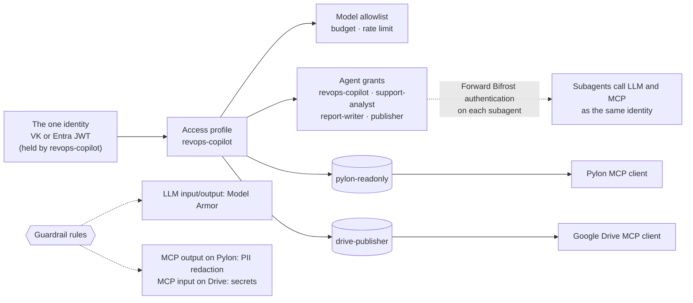

# Bifrost Enterprise setup for revops-copilot

This guide sets up the Bifrost Enterprise server so that every hop in the example is **governed, secured and observed**. You perform each step yourself; the example creates nothing on Bifrost. When you are done, `make preflight` checks the result read-only.

Every step lists the dashboard path, and the API or config shape where one exists. Docs links point to `docs.getbifrost.ai`.

## What you are building

One identity runs the whole job. `revops-copilot` holds it, as a virtual key or an Entra app that gets a JWT. The CLI starts jobs as that identity. When `revops-copilot` delegates, Bifrost forwards the same credential to the subagent, and the subagent uses it for its own LLM and MCP calls. One access profile therefore governs every LLM, MCP and A2A call in the job.



| Agent | Bifrost identity | Forward Bifrost authentication | Inbound key |
|---|---|---|---|
| `revops-copilot` | its own: `REVOPS_COPILOT_VK`, or the Entra app | **off** | `REVOPS_COPILOT_INBOUND_KEY` |
| `support-analyst` | forwarded from the caller | **on** | `SUPPORT_ANALYST_INBOUND_KEY` |
| `report-writer` | forwarded from the caller | **on** | `REPORT_WRITER_INBOUND_KEY` |
| `publisher` | forwarded from the caller | **on** | `PUBLISHER_INBOUND_KEY` |

Two secrets point in opposite directions. The identity tells Bifrost who is calling, so the access profile applies. The inbound key tells the agent that the caller is Bifrost, so nothing can bypass the gateway.

## 0. Prerequisites

- Bifrost Enterprise with Microsoft Entra SSO configured ([setting-up-entra](https://docs.getbifrost.ai/enterprise/setting-up-entra/oidc)). Workload identity reuses this tenant and app registration. VK mode does not need it.
- Log storage enabled (request, MCP and agent logs).
- A provider key for the model the agents use.
- Pylon: an admin enables **Settings → AI Controls → MCP Server**, and the account that authorizes Bifrost has the MCP Access role.
- Google: access to the Drive MCP server (developer preview at the time of writing) and an OAuth client in Google Cloud with the `drive.file` scope.
- A GCP project with Model Armor enabled and a template, for the guardrail profile.
- A `.env` for the agents: run `cp .env.example .env` once, now, and fill it in as you go through the steps below (the identity, four inbound keys, `BIFROST_URL`).

## 1. Providers and models

**Models & Providers → Providers**: add the provider key. Note the exact provider-prefixed model name (for example `openai/gpt-4o-mini`); the access profile allows models by these names, and `MODEL` in `.env` must match.

## 2. MCP clients (Bifrost holds the SaaS credentials)

**MCP Servers → Add server** ([connecting-to-servers](https://docs.getbifrost.ai/mcp/connecting-to-servers)).

| Field | Pylon | Google Drive |
|---|---|---|
| Name | `pylon` | `drive` |
| Connection | HTTP (streamable) | HTTP (streamable) |
| URL | `https://mcp.usepylon.com/` | `https://drivemcp.googleapis.com/mcp/v1` |
| Auth | OAuth (shared). Pylon advertises CIMD but rejects Bifrost's metadata document (`invalid_client`), so register a public client at `https://o.auth.usepylon.com/oauth2/register` and enter its client id. | OAuth (shared), with your Google OAuth client id/secret and the `https://www.googleapis.com/auth/drive.file` scope |
| Tools to execute | read tools only (list/search/get) | upload/create and list/search only |

Complete the OAuth consent once as the admin. From then on Bifrost refreshes the tokens; agents never see them.

Shared OAuth means every caller acts as the account that consented. That is what a service workflow wants. Use `per_user_oauth` instead when actions must run as each human caller.

> Verify after adding: the client shows **Connected** and lists tools. Record the exposed tool names (`<client>-<tool>`). You need them for the Virtual MCPs and the scenarios.

## 3. Virtual MCPs (what the identity can discover)

**MCP Servers → Virtual MCPs → Create** ([virtual-mcps](https://docs.getbifrost.ai/enterprise/virtual-mcps)).

| Name | Endpoint slug | Tools |
|---|---|---|
| Pylon read-only | `pylon-readonly` | Pylon list/search/get tools. No create, update or delete. |
| Drive publisher | `drive-publisher` | Drive upload/create and list/search. No delete, no permission or share tools. |

Each one is served at `/mcp/<slug>`, and Bifrost's main MCP server at `/mcp` serves the tools of every Virtual MCP granted to the caller. **All four agents use `/mcp`**, so granting one more Virtual MCP gives every agent its tools with no code change (`MCP_SLUG` in `.env` narrows them to one slug). A caller without a grant gets `403` on a slug, with no detail, so slugs cannot be probed (surface 5). A call to a tool outside the granted lists is refused (surface 6).

Check which servers feed `/mcp` before you rely on it: if a code-mode MCP client is allowed on all virtual keys, `/mcp` also carries Bifrost's code-mode tools (`executeToolCode`, `getToolDocs`, ...), and every agent sees them.

## 4. The identity

Create it before you start the agents. `revops-copilot` refuses to boot without it, and the Agent Gateway (step 5) needs the agents running to fetch their cards. The subagents need no identity of their own.

### VK mode (`AUTH_MODE=vk`)

**Governance → Virtual Keys → Create** one key, `revops-copilot`. In enterprise, assign it to a service account `revops-copilot` so the access profile from step 6 governs it. Set `REVOPS_COPILOT_VK` in `.env`.

### Entra mode (`AUTH_MODE=entra`)

Follow [workload-identity/entra](https://docs.getbifrost.ai/enterprise/workload-identity/entra):

1. **Entra**: create an app registration `revops-copilot` (or a user-assigned managed identity, when the agent runs on Azure). For an app registration, add a client secret or certificate.
2. **Entra**: on the Bifrost SSO app, create an app role with **Allowed member types: Applications** (for example `Bifrost.Workload`), and assign it to the app's service principal. Without this, Entra refuses the token with `AADSTS501051`.
3. **Bifrost → Governance → Users**: create a service account `revops-copilot`.
4. **Bifrost**: open the service account, go to **Workload identity → Add workload identity → Azure workload identity federation**, and paste the service principal **object id**: the Enterprise application's object id, or the managed identity's principal id. Do not use the client id here.
   API: `POST /api/governance/users/{user_id}/workload-identities`. Mappings cannot be declared in config.json.
5. **`.env`**: comment out `REVOPS_COPILOT_VK`, set `AUTH_MODE=entra`, and set `ENTRA_TENANT_ID`, `ENTRA_SCOPE` (for example `api://<bifrost-client-id>/.default`), `REVOPS_COPILOT_ENTRA_CLIENT_ID` and `REVOPS_COPILOT_ENTRA_CLIENT_SECRET`. For a certificate instead of a secret, leave the secret empty and set `REVOPS_COPILOT_ENTRA_CERTIFICATE_PATH` to a PEM or PKCS#12 file that holds the certificate and its private key; when both are set, the secret wins. For a managed identity, set the client id alone.

Two settings to check:
- If the MCP gateway's auth mode is **OAuth only**, it accepts only Bifrost-issued tokens, so workload tokens are refused on `/mcp`. Use a mode that accepts identity tokens.
- The agent sends either a token or a VK, never both. Bifrost rejects a request that carries both (`400`).

## 5. Agent Gateway

**Agents → Agent Settings**:
- **Public base URL** (`client.a2a_external_client_url`): the URL callers use to reach Bifrost, for example `https://bifrost.example.com`. Bifrost rewrites agent cards to point here.
- **Private Network Allowlist** (`client.a2a_private_allowlist`): add the agents' host when it is private (`127.0.0.1`, `localhost`, or an internal DNS name). Without it Bifrost refuses to connect to private addresses. Leave it empty with ngrok.

**Where the agents run.** Bifrost must reach each agent at the URL its card advertises.
- Gateway on the same machine: `make agents`. The cards advertise `http://127.0.0.1:9100` to `:9103`, which only a gateway on this machine can reach. For a gateway elsewhere on your network, set each `<AGENT>_HOST=0.0.0.0` and `<AGENT>_PUBLIC_URL` to an address that gateway can reach (for example `http://10.0.0.5:9100`), or use a tunnel mode below.
- Remote gateway: `make agents-cloudflared`. With `cloudflared.yml` (from `cloudflared.yml.example`, one hostname per agent on a domain you have on Cloudflare) it runs a named tunnel and the URLs never change. Without it, it opens free quick tunnels with new hostnames on every start, which means re-registering. `make agents-ngrok` needs a paid ngrok plan for four endpoints. Agent cards advertise no streaming, because quick tunnels buffer server-sent events, and they write `securityRequirements` scopes as a JSON list (`"bifrostGateway": []`), because Bifrost's a2a-go cannot parse the Python SDK's default `{}` encoding.

**Agents → Add agent**, once per agent ([registration](https://docs.getbifrost.ai/features/agent-gateway/registration), [authentication](https://docs.getbifrost.ai/features/agent-gateway/authentication)):

| Field | Value |
|---|---|
| Name | `revops-copilot`, `support-analyst`, `report-writer`, `publisher` (must match exactly) |
| Agent Card URL | `<agent url>/.well-known/agent-card.json` (printed by `make agents-cloudflared` or `make agents-ngrok`, or `http://<host>:9100` to `:9103`) |
| Request authentication | Header `x-agent-key`. Set it to that agent's `<AGENT>_INBOUND_KEY` from `.env`, or store it as `env.<AGENT>_INBOUND_KEY` on the server. |
| Forward Bifrost authentication | **Off** for `revops-copilot`: it uses its own identity from `.env`. **On** for the three subagents: they have no identity, and use the one Bifrost forwards. |
| Allow by default | **Off**. Only granted identities may call the agent. |

The equivalent config.json shape (the secrets come from the environment):

```json
{
  "client": {
    "a2a_external_client_url": "https://bifrost.example.com"
  },
  "agents": [
    {
      "name": "revops-copilot",
      "agent_card_url": "https://<revops-copilot tunnel>/.well-known/agent-card.json",
      "enabled": true,
      "allow_by_default": false,
      "forward_accepted_credential": false,
      "runtime_auth": { "type": "headers", "headers": { "x-agent-key": "env.REVOPS_COPILOT_INBOUND_KEY" } }
    },
    {
      "name": "publisher",
      "agent_card_url": "https://<publisher tunnel>/.well-known/agent-card.json",
      "enabled": true,
      "allow_by_default": false,
      "forward_accepted_credential": true,
      "runtime_auth": { "type": "headers", "headers": { "x-agent-key": "env.PUBLISHER_INBOUND_KEY" } }
    }
  ]
}
```

Bifrost forwards the credential in the header it arrived in: `x-bf-vk` for a VK, `Authorization: Bearer` for an Entra JWT. It never forwards to an agent with forwarding off. A subagent with no forwarded credential rejects the task at surface 1 (`no_forwarded_credential`).

The inbound key is what makes the gateway impossible to bypass. An agent refuses any POST without the key (`401`), only Bifrost holds the key, and an agent will not start until its key is set.

## 6. Access profile

**Governance → Access Profiles → Create** ([access-profiles](https://docs.getbifrost.ai/enterprise/access-profiles)) one profile, `revops-copilot`, and assign it to the `revops-copilot` service account (**Users → Access Profiles**).

| Setting | Value |
|---|---|
| Providers / models | `MODEL` only |
| Virtual MCPs | `pylon-readonly`, `drive-publisher` |
| Agent access | `revops-copilot` (the CLI's entry call), `support-analyst`, `report-writer`, `publisher` |
| Budget / rate limit | for example $5/day, 60 req/min |

Notes:
- Grant **Virtual MCPs**, not whole MCP servers. A profile cannot express "every tool except X". The Virtual MCP's tool list is the allowlist.
- The trade-off of one identity: every agent in the job can reach both Virtual MCPs. The Virtual MCP tool lists and the guardrails still bound what any agent can do.

The config.json shape (assignment happens in the dashboard or through IdP mappings):

```json
{
  "access_profiles": [
    {
      "name": "revops-copilot",
      "is_active": true,
      "provider_configs": [{ "provider_name": "openai", "all_models_allowed": false, "allowed_models": ["gpt-4o-mini"] }],
      "budgets": [{ "id": "revops-copilot-daily", "max_limit": 5, "reset_duration": "1d" }],
      "agent_grants": [
        { "agent_name": "revops-copilot" },
        { "agent_name": "support-analyst" },
        { "agent_name": "report-writer" },
        { "agent_name": "publisher" }
      ]
    }
  ]
}
```

## 7. Guardrails

**Guardrails → Providers** ([guardrails](https://docs.getbifrost.ai/enterprise/guardrails)). Create three profiles:

| Profile | Provider | Config |
|---|---|---|
| Model Armor | `model-armor` | `auth_type: default_credential`, `project_id`, `location`, `template_id` (template with prompt-injection/jailbreak, RAI and sensitive-data filters) |
| PII | `presidio`, or `azure-pii`, or `regex` with the PII Detection template | redaction on: email, phone |
| Secrets | `secrets` (Gitleaks-backed) | defaults |

Copy the identity's **id**: the service account's user id, or the virtual key's id. The CEL identity variables (`user`, `team`, `teams`, `virtual_key`) hold ids, not names.

**Guardrails → Configuration → Add Rule**. Scope the LLM rules to the identity, so other gateway traffic is unaffected:

| Rule | Target | Apply to | CEL | Profiles | Mode |
|---|---|---|---|---|---|
| revops LLM input | `llm` | `input` | `user == "<user id>"` (Entra) or `virtual_key == "<vk id>"` (VK) | Model Armor | enforce |
| revops LLM output | `llm` | `output` | same | Model Armor | monitor |
| Pylon PII | `mcp` | `output` | `mcp_client == "pylon"` | PII (redact) | enforce |
| Drive secrets | `mcp` | `input` | `mcp_client == "drive"` | Secrets | enforce |

Planned, not yet available: an A2A content rule (target `a2a`, apply to `both`, Model Armor, enforce). Skip it for now; the setup works without it.

Every rule calls the provider during the request: Bifrost sends the prompt, the response, or the tool arguments and results to the provider's API, and acts on the verdict. Monitor mode records the verdict without blocking.

## 8. Observability

- **Observability → LLM Logs, MCP Logs, Agent Logs**: each agent sends `x-bf-session-id` (the A2A context id) and `x-bf-agent-correlation-id` (the A2A task id). One job therefore shows up as one session across all three views, under one identity. Filter by session id, or run `make trace ID=<session-id>`.
- **Audit logs** (`/enterprise/audit-logs`): record every change you made in steps 2 to 7.
- **Log redaction**: turn it on so PII redacted by guardrails is also redacted in stored logs.
- **Optional export**: OTel, Datadog, Splunk or BigQuery, including A2A spans.

## 9. RBAC

Give operators a role with **View** on `AgentGateway`, `AgentLogs`, logs and guardrails, and no **Update** on access profiles, guardrails or agents. People who run the demo can then watch every decision but cannot change policy.

## Coverage matrix

| Hop | Governed by | Secured by | Observed in |
|---|---|---|---|
| CLI → `revops-copilot` (A2A) | agent grant `revops-copilot` | the identity (1), `x-agent-key` runtime auth; A2A guardrail (server-side) upcoming, not yet enforced | Agent Logs, audit log |
| `revops-copilot` → subagents (A2A) | agent grants (2) | the identity, forwarded; `x-agent-key` per agent | Agent Logs, linked by session and task id |
| any agent → LLM | model allowlist, budget, rate limit (3) | Model Armor input (4); output (8) monitored only, not blocked | LLM Logs: cost, tokens, guardrail verdicts |
| `support-analyst` → Pylon MCP | Virtual MCP `pylon-readonly` (5), tool allowlist (6), budget | PII redaction on tool output (7); OAuth tokens held by Bifrost | MCP Logs |
| `publisher` → Drive MCP | Virtual MCP `drive-publisher` (5), no delete or share tools (6) | Secrets detection on tool input (7); OAuth tokens held by Bifrost | MCP Logs |

## Check it

```bash
make install            # uses the .env you filled in during step 0
make agents-ngrok       # terminal 1 (or make agents for a local gateway)
make preflight          # terminal 2: asks for the gateway URL; every row should PASS
```

Optional settings, for preflight's admin checks and some scenarios. Export them in your shell, or add them to `.env` when you need them:

| Variable | Used by |
|---|---|
| `BIFROST_ADMIN_TOKEN` | preflight registration checks, `make trace` |
| `BLOCKED_MODEL` | `model-not-allowed`: a model outside the profile |
| `PYLON_SEARCH_TOOL`, `DRIVE_BLOCKED_TOOL`, `DRIVE_UPLOAD_TOOL` | `pii-redaction`, `tool-denied`, `upload-dlp`: tool names `make preflight` prints |
| `OUTSIDER_VK` | `agent-not-granted`: a second VK with no agent grants |
