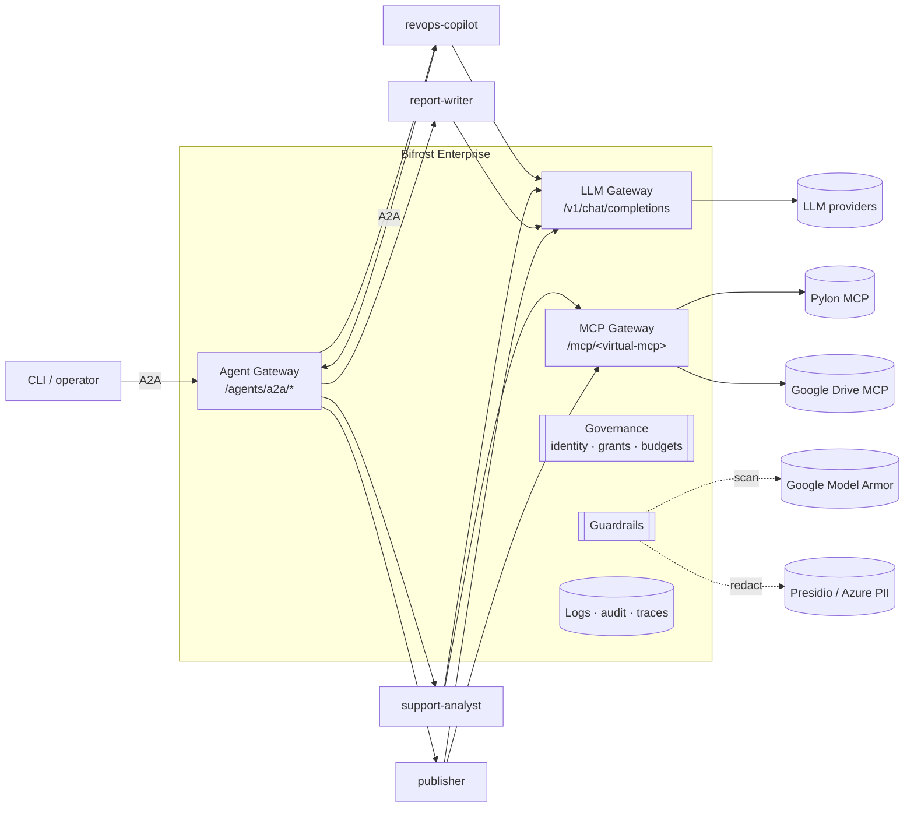
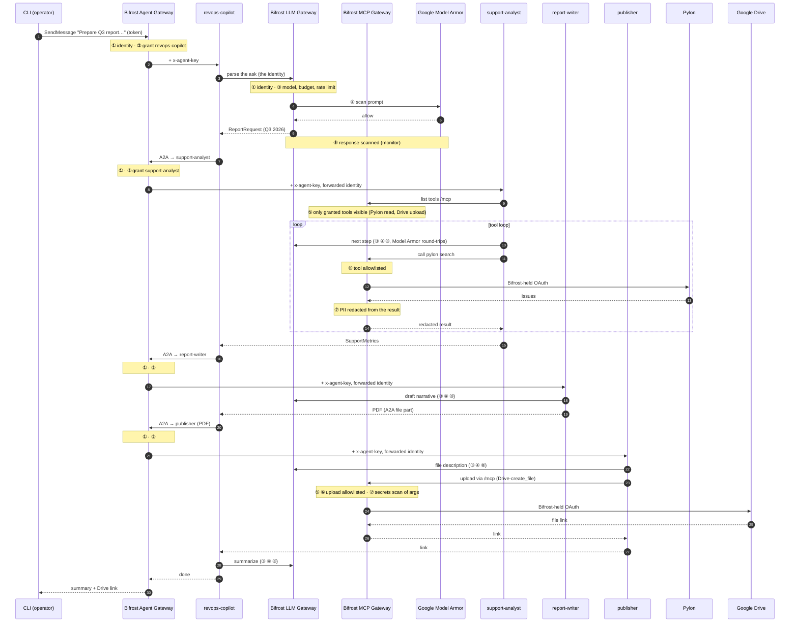
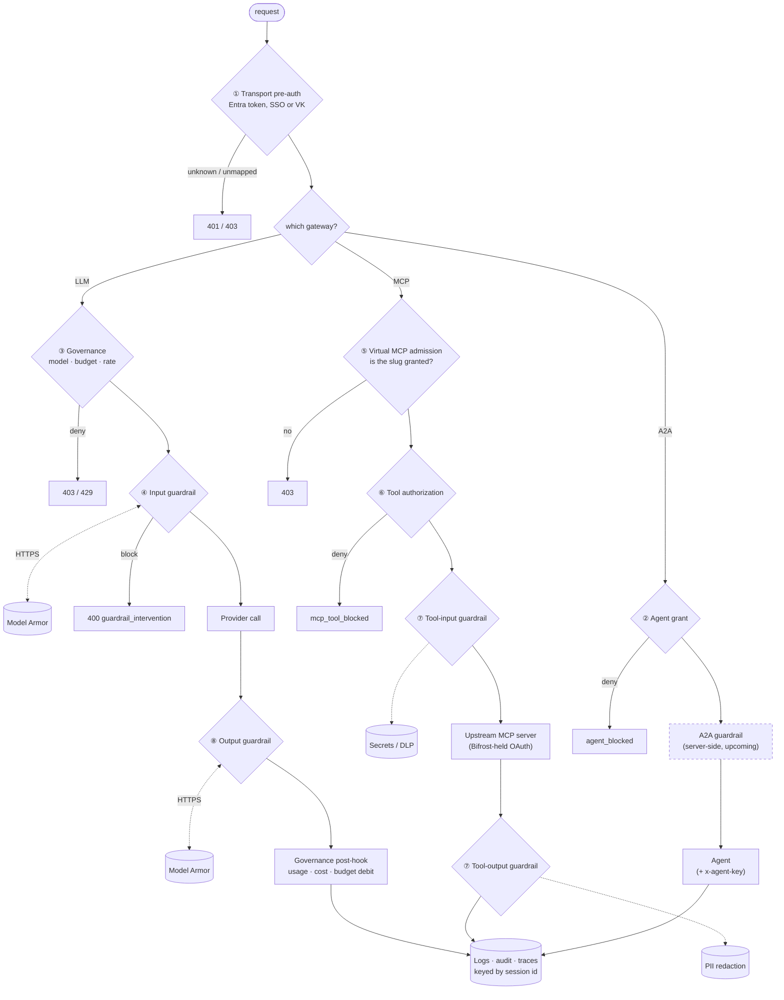

# revops-copilot

A multi-agent LangGraph example where **every** model call, tool call and agent-to-agent call goes through Bifrost, and each one is governed, secured and observed.

The job:

> "Prepare the Q3 2026 customer health report and upload the PDF to the shared drive."

One job crosses all three Bifrost gateways (LLM, MCP, Agent) and all eight policy surfaces, including round-trips to a third-party guardrail (Google Model Armor). Pylon and Google Drive are real SaaS, reached only through Bifrost's MCP Gateway, and Bifrost holds their OAuth tokens. No agent holds a SaaS credential.

## Agents

| Agent | Does | Calls through Bifrost |
|---|---|---|
| `revops-copilot` | Answers any question. Looks things up itself with MCP tools, or delegates over A2A; builds a report only when asked. | LLM, MCP `/mcp`, A2A to the 3 subagents |
| `support-analyst` | Answers support questions, or gathers a quarter's metrics, from Pylon. | LLM, MCP `/mcp` |
| `report-writer` | Optionally looks up missing facts, writes the narrative, draws charts, renders the PDF. | LLM, MCP `/mcp` |
| `publisher` | Uploads the PDF to a fixed Drive folder and returns the link. | LLM, MCP `/mcp` |

**Every agent connects to Bifrost's MCP server** at `/mcp`, which serves every MCP tool the identity's access profile grants: today the Pylon tools from `pylon-readonly` and the Drive tools from `drive-publisher`. Grant another Virtual MCP and every agent sees its tools on its next call, with no code change. `MCP_SLUG` narrows all agents to one Virtual MCP instead.

**One identity runs the job.** `revops-copilot` holds it: a virtual key, or an Entra app that gets a JWT. The CLI starts jobs as that identity. When `revops-copilot` delegates, Bifrost forwards the same credential to the subagent (Forward Bifrost authentication: on), and the subagent uses it for its own LLM and MCP calls. One access profile therefore governs every LLM, MCP and A2A call in the job.

Each agent is an A2A v1.0 server registered on Bifrost's Agent Gateway. Each one also refuses any request that lacks the `x-agent-key` Bifrost injects, so nothing can reach an agent except through the gateway.

## Architecture



## The 8 policy surfaces

| # | Surface | Where it runs in Bifrost | What this example configures |
|---|---|---|---|
| 1 | Ingress identity | HTTP transport pre-auth | Entra app-only token mapped to a service account, or a VK |
| 2 | Agent grant | `PreA2AHook` (governance) | Access-profile agent grants; `allow_by_default` off |
| 3 | LLM governance | `PreLLMHook` (governance) | Model allowlist, budget, rate limit on the identity's profile |
| 4 | LLM input guardrail | `PreLLMHook` (guardrails) | Model Armor: prompt injection, jailbreak |
| 5 | MCP discovery | `/mcp` admission + Virtual MCPs | `/mcp` lists only the tools of the granted Virtual MCPs; an ungranted slug answers 403 |
| 6 | MCP tool authorization | `PreMCPHook` (governance) | Tool allowlist; no Pylon writes, no Drive delete or share |
| 7 | MCP tool guardrails | `PreMCPHook` / `PostMCPHook` (guardrails) | PII redaction on Pylon results; secrets detection on Drive upload args |
| 8 | LLM output guardrail | `PostLLMHook` (guardrails, streaming too) | Model Armor on responses (monitor mode) |

Every hop also carries `x-bf-session-id` (the A2A context id) and `x-bf-agent-correlation-id` (the A2A task id). One job is therefore one session across Agent Logs, LLM Logs and MCP Logs.

## Request pipeline: when each stage runs



### Inside Bifrost, for a single request



## Run it

1. **Set up Bifrost.** Follow [BIFROST_SETUP.md](BIFROST_SETUP.md). You create the identities, access profiles, MCP clients, Virtual MCPs, agent registrations and guardrails. The example provisions nothing.
2. **Configure and install.**
   ```bash
   cp .env.example .env   # the identity, inbound keys, Drive folder
   make install
   make test              # unit tests, no Bifrost needed
   ```
3. **Start the agents and check the setup.**
   ```bash
   make agents            # terminal 1: four A2A servers on :9100-9103
   make preflight         # terminal 2: asks for the gateway URL, then checks identity, grants, discovery, registrations
   ```
   **Remote gateway** (Bifrost cannot reach `127.0.0.1`): run `make agents-cloudflared` instead of `make agents`. With a `cloudflared.yml` (copy `cloudflared.yml.example`; needs a domain on Cloudflare) it runs a named tunnel with fixed hostnames, so you register the agents once. Without one it falls back to free quick tunnels, whose hostnames change on every start. `make agents-ngrok` also works, but four endpoints need a paid ngrok plan. Every mode prints the four Agent Card URLs to register with their forwarding setting.
4. **Run the job.** `make chat` opens an interactive prompt (like Claude Code): type a request and watch every step live, from each LLM call and MCP tool call to each A2A delegation, with the policy surfaces that evaluated it and how long it took. `/trace` shows what Bifrost logged for the job. One-shot runs use the same live view:
   ```bash
   make ask Q="Prepare the Q3 2026 customer health report and upload the PDF to the shared drive"
   make trace ID="$SESSION_ID"   # set SESSION_ID to the x-bf-session-id printed above
   ```

## Scenarios

Each scenario targets one surface and checks that surface fired (or that the call passed). `make demo` lists them; `make demo-all` runs all of them.

| Scenario | Surface | Caller | Expected |
|---|---|---|---|
| `happy-path` | all | CLI | PDF in Drive; trace shows every hop |
| `unknown-identity` | ① | unknown VK or unmapped SP | 401 / 403 |
| `agent-not-granted` | ② | a second VK with no grants (`OUTSIDER_VK`) → publisher | `agent_blocked` |
| `model-not-allowed` | ③ | the identity, `BLOCKED_MODEL` | `model_blocked` |
| `prompt-injection` | ④ | CLI with a jailbreak ask | Model Armor blocks at the supervisor's first LLM call |
| `tool-hidden` | ⑤ | the identity → an ungranted slug | 403 |
| `tool-denied` | ⑥ | Drive delete or share | `mcp_tool_blocked` |
| `pii-redaction` | ⑦ | Pylon search | no email address reaches the agent |
| `upload-dlp` | ⑦ | upload a credential to Drive | secrets rule blocks before Drive |
| `output-scan` | ⑧ | an LLM call | allowed; verdict in LLM Logs |

A refusal never crashes the job. The refusing agent returns a structured `policy_denied` (surface, hop, status, code), the supervisor stops at the first one, and the CLI prints which surface fired.

## Layout

```
src/revops_copilot/
  common/
    config.py      env settings, read per agent via env prefix
    identity.py    VK, Entra (client credentials / certificate / managed identity), or the forwarded credential
    bifrost.py     per-task LLM, MCP and A2A clients + correlation headers
    a2aserver.py   LangGraph → A2A v1.0 server, inbound-key guard, A2A client via gateway
    toolloop.py    explicit LangGraph tool loop over a Bifrost MCP session
    policy.py      Bifrost refusal → policy surface
    contracts.py   typed payloads passed between agents
  supervisor/agent.py              revops-copilot
  agents/supportanalyst/agent.py   support-analyst
  agents/reportwriter/agent.py     report-writer (+ pdf.py)
  agents/publisher/agent.py        publisher (+ upload.py: Drive schema mapping)
  preflight.py  trace.py  scenarios.py  tunnel.py (ngrok mode)  cli.py
scenarios/*.yaml
```

## Design notes

- **One identity, forwarded by Bifrost.** Only `revops-copilot` holds a credential. Subagents hold none: they reuse the one Bifrost forwards, in the header it arrived in (`x-bf-vk` or `Authorization: Bearer`). A subagent reached without a forwarded credential rejects the task at surface 1. The trade-off: one profile covers every agent, so the Virtual MCP tool lists and the guardrails, not separate profiles, bound what each agent can do.
- **The PDF never passes through an LLM.** It travels as an A2A raw file part. The publisher uploads it with a deterministic tool call; its LLM only writes the file description.
- **Upload schema mapping happens at runtime.** The Drive MCP server is in preview, so the publisher reads the upload tool's input schema and fills fields by name. It fails with the schema in the message rather than guessing.
- **Retries are disabled on purpose** (`max_retries=0`). A policy refusal is an answer, not a transient error.
